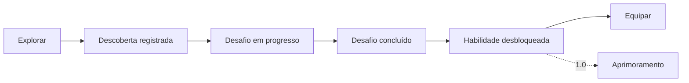
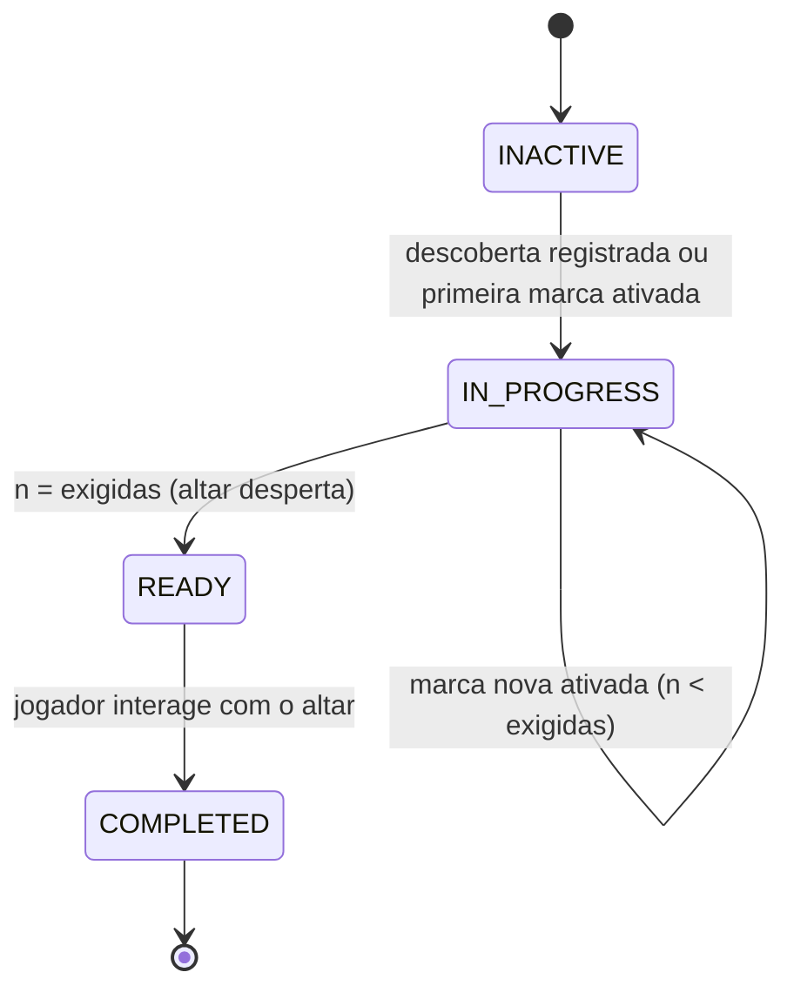

# Essências Ancestrais e Progressão por Descoberta — Especificação

> **Origem:** GDD 005 / diretriz WLD-ESSENCES-001 (2026-11-19).
> **Status:** design documentado. **Nenhuma implementação iniciada.** Nenhum arquivo citado em "Arquitetura prevista" existe ainda.
> **Direção do Game Director:** a exploração é a principal forma de encontrar poderes; os desafios provam que o jogador está preparado para usá-los. No MVP: **uma ruína, uma essência e um desafio curto**. Nada de chefes gigantes ou dezenas de templos.
>
> Relação com outros documentos: este sistema **alimenta** o modelo de poderes de [`ANCESTRAL_POWERS.md`](ANCESTRAL_POWERS.md) (habilidades, energia, armas). Este documento resolve as pendências P-PW-01 (obtenção de essências) e P-PW-09 (desafio da ruína) daquele documento.
>
> Legenda: **[APROVADO]** decisão do GDD 005 · **[PROPOSTO]** regra preenchida aqui para não ser inventada na implementação, válida até confirmação · **[PENDENTE]** em aberto (seção 13) · **[1.0]** fora do MVP.

---

## 1. Visão geral

| Item | Valor |
|---|---|
| Modelo de obtenção | **Misto**: descobrir a essência explorando, desbloquear a habilidade superando um desafio **[APROVADO]** |
| Fonte principal | Exploração **[APROVADO]** |
| Papel do desafio | Provar que o jogador está preparado **[APROVADO]** |
| Classes | Nenhuma obrigatória **[APROVADO]** |
| Moeda ancestral | Não existe no MVP (nem no início da 1.0) **[APROVADO]** |

Cada essência está ligada a **um lugar, um pequeno mistério e uma recompensa que muda a forma de jogar**; não é um colecionável **[APROVADO]**.

### 1.1 Princípios [APROVADO]
1. **Descoberta** — encontrar uma essência desperta curiosidade.
2. **Preparação** — pode exigir recursos ou habilidades básicas.
3. **Desafio** — desbloquear exige uma ação significativa.
4. **Recompensa** — a habilidade é útil imediatamente.
5. **Liberdade** — o jogador decide o que equipar e combinar.

---

## 2. Core loop

1. **Explorar** — encontrar pistas ou uma ruína.
2. **Descobrir** — localizar uma fonte ancestral.
3. **Preparar** — reunir o necessário para o desafio.
4. **Superar** — concluir um desafio curto.
5. **Desbloquear** — receber uma habilidade permanente.
6. **Experimentar** — equipar e usar o poder.

O novo poder ajuda a explorar regiões mais difíceis e descobrir outras essências, fechando o ciclo **[APROVADO]**.

---

## 3. Três coisas separadas [APROVADO]

| Sistema | Função | MVP? |
|---|---|---|
| **Descoberta de essência** | Revela a existência de um poder | Sim |
| **Conclusão de desafio** | Desbloqueia a habilidade | Sim |
| **Aprimoramento** | Melhora a habilidade já desbloqueada | Não — 1.0, simples |



---

## 4. Tipos de desafio

| Tipo | Exemplos | Recompensa o quê | Versão |
|---|---|---|---|
| **Exploração** | Entrada escondida, seguir pistas, ativar um altar | Observação e curiosidade | **MVP** (um, com interação simples) |
| **Combate** | Guardião ancestral, sobreviver a um encontro especial | Preparação, domínio de armas e poderes | 1.0 |
| **Preparação** | Levar materiais a um altar, pequena tarefa de sobrevivência | Conexão com coleta e crafting | 1.0 |

**Restrição [APROVADO]:** o MVP usa **apenas um desafio de exploração** com interação simples.

---

## 5. MVP — Ruína do Primeiro Fogo

### 5.1 Ficha

| Item | Valor |
|---|---|
| Essência | **Essência da Centelha** |
| Local | **Ruína do Primeiro Fogo** |
| Bioma | Floresta Primordial (no MVP: região florestal / mundo de teste) |
| Recompensa | Habilidade **Centelha Ancestral** (permanente) + mensagem narrativa curta |
| Tipo de desafio | Exploração e interação |
| Afinidade | Fogo **[PROPOSTO]** — o nome da ruína confirma a sugestão de P-PW-04 para a Centelha |
| Tempo-alvo | 2 a 5 minutos, depois de chegar à área da ruína **[APROVADO]** |

### 5.2 Experiência planejada [APROVADO]
1. O jogador começa com o **Pulso Vital**, sem a Centelha.
2. Explorando a floresta, encontra uma pequena estrutura de pedra coberta por vegetação, com um **altar apagado** dentro.
3. Precisa encontrar **três marcas ancestrais** perto da ruína e interagir com elas, **em qualquer ordem**.
4. Com as três ativadas, o altar **desperta**.
5. Ao tocar o altar, desbloqueia a **Centelha Ancestral** de forma permanente.
6. Sem cinemática longa: animação curta, efeito de luz e mensagem de desbloqueio.

**Ajuste previsto [APROVADO]:** se procurar as marcas for cansativo nos testes, reduzir para **uma** interação. Por isso o número de marcas exigidas é um dado do desafio, não um valor fixo no código **[PROPOSTO]**.

### 5.3 Regras de conclusão [APROVADO]
- A recompensa é concedida **uma única vez**.
- Marcas em **qualquer ordem**.
- **Sem chefe.**
- A habilidade permanece após salvar e carregar.
- A essência **não** ocupa espaço no inventário comum.
- O jogador **nunca** perde permanentemente uma habilidade desbloqueada.

### 5.4 Regras complementares [PROPOSTO]
1. **Descoberta:** registrada quando o jogador entra num raio de **15 m** do centro da ruína. Se ele ativar uma marca antes disso (vindo de outra direção), a descoberta é registrada no mesmo momento.
2. **Distribuição das marcas:** dentro de **20 m** do altar, visíveis a partir de pontos acessíveis, sem exigir pulo difícil ou combate. Cada marca tem um brilho fraco quando apagada e forte quando ativada, para servir de pista e de retorno visual.
3. **Distância de interação:** 2,5 m, igual à do Wild Bond, pela mesma ação `interact`.
4. **Marca já ativada:** interagir de novo não muda nada (sem mensagem de erro; no máximo o mesmo brilho).
5. **Altar incompleto:** interagir mostra "Faltam N marcas" e não concede nada.
6. **Progresso parcial:** marcas já ativadas continuam ativadas para sempre, inclusive depois de salvar e carregar.
7. **Sem falha nem reinício:** o desafio de exploração não pode ser perdido; morrer não desfaz marcas.
8. **Combate não é exigido** pelo desafio. Inimigos perto da ruína são opcionais e dependem de P-PW-02.

---

## 6. Estados

### 6.1 Essência

| Estado | Significado |
|---|---|
| `UNKNOWN` | O jogador ainda não encontrou a ruína |
| `DISCOVERED` | A ruína foi encontrada (descoberta registrada) |

### 6.2 Desafio



| Estado | Altar | Interação com o altar |
|---|---|---|
| `INACTIVE` | Apagado | "Faltam N marcas" |
| `IN_PROGRESS` | Apagado; HUD mostra n/3 | "Faltam N marcas" |
| `READY` | Desperto (luz) | Concede a recompensa → `COMPLETED` |
| `COMPLETED` | Aceso, estado final | Sem efeito; nenhuma recompensa nova |

`COMPLETED` é final. Nenhuma transição volta para trás **[APROVADO]** (desbloqueios não se perdem).

### 6.3 Marca

| Estado | Visual |
|---|---|
| `DORMANT` | Brilho fraco |
| `ACTIVATED` | Brilho forte, permanente |

### 6.4 Habilidade (visão deste sistema)

| Estado | Pode equipar? |
|---|---|
| `LOCKED` | Não — equipar é recusado |
| `UNLOCKED` | Sim |

O Pulso Vital começa `UNLOCKED` **[APROVADO]**; a Centelha começa `LOCKED`.

### 6.5 Eventos (sinais Godot) [PROPOSTO]

| Emissor | Sinal | Quando |
|---|---|---|
| `EssenceDiscovery` | `essence_discovered(essence_id: StringName)` | Primeira descoberta (uma vez) |
| `AncestralChallenge` | `mark_activated(challenge_id, mark_id, activated: int, required: int)` | Marca nova ativada |
| `AncestralChallenge` | `challenge_ready(challenge_id)` | Altar desperta |
| `AncestralChallenge` | `altar_rejected(challenge_id, missing: int)` | Altar incompleto |
| `AncestralChallenge` | `challenge_completed(challenge_id)` | Recompensa concedida (uma vez) |
| `AbilityUnlocks` | `ability_unlocked(ability_id: StringName)` | Habilidade nova desbloqueada (uma vez) |
| Todos acima | — | Marcam o progresso para salvamento |

---

## 7. Recompensas

| Categoria | Conteúdo | Versão |
|---|---|---|
| **Principal** | Nova habilidade ou aprimoramento permanente | MVP (só habilidade) |
| **Narrativa** | Pequena descoberta sobre a história do continente | MVP (mensagem curta) |
| **Secundária** | Material especial para aprimoramentos ou encantamentos | 1.0 |

**MVP [APROVADO]:** apenas a habilidade e uma mensagem narrativa curta. **Sem** materiais especiais e **sem** moedas ancestrais. O texto da mensagem ainda não foi escrito (P-ES-03).

---

## 8. Progressão futura

### 8.1 Por biomas [APROVADO — planejamento futuro]

| Bioma | Essências e habilidades | Desafios |
|---|---|---|
| **Floresta Primordial** | Primeiras de natureza e fogo | Exploração simples |
| Terras Rochosas | Defesa e terra | Preparação e resistência |
| Montanhas Geladas | Controle e gelo | Ambientais mais exigentes |
| Região Vulcânica | Ofensivas avançadas | Combate |

O MVP fica só na floresta. **Sem sequência rígida de biomas**: alguns desafios terão recomendações de preparação, mas a exploração preserva a liberdade **[APROVADO]**.

### 8.2 Aprimoramento [1.0]

> **GDD 010:** o reset da árvore pode remover melhorias aprendidas, mas **nunca** a habilidade conquistada na exploração; a descoberta da essência é permanente ([`KNOWLEDGE_TREE.md`](KNOWLEDGE_TREE.md) 9).
>
> **GDD 009:** o ramo Conhecimento Ancestral da árvore libera melhorias e encantamentos, sem substituir a exploração como fonte de habilidades. Proposta: o aprimoramento exige o conhecimento da árvore **e** os recursos de exploração (P-PG-08 em [`PROGRESSION.md`](PROGRESSION.md)). Concluir um desafio também dá XP elevado ao nível geral.
Exemplo conceitual da Centelha **[APROVADO]**:
- **Desbloqueada** — projétil mágico que causa dano.
- **Aprimorada** — pequeno aumento de alcance ou eficiência energética.
- **Especializada** — escolha entre duas melhorias (ex.: mais alcance ou menos recarga).

Regras: aprimoramentos só depois de um combate funcional e balanceado; **sem melhorias infinitas de dano** **[APROVADO]**.

---

## 9. Economia e balanceamento [APROVADO]

| Regra | MVP | 1.0 |
|---|---|---|
| Essências disponíveis | 1 descoberta | Várias |
| Desafios | 1 curto | Exploração, combate e preparação |
| Recompensa principal | 1 habilidade | Habilidades e melhorias |
| Moeda ancestral | Não | Não inicialmente |
| Aprimoramentos | Não | Simples |
| Materiais especiais | Não | Limitados |
| Repetição de desafios | Não | Só com motivo claro |
| Perda de poderes | Não | Não |

Recursos normais de sobrevivência servem para crafting e construção; Essências são **desbloqueios permanentes**, fora do inventário. Isso evita misturar inventário, moedas, experiência e habilidades antes de existir um jogo divertido.

A primeira habilidade ofensiva precisa chegar **cedo** para validar o combate mágico; não pode ser uma recompensa distante.

---

## 10. Interface de descoberta

### 10.1 Regras [APROVADO]
- Mostrar o progresso sem virar painel de missões.
- O HUD só aparece perto da ruína ou enquanto o jogador acompanha o objetivo.
- Ao desbloquear: notificação breve com o **nome da habilidade** e o **botão para equipá-la**.

### 10.2 Conteúdo (do protótipo do GDD 005)

| Elemento | Exemplo |
|---|---|
| Título | Ruína do Primeiro Fogo |
| Instrução | Encontre e ative as três marcas ancestrais para despertar o altar. |
| Lista | Marca 1, Marca 2, Marca 3 (ativadas ou não; **sem** indicar onde estão) |
| Progresso | 0/3 |
| Mensagem | "Faltam 3 marcas para ativar o altar." / "O altar despertou." |

### 10.3 Regras complementares [PROPOSTO]
1. "Perto da ruína" = até **25 m** do altar, com o desafio ainda não concluído.
2. "Acompanhar o objetivo" exige um sistema de objetivos que **não existe**. No MVP, só a regra de proximidade (P-ES-04).
3. Depois de `COMPLETED`, o HUD de progresso não aparece mais.
4. **Notificação de desbloqueio:** fica ~5 s, mostra o nome da Centelha, a mensagem narrativa curta e um botão **Equipar**. O botão coloca a Centelha no espaço 2 (vazio no MVP). Se o jogador ignorar, a habilidade continua desbloqueada e pode ser equipada depois (P-ES-05).
5. Respeitar a área segura do iPhone e área de toque mínima de 44 × 44 pt.

Isso substitui a proposta anterior de equipar a Centelha automaticamente (`ANCESTRAL_POWERS.md` 6.2), conforme a regra aprovada aqui.

---

## 11. Arquitetura prevista

> Arquivos **planejados**, não criados. Não precisamos de uma arquitetura genérica para centenas de desafios: o primeiro sistema deve ser simples e expansível **[APROVADO]**.

### 11.1 Estrutura (GDD 005)

```
Wildbound/
├── scripts/progression/
│   ├── essence_discovery.gd
│   ├── ancestral_challenge.gd
│   └── ability_unlocks.gd
├── resources/progression/
│   ├── essence_definition.gd        (+ essence_spark.tres)
│   └── challenge_definition.gd      (+ challenge_first_fire.tres)
├── scenes/world/ruins/
│   ├── first_fire_ruin.tscn
│   └── ancestral_mark.tscn
├── scenes/ui/progression/
│   └── essence_discovery_hud.tscn
└── tests/test_essence_progression.gd
```

**Mudança de local:** o GDD 004 previa `resources/essences/essence_definition.gd`; o GDD 005 (mais recente) usa `resources/progression/essence_definition.gd`. Prevalece o GDD 005 (atualizado em `ANCESTRAL_POWERS.md`). Scripts de `Resource` em `resources/` continuam sujeitos à pendência P-10.

### 11.2 Responsabilidades

| Componente | Tipo Godot | Responsabilidade | Não faz |
|---|---|---|---|
| `EssenceDiscovery` | `Node` | Registrar essências descobertas (ids) | Desbloquear habilidades |
| `AncestralChallenge` | `Node` (na cena da ruína) | Estado do desafio, marcas ativadas, conclusão única, entrega da recompensa | Mexer no inventário ou em espaços de habilidade |
| `AbilityUnlocks` | `Node` | Registrar habilidades desbloqueadas; habilidades iniciais (Pulso Vital) | Equipar, executar habilidades |
| `EssenceDefinition` | `Resource` | Id, nome, afinidade, desafio, habilidade-recompensa, texto narrativo | Lógica |
| `ChallengeDefinition` | `Resource` | Id, tipo (`exploration` no MVP), ids das marcas exigidas | Lógica |
| `EssenceDiscoveryHUD` | `Control` | Progresso e notificação de recompensa | Decidir desbloqueio |

`EssenceDefinition` substitui a versão do GDD 004 e reúne os campos dos dois documentos **[PROPOSTO]**: `id`, `display_name`, `affinity`, `challenge` (→ `ChallengeDefinition`), `reward_ability_id`, `lore_text`; [1.0] `enchantment_recipes`.

### 11.3 Fluxo técnico [APROVADO]

1. Jogador encontra a ruína.
2. Sistema registra a descoberta.
3. Jogador ativa as marcas.
4. Desafio verifica os requisitos.
5. Sistema libera a habilidade.
6. Progresso é marcado para salvamento.
7. Interface apresenta a recompensa.

### 11.4 Regras técnicas [APROVADO + PROPOSTO]
- Identificadores estáveis para essência e desafio **[APROVADO]** (seção 12).
- Desbloqueios registrados **separados do inventário** **[APROVADO]**.
- Uma recompensa nunca é concedida duas vezes **[APROVADO]**. A garantia fica em dois lugares: o desafio não sai de `COMPLETED` e `AbilityUnlocks.unlock()` ignora uma habilidade já desbloqueada **[PROPOSTO]**.
- A conclusão do desafio é preservada no save **[APROVADO]**.
- A interface só reage a eventos **[APROVADO]**.
- O sistema de habilidades consulta `AbilityUnlocks` antes de permitir equipar **[APROVADO]**. Na arquitetura do GDD 004, a lista de "habilidades aprendidas" sai do `AbilityController` e passa para `AbilityUnlocks`; o `AbilityController` só lê.

### 11.5 Onde ficam os registros (sem autoload) [PROPOSTO]
- `EssenceDiscovery` e `AbilityUnlocks` são **filhos do Player**, ao lado dos componentes de combate (exige adicionar nós ao `player.tscn` da WLD-001 — mesmo risco já registrado em R-PW-02).
- A ruína não procura singletons: quando o jogador interage, o sistema de interação entrega o nó que interagiu, e o desafio obtém dele os registros por métodos conhecidos.
- A descoberta por proximidade usa um `Area3D` de 15 m na ruína que detecta só a camada `player`.

### 11.6 Dependências entre componentes
- `AncestralChallenge` → `AbilityUnlocks` (concede) e → `EssenceDiscovery` (registra).
- `AbilityController` (combate) → `AbilityUnlocks` (só leitura).
- Nenhum deles → inventário.
- UI → escuta todos; ninguém → UI.

---

## 12. Identificadores e persistência

### 12.1 Identificadores estáveis [PROPOSTO]
Formato: `snake_case`, ASCII, **nunca renomeados** depois de publicados. Nomes exibidos ficam separados (podem mudar ou ser traduzidos).

| Objeto | Id |
|---|---|
| Essência da Centelha | `essence_spark` |
| Desafio da Ruína do Primeiro Fogo | `challenge_first_fire` |
| Ruína do Primeiro Fogo | `ruin_first_fire` |
| Marcas | `first_fire_mark_1`, `first_fire_mark_2`, `first_fire_mark_3` |
| Centelha Ancestral | `ancestral_spark` |
| Pulso Vital | `vital_pulse` |

Os ids de habilidade valem também para os `.tres` previstos em `ANCESTRAL_POWERS.md`.

### 12.2 O que salvar (quando o save existir)

| Dado | Formato | Status |
|---|---|---|
| Essências descobertas | lista de ids | APROVADO (conclusão preservada) |
| Desafios concluídos | lista de ids | APROVADO |
| Marcas ativadas de desafios não concluídos | id do desafio → lista de ids de marcas | PROPOSTO (progresso parcial preservado) |
| Habilidades desbloqueadas | lista de ids | APROVADO |
| Habilidades equipadas por espaço | já previsto em `ANCESTRAL_POWERS.md` 11.1 | — |

Nunca salvar referências a nós da cena (regra comum a todos os sistemas).

### 12.3 Regras de carregamento [PROPOSTO]
1. **Reconciliação:** se o save tem `challenge_first_fire` concluído mas não tem `ancestral_spark` desbloqueada (save antigo ou parcial), a habilidade é desbloqueada ao carregar. Desbloqueios nunca se perdem.
2. **Ids desconhecidos** no save (conteúdo removido) são ignorados com aviso no log, sem travar.
3. Ao carregar com o desafio `READY`, o altar aparece desperto; com `COMPLETED`, aceso e inerte.
4. **Antes de existir o save:** fechar o jogo reinicia o progresso. Isso é esperado no MVP e não conta como "perder um desbloqueio" (P-ES-06).

---

## 13. Pendências

| ID | Pendência | Sugestão |
|---|---|---|
| P-ES-01 | ~~Intensidade da sobrevivência~~ | **Resolvida (GDD 006):** quatro presets; Intermediário é o padrão ([`SURVIVAL_DIFFICULTY.md`](SURVIVAL_DIFFICULTY.md)) |
| P-ES-02 | Posição da ruína no mapa: mundo de teste atual (arquivo da WLD-001) ou região florestal (WLD-005) | Mundo de teste primeiro, para validar cedo; mover depois |
| P-ES-03 | Texto da mensagem narrativa curta | Escrever junto com a arte da ruína |
| P-ES-04 | Sistema de "acompanhar objetivo" | Não no MVP; só proximidade |
| P-ES-05 | Notificação de desbloqueio: só botão Equipar, ou equipar automático se o espaço estiver vazio | Botão Equipar (regra do GDD 005) |
| P-ES-06 | Ordem entre o save e esta tarefa (teste "salvar e carregar" bloqueado até existir save) | Aceitar o bloqueio no MVP e marcar o teste como bloqueado |
| P-ES-07 | Confirmar a afinidade Fogo da Centelha (P-PW-04) | Sim, pelo nome da ruína |
| P-ES-08 | Pistas visuais das marcas: brilho apenas, ou também som/partícula leve | Brilho fraco + som curto |
| P-ES-09 | Confirmar as regras [PROPOSTO] da seção 5.4 (raios de 15 m, 20 m e 25 m) | Validar no teste de 2 a 5 min |
| P-10 | (herdada) Scripts de `Resource` em `resources/` ou `scripts/` | Scripts em `scripts/resources/`, `.tres` em `resources/` |

---

## 14. Dependências

| Dependência | Situação | Necessária para |
|---|---|---|
| Ação `interact` e interação por proximidade | Não existe (WLD-006) | Ativar marcas e o altar |
| `AbilityController` e as habilidades | Documentado (`ANCESTRAL_POWERS.md`); não implementado (WLD-014) | Equipar e usar a Centelha; Pulso Vital inicial |
| Combate | Não implementado | **Não** é exigido pelo desafio; só para a Centelha ter utilidade |
| Inventário | Não existe | **Não usado** — essências e desbloqueios ficam fora dele |
| UI (HUD, notificação) e controles touch | Não existe (WLD-003) | HUD e botão Equipar no iPhone |
| Save | Não existe | Persistência (testes E09/E15 bloqueados) |
| Mundo: local da ruína | Mundo de teste (WLD-001) ou região florestal (WLD-005) | Colocar a ruína (P-ES-02) |

---

## 15. Riscos

| ID | Risco | Mitigação |
|---|---|---|
| R-ES-01 | Marcas escondidas demais tornam a busca cansativa | Número de marcas em dado; ajuste aprovado para 1 interação; raio de 20 m; brilho como pista |
| R-ES-02 | Centelha chega tarde e o combate mágico não é validado | Tempo-alvo de 2 a 5 min; ruína perto do início |
| R-ES-03 | Colocar a ruína no mundo de teste exige **alterar** `test_world.tscn`, arquivo da WLD-001 | Adicionar só uma instância da cena da ruína, com autorização explícita; testes de regressão da WLD-001 |
| R-ES-04 | Recompensa concedida duas vezes (por exemplo, por reconciliação no carregamento) | Dupla proteção (11.4) e testes E08/E16 |
| R-ES-05 | Sem save, o jogador perde o progresso ao fechar o jogo | Esperado no MVP; documentado (12.3.4) |
| R-ES-06 | HUD de progresso e notificação poluem a tela do iPhone | Só por proximidade; notificação curta |
| R-ES-07 | Arquitetura cresce para "centenas de desafios" cedo demais | Regra aprovada: simples primeiro, sem sistema genérico |

---

## 16. Casos de teste e critérios de aceite

Integrados à suíte headless existente.

### 16.1 Critérios do GDD 005 [APROVADO]

| # | Teste | Resultado esperado |
|---|---|---|
| E01 | Encontrar a ruína | Descoberta registrada (`essence_spark` em `DISCOVERED`) |
| E02 | Ativar uma marca | Progresso aumenta (1/3) |
| E03 | Ativar a mesma marca duas vezes | Progresso não duplica |
| E04 | Ativar marcas em qualquer ordem | Desafio chega a `READY` com qualquer ordem (testar 3 ordens) |
| E05 | Interagir com o altar incompleto | Recompensa bloqueada (`altar_rejected` com `missing` correto) |
| E06 | Completar as três marcas | Altar fica disponível (`READY`) |
| E07 | Ativar o altar completo | Centelha desbloqueada; desafio `COMPLETED` |
| E08 | Ativar o altar de novo | Nenhuma recompensa duplicada (`ability_unlocked` emitido só uma vez) |
| E09 | Salvar e carregar | Progresso preservado — **bloqueado até existir save** |
| E10 | Equipar habilidade bloqueada | Ação recusada |
| E11 | Equipar habilidade desbloqueada | Ação permitida |

### 16.2 Testes complementares [PROPOSTO]

| # | Teste | Resultado esperado |
|---|---|---|
| E12 | Início do jogo | Pulso Vital desbloqueado; Centelha bloqueada |
| E13 | Ativar marca antes de entrar no raio de descoberta | Descoberta registrada no mesmo momento |
| E14 | Interagir fora de 2,5 m | Nada acontece |
| E15 | Carregar save com desafio concluído e sem a habilidade | Habilidade desbloqueada por reconciliação, uma vez — **bloqueado até existir save** |
| E16 | Concluir o desafio e reconciliar | Nenhum desbloqueio duplicado |
| E17 | Inventário antes e depois do desafio | Inalterado |
| E18 | Exigir 1 marca no `.tres` | Desafio conclui com 1 marca, sem mudar código |
| E19 | HUD | Aparece a até 25 m com o desafio não concluído; some após a conclusão |
| E20 | Botão Equipar da notificação | Coloca a Centelha no espaço 2; ignorar a notificação mantém o desbloqueio |
| E21 | Morte do jogador com marcas ativadas | Marcas continuam ativadas |
| E22 | Regressão | Testes da WLD-001 continuam passando |

### 16.3 Avaliação manual [APROVADO]
Medir o tempo da descoberta à conclusão (meta 2 a 5 min) e se a busca pelas marcas é divertida. Se for cansativa, reduzir para 1 interação.

### 16.4 Critérios de conclusão
1. E01–E08, E10–E14, E16–E22 passando no modo headless; E09 e E15 marcados como bloqueados até existir save.
2. Ruína jogável com teclado e mouse, com marcas, altar, HUD e notificação.
3. Teste manual de tempo e diversão registrado.
4. Nada fora do MVP: sem chefes, moedas, materiais especiais, aprimoramentos, desafios de combate ou preparação.
