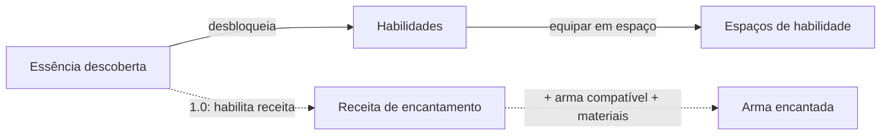

# Poderes Ancestrais, Armas e Builds — Especificação

> **Origem:** GDD 004 / diretriz WLD-POWERS-001 (2026-11-19).
> **Status:** design documentado. **Nenhuma implementação iniciada.** Nenhum arquivo citado em "Arquitetura prevista" existe ainda.
> **Direção do Game Director:** projetar o sistema completo, mas construir primeiro **só o suficiente para descobrir se o combate é divertido**.
>
> Legenda: **[APROVADO]** decisão do GDD 004 · **[PROPOSTO]** regra preenchida aqui para não ser inventada na implementação, válida até confirmação · **[PENDENTE]** em aberto (seção 14) · **[1.0]** / **[2.0]** fora do MVP.
>
> Todos os números ficam em recursos de dados. Os valores do GDD 004 são **referência de protótipo, não balanceamento final** **[APROVADO]**.

---

## 1. Visão geral

| Item | Valor |
|---|---|
| Combate | Híbrido: magia independente + armas encantadas **[APROVADO]** |
| Classes | Nenhuma obrigatória **[APROVADO]** |
| Build | Arma + habilidades + companheiro; na 1.0, encantamento como 4ª escolha **[APROVADO]** |
| Fonte de poder | Essências Ancestrais, descobertas por exploração **[APROVADO]** |
| Energia | Uma única barra de energia mágica para todas as habilidades **[APROVADO]** |
| Encantamentos | Só na 1.0 **[APROVADO]** |

**Decisões que o MVP precisa validar [APROVADO]:** quando atacar, quando gastar energia e quando recuar para se recuperar.

Este documento resolve a pendência **P-C10** do Wild Companions (modelo de poderes → híbrido com Essências Ancestrais).

> **Atualização 2026-11-19 (GDD 006):** vida, fome, morte e dificuldade estão em [`SURVIVAL_DIFFICULTY.md`](SURVIVAL_DIFFICULTY.md). O `HealthComponent` mudou para `scripts/survival/` (um único arquivo). P-PW-03 resolvida (morte e reaparecimento). O dano e a vida dos inimigos recebem os multiplicadores do preset de dificuldade; o dano do jogador não.
>
> **Atualização 2026-11-19 (GDD 005):** obtenção de essências, a Ruína do Primeiro Fogo e o registro de desbloqueios estão em [`ANCESTRAL_ESSENCES.md`](ANCESTRAL_ESSENCES.md). Resolvidas: P-PW-01 (modelo misto), P-PW-09 (três marcas + altar) e, em parte, P-PW-04 (Centelha = Fogo). A Centelha **não** é mais equipada automaticamente: a notificação oferece um botão Equipar. `essence_definition.gd` mudou para `resources/progression/`. A lista de habilidades desbloqueadas passou do `AbilityController` para o `AbilityUnlocks`.

---

## 2. Os três sistemas e como se relacionam

| Sistema | O que é | Exemplos | Versão |
|---|---|---|---|
| **Magia independente** | Habilidade ativada diretamente, mesmo sem arma | Projétil de fogo, cura, escudo, impulso de vento | MVP |
| **Arma encantada** | Essência aplicada a uma arma compatível | Espada flamejante, arco elétrico, lança congelante | **1.0** |
| **Build híbrida** | Combinação de arma, habilidades e companheiro | Espada comum + cura + Lumaru | MVP (sem encantamento) |

**Regra [APROVADO]:** magia e encantamento são sistemas **relacionados, mas não idênticos**. Desbloquear um poder **não** permite encantar qualquer arma com ele.

### 2.1 Três conceitos que não se confundem [APROVADO]

| Conceito | Representa | É item de inventário? |
|---|---|---|
| **Essência** | Descoberta que desbloqueia possibilidades mágicas | Não — é um desbloqueio permanente **[PROPOSTO]** |
| **Habilidade** | Poder ativo equipado em um espaço | Não — fica na lista de habilidades aprendidas |
| **Encantamento** [1.0] | Modificação aplicada a uma arma | Não — é um dado da arma |



---

## 3. Essências Ancestrais

### 3.1 Afinidades [APROVADO]

| Afinidade | Papel | Disponibilidade |
|---|---|---|
| Fogo | Dano e pressão ofensiva | Base de design |
| Natureza | Cura, recuperação e controle | Base de design |
| Terra | Defesa e resistência | Base de design |
| Vento | Mobilidade e evasão | Base de design |
| Água/Gelo | Desaceleração e controle de inimigos | Planejada para biomas posteriores |

Nem todas precisam existir no lançamento; elas podem aparecer na história do mundo sem mecânica implementada **[APROVADO]**.

### 3.2 Afinidade das habilidades do MVP [PROPOSTO]
- **Centelha Ancestral** → Fogo (projétil de dano).
- **Pulso Vital** → Natureza (cura).

Ver P-PW-04.

### 3.3 Obtenção de essências
Exploração de ruínas, desafios e regiões diferentes **[APROVADO]**. **Decidido no GDD 005:** modelo misto — a exploração revela a essência e um desafio desbloqueia a habilidade. Detalhes em [`ANCESTRAL_ESSENCES.md`](ANCESTRAL_ESSENCES.md).

---

## 4. Kit e regras do combate MVP

### 4.1 Kit inicial [APROVADO]

| Item | Função |
|---|---|
| **Clava improvisada** | Ataque corpo a corpo simples, alcance curto, um único tipo de golpe |
| **Centelha Ancestral** | Projétil mágico de curto alcance que causa dano |
| **Pulso Vital** | Recupera uma quantidade limitada de vida |

### 4.2 Regras [APROVADO]
- Ataque básico com arma **não** consome energia.
- Magias consomem energia e têm recarga própria.
- **Dois espaços** de habilidade.
- Sem combos complexos, esquivas especiais ou árvores de talentos.
- Magias obtidas por progressão simples de exploração, não por fabricação de feitiços.
- Sem encantamentos no MVP.

### 4.3 Valores de protótipo

| Parâmetro | Valor | Status |
|---|---|---|
| Vida máxima do jogador | 100 | Referência GDD 004 |
| Energia máxima | 100 | Referência GDD 004 |
| Dano da clava | 12 | Referência GDD 004 |
| Alcance da clava | 1,8 m, arco de 90° à frente | PROPOSTO |
| Intervalo entre golpes | 0,6 s (preparação 0,15 s + golpe ativo 0,1 s) | PROPOSTO |
| Centelha — custo / dano / recarga | 20 energia / 25 dano / 3 s | PROPOSTO |
| Centelha — alcance / velocidade | 15 m / 20 m/s; some ao atingir algo ou ao fim do alcance | PROPOSTO |
| Pulso Vital — custo / cura / recarga | 35 energia / 30 vida / 12 s | PROPOSTO |
| Regeneração de energia | 6 por segundo, começando 1 s depois do último gasto | PROPOSTO |
| Regeneração natural de vida | Nenhuma no MVP (cura só pelo Pulso Vital) | PROPOSTO — ver P-PW-06 |

Com esses valores, a energia cheia permite 5 Centelhas seguidas (limitadas pela recarga de 3 s) ou 2 Pulsos; recuperar de 0 a 100 leva ~17 s. A tensão entre "atacar com magia" e "guardar para curar" é o que se quer testar.

### 4.4 Regras complementares [PROPOSTO]
1. **Mira da Centelha:** dispara na direção do centro da câmera, a partir do peito do jogador. No toque, terá assistência de mira leve para o inimigo mais próximo dentro de um cone de 15°. Ver P-PW-05.
2. **Mira da clava:** golpeia na direção para onde o personagem está virado; se houver inimigo a até 2,5 m num cone de 60°, o personagem gira para ele antes do golpe.
3. **Movimento durante ataques:** permitido, sem animação que trave o personagem (o MVP não tem animações complexas, regra da WLD-001).
4. **Sem fogo amigo:** ataques e magias do jogador não atingem o jogador nem o companheiro.
5. **Pulso Vital com vida cheia:** recusado, sem gastar energia nem iniciar a recarga.
6. **Uso recusado nunca consome energia nem inicia recarga.** Motivos na seção 6.3.
7. **Morte do jogador** (vida 0): regras por dificuldade em [`DEATH_RESPAWN.md`](DEATH_RESPAWN.md) (GDD 008). No Difícil, a clava vai para a mochila, mas a magia continua disponível.
8. **Contra quem lutar:** o MVP precisa de um alvo que revide para validar "quando recuar". O GDD 004 não define inimigos. Ver P-PW-02 (pendência bloqueante).

---

## 5. Energia, custo e recarga

### 5.1 Regras [APROVADO]
- Uma barra de energia compartilhada por todas as habilidades ativas.
- Ataques comuns não gastam energia.
- A energia se recupera gradualmente.
- Cada habilidade tem a própria recarga.
- Trocar habilidades equipadas só fora de combate.
- [1.0] Encantamentos **não** gastam essa energia a cada golpe; são equilibrados por intensidade, frequência e custo de fabricação.

### 5.2 Ordem de validação ao usar uma habilidade [PROPOSTO]
1. A habilidade está equipada?
2. O jogador pode agir (vivo, sem menu aberto)?
3. A recarga dela terminou?
4. Há energia suficiente?
5. Condição específica (ex.: Pulso Vital exige vida abaixo do máximo).
6. Só então: gastar energia, iniciar recarga, executar o efeito.

### 5.3 Definição de "em combate" [PROPOSTO]
O jogador está em combate se causou ou recebeu dano nos últimos **5 s**. Fora disso, pode trocar habilidades. Ver P-PW-07.

---

## 6. Descoberta e equipamento de habilidades

### 6.1 Fluxo de progressão [APROVADO]
1. **Descoberta** — encontrar uma ruína ou fonte ancestral.
2. **Desbloqueio** — concluir um desafio simples e aprender uma habilidade.
3. **Equipamento** — escolher quais habilidades colocar nos espaços.
4. **Experimentação** — combinar poderes com armas e companheiros.
5. **Aprimoramento** [1.0+] — melhorar habilidades com recursos de exploração.

### 6.2 MVP
- **Pulso Vital** disponível desde o início, para facilitar os testes **[APROVADO]**; começa equipado no espaço 1 **[PROPOSTO]**.
- **Uma** descoberta ancestral no mundo, que desbloqueia a **Centelha Ancestral** **[APROVADO]**.
- Ao desbloquear, uma notificação mostra o nome da Centelha e um botão **Equipar**, que a coloca no espaço 2 **[APROVADO no GDD 005]**. Substitui a proposta anterior de equipar automaticamente.
- Como só existem 2 habilidades e 2 espaços, a tela de troca de habilidades não é necessária no MVP **[PROPOSTO]** (ver P-PW-08).
- Formato da descoberta **[APROVADO no GDD 005]**: Ruína do Primeiro Fogo, com três marcas ativáveis em qualquer ordem e um altar que concede a Centelha uma única vez. Sem combate exigido. Ver [`ANCESTRAL_ESSENCES.md`](ANCESTRAL_ESSENCES.md) seção 5.

### 6.3 Motivos de recusa de habilidade (sinal `ability_failed`) [PROPOSTO]

| Motivo | Condição |
|---|---|
| `not_equipped` | Espaço vazio |
| `cannot_act` | Jogador morto ou com menu aberto |
| `cooldown` | Recarga ativa |
| `no_energy` | Energia menor que o custo |
| `full_health` | Pulso Vital com vida cheia |
| `in_combat` | Tentativa de trocar habilidade em combate |

A interface mostra recarga e falta de energia sem mensagens longas **[APROVADO]**: ícone escurecido com contagem/arco de recarga, ou contorno de cor para "sem energia".

---

## 7. Armas e encantamentos [1.0]

### 7.1 Regras iniciais [APROVADO]
- Fórmula: **arma + essência desbloqueada + materiais = encantamento**.
- **Um** espaço de encantamento por arma.
- A arma encantada usa os ataques normais da sua categoria e ganha um efeito adicional.
- Custos de fabricação e limites de poder impedem que a arma encantada seja sempre superior.
- **Não** entram na 1.0: durabilidade mágica, recarga de cristais, raridades aleatórias, múltiplos encaixes.

### 7.2 Efeitos propostos [APROVADO]

| Encantamento | Efeito |
|---|---|
| Fogo | Pequena queimadura temporária |
| Natureza | Pequena chance de recuperar vida em condições específicas |
| Terra | Mais resistência durante determinados ataques |
| Vento | Velocidade de ataque levemente maior |
| Gelo | Desacelera inimigos por pouco tempo |

Limite da 1.0: **até 3 encantamentos** e **até 3 categorias de arma** **[APROVADO]**. Quais 3 estão pendentes (P-PW-10).

### 7.3 Preparação exigida desde o MVP
A infraestrutura de encantamento **não** será criada no MVP **[APROVADO]**. Basta que o dano passe por um **pacote de dano** comum (seção 10.3), ao qual a 1.0 poderá anexar efeitos sem reescrever o combate.

---

## 8. Builds

**Composição [APROVADO]:** arma (como ataca) + poderes (habilidades) + criatura (especialização). Na 1.0, + encantamento ligado à arma.

| Build de exemplo | Composição | Foco | Versão |
|---|---|---|---|
| Kit do MVP | Clava + Centelha + Pulso Vital (+ Lumaru) | Validar o combate | MVP |
| Sentinela das Brasas | Espada de fogo + escudo mágico + Guardião | Combate próximo e proteção | 1.0+ |
| Rastreador Ancestral | Arco + cura natural + Lumaru | Exploração, segurança e recursos | 1.0+ |
| Nômade dos Ventos | Lança encantada + impulso de vento + Transportador | Mobilidade e expedições | 1.0+ |

São exemplos, **não** classes selecionáveis em menu **[APROVADO]**.

### 8.1 Integração com companheiros (Wild Companions)
- No MVP, sem sinergias (Wild Companions seção 7).
- [1.0] Cada `AbilityDefinition` declara **etiquetas** (ex.: afinidade `nature`, função `healing`, `perception`). O sistema de habilidades publica as etiquetas das habilidades equipadas; o componente do companheiro as lê. O sistema de habilidades nunca referencia companheiros (contrato de `WILD_COMPANIONS.md` 8.3, agora com a fonte das etiquetas definida).
- O Lumaru Explorador **não luta** no MVP; combate de companheiros é só para Guardiões na 1.0.

---

## 9. Interface e controles

### 9.1 iPhone, tela horizontal [APROVADO]
- MVP: **um botão de ataque e dois de habilidade**, além de espaço para pulo, interação e câmera. Layout definitivo depende de testes de ergonomia.
- Barras de vida e energia visíveis.
- Recarga e falta de energia indicadas sem mensagens longas.

### 9.2 Teclado e mouse [PROPOSTO]

| Ação nova no InputMap | Tecla | Observação |
|---|---|---|
| `attack` | Botão esquerdo do mouse | Ver risco R-PW-01 |
| `ability_1` | Q | |
| `ability_2` | R | Conflita com "girar objeto" da construção (GDD 011); ver `BUILDING.md` 7.3 e P-BL-06 |
| `interact` | E | Prevista no Wild Bond; tecla fixada aqui |

Nenhuma ação existente da WLD-001 muda. Ver P-PW-11.

### 9.3 HUD de combate [PROPOSTO]
Vida e energia no canto superior esquerdo (dentro da área segura), botões de ataque e habilidades no canto inferior direito no toque; no PC, ícones das habilidades com tecla. Botões com área mínima de 44 × 44 pt.

---

## 10. Arquitetura prevista

> Arquivos **planejados**, não criados. Verificar a estrutura existente antes de implementar.

### 10.1 Estrutura (GDD 004)

```
Wildbound/
├── scripts/
│   ├── combat/
│   │   ├── combat_component.gd
│   │   ├── (health_component.gd → movido para scripts/survival/ pelo GDD 006)
│   │   └── damage_receiver.gd
│   ├── abilities/
│   │   ├── ability_controller.gd
│   │   ├── ability_effect.gd
│   │   └── energy_component.gd
│   └── equipment/
│       ├── weapon_controller.gd
│       └── enchantment_component.gd     # 1.0 — não criar no MVP
├── resources/
│   ├── abilities/ability_definition.gd   (+ ancestral_spark.tres, vital_pulse.tres)
│   ├── equipment/
│   │   ├── weapon_definition.gd          (+ improvised_club.tres)
│   │   └── enchantment_definition.gd     # 1.0
│   └── progression/essence_definition.gd # GDD 005 (antes: resources/essences/) — ver ANCESTRAL_ESSENCES.md 11
├── scenes/ui/combat_hud.tscn
└── tests/test_abilities.gd
```

Scripts de `Resource` em `resources/` continuam sujeitos à pendência P-10.

### 10.2 Responsabilidades

| Componente | Tipo Godot | Responsabilidade | Não faz |
|---|---|---|---|
| `HealthComponent` | `Node` | Vida atual/máxima, cura, morte; **compartilhado** por jogador, inimigos e companheiros | Decidir o que acontece na morte (quem é dono decide) |
| `DamageReceiver` | `Area3D` ou `Node` | Recebe o pacote de dano e repassa ao `HealthComponent` | Calcular dano de ataque |
| `CombatComponent` | `Node` | Regras gerais: estado "em combate", fogo amigo, aplicação do pacote de dano | Animação |
| `WeaponController` | `Node` | Executa o ataque da arma equipada (detecção do golpe) | Gastar energia |
| `EnergyComponent` | `Node` | Energia atual/máxima, gasto, regeneração | Saber de habilidades específicas |
| `AbilityController` | `Node` | Espaços, validação (5.2), recargas, publicação de etiquetas; consulta `AbilityUnlocks` antes de equipar (GDD 005) | Efeito em si; guardar a lista de desbloqueios |
| `AbilityEffect` | `Resource` ou `RefCounted` | Executa o efeito (projétil, cura) | Validar custo/recarga |
| `AbilityDefinition` | `Resource` | Id, nome, afinidade, custo, recarga, parâmetros, etiquetas, efeito | Lógica |
| `WeaponDefinition` | `Resource` | Categoria, dano, alcance, intervalo; [1.0] espaço de encantamento e afinidades compatíveis | Lógica |
| `EssenceDefinition` | `Resource` | Definição unificada com o GDD 005: ver `ANCESTRAL_ESSENCES.md` 11.2 | Lógica |
| `EnchantmentDefinition` | `Resource` | [1.0] Afinidade, efeito, categorias de arma, materiais | Existir no MVP |
| `CombatHUD` | `Control` | Vida, energia, botões, recargas | Alterar estado |

`AbilityEffect` no MVP terá só dois efeitos concretos (projétil de dano e cura). Sem hierarquia genérica além disso, seguindo a regra "sem abstrações complexas para problemas simples" da WLD-001.

### 10.3 Sistema de dano compartilhado [APROVADO + PROPOSTO]
Físico e mágico usam **o mesmo caminho** **[APROVADO]**:

```
Ataque (arma ou magia) → pacote de dano → DamageReceiver → HealthComponent → sinais (damaged, died)
```

Pacote de dano **[PROPOSTO]**: `amount`, `damage_type` (`physical` ou afinidade), `source` (atacante), `tags`. Na 1.0, encantamentos anexam efeitos ao pacote (queimadura, lentidão) sem novos caminhos de vida ou morte.

### 10.4 Física e detecção [PROPOSTO]
- Novas camadas: 4 `enemies`, 5 `player_attacks`. As camadas 1 (`world`) e 2 (`player`) da WLD-001 não mudam; a camada 3 (`resources`) foi reservada pelo Wild Companions.
- Golpe da clava: uma consulta de forma no instante do golpe ativo, não uma área ativa permanente.
- Centelha: projéteis reaproveitados (pool pequeno, ex.: 4), movidos no passo de física; nada de criar e destruir nós a cada disparo no iPhone.

### 10.5 Onde os componentes ficam
- Jogador: `HealthComponent`, `EnergyComponent`, `AbilityController`, `WeaponController` e `CombatComponent` como **filhos do Player**. Isso exige **adicionar** nós ao `player.tscn` da WLD-001 sem alterar `PlayerController` nem a câmera (risco R-PW-02).
- Companheiro: o `CompanionController` (Wild Bond) usa um `HealthComponent` para vida e incapacitação, em vez de vida própria.
- Inimigos: `HealthComponent` + `DamageReceiver` (P-PW-02).

### 10.6 Regras de dependência
- Combate não conhece habilidades; habilidades usam o pacote de dano do combate.
- Armas não conhecem habilidades; encantamentos [1.0] dependem de armas, nunca o contrário.
- UI só escuta sinais.
- Habilidades do jogador e de companheiros ficam separadas (Wild Companions).
- Sem autoload.

### 10.7 Ordem de implementação [APROVADO]
1. Movimento e câmera validados (WLD-002).
2. Vida e recebimento de dano.
3. Ataque físico simples.
4. Energia e duas habilidades.
5. Interface de combate.
6. Equipamentos e encantamentos — 1.0.

---

## 11. Dependências

| Dependência | Situação | Necessária para |
|---|---|---|
| WLD-001 validada no Windows | Pendente (WLD-002) | Tudo (passo 1 da ordem aprovada) |
| Inimigo ou alvo que revida | **Não definido** (P-PW-02) | Validar o combate |
| Ações novas no InputMap (`attack`, `ability_1`, `ability_2`, `interact`) | Não existem | Controles |
| Controles touch | Não existe (WLD-003) | Combate no iPhone |
| Interação por proximidade | Não existe (WLD-006) | Ativar a descoberta ancestral |
| Ruína/descoberta no mundo | Não existe | Desbloquear a Centelha |
| Inventário | Não necessário no MVP (clava vem equipada) | [1.0] materiais, armas como itens, encantamentos por arma |
| Criaturas (Wild Bond) | Documentado | Companheiro passa a ter vida real; [1.0] Caminho B usa combate |
| Companheiros (Wild Companions) | Documentado | [1.0] sinergias por etiquetas |
| Save | Não existe | Persistir progresso (11.1) |

### 11.1 Persistência (quando o save existir) [PROPOSTO]
- **MVP:** habilidades equipadas por espaço, arma equipada (id), vida atual. Essências descobertas, desafios e habilidades desbloqueadas: ver `ANCESTRAL_ESSENCES.md` 12.2. Energia e recargas **não** são salvas (ao carregar, energia cheia e recargas zeradas).
- **1.0:** armas como itens com id único de instância e o encantamento de cada uma; materiais no inventário; nível de aprimoramento das habilidades.
- Nunca salvar referências a nós da cena.

---

## 12. Escopo por versão [APROVADO]

| Funcionalidade | MVP | 1.0 | 2.0 |
|---|---|---|---|
| Ataque físico simples | ✓ | ✓ | ✓ |
| Duas habilidades mágicas | ✓ | ✓ | ✓ |
| Dois espaços de habilidade | ✓ | — | — |
| Quatro espaços de habilidade | — | ✓ | ✓ |
| Energia e recargas | ✓ | ✓ | ✓ |
| Essências encontradas no mundo | 1 | Várias | Várias |
| Armas encantadas | — | ✓ | ✓ |
| Múltiplos tipos de arma | — | ✓ | ✓ |
| Combinações com companheiros | — | ✓ | ✓ |
| Evolução de habilidades | — | Simples | Avançada |
| Combinações elementais complexas | — | — | Possível |

**Limites da 1.0:** até 3 categorias de arma, 8 habilidades mágicas e 3 encantamentos.

**Fora do MVP, de forma explícita:** encantamentos, mais de uma arma, mais de duas habilidades, troca de habilidades em tela própria, evolução/aprimoramento, sinergias com companheiros, combos, esquivas especiais, árvores de talento, fabricação de feitiços, durabilidade, raridades, múltiplos encaixes.

---

## 13. Casos de teste e critérios de aceite

Integrados à suíte headless existente.

### 13.1 Vida e dano

| # | Teste | Resultado esperado |
|---|---|---|
| A01 | Aplicar pacote de dano físico | Vida diminui exatamente o valor |
| A02 | Aplicar pacote de dano mágico | Mesmo caminho de A01 (mesmo componente e sinais) |
| A03 | Vida chega a 0 | Sinal `died` emitido uma vez; vida não fica negativa |
| A04 | Cura acima do máximo | Vida limitada ao máximo |
| A05 | Morte do jogador | Conforme `DEATH_RESPAWN.md` DR01–DR03 e DR12 |
| A06 | Vida do companheiro chega a 0 | Lumaru incapacitado, não removido (Wild Bond) |

### 13.2 Arma

| # | Teste | Resultado esperado |
|---|---|---|
| A07 | Golpe da clava com alvo a 1,5 m à frente | Causa 12 de dano |
| A08 | Alvo a 3 m ou atrás do jogador | Sem dano |
| A09 | Golpes seguidos | Intervalo mínimo de 0,6 s respeitado |
| A10 | Ataque básico | Energia inalterada |
| A11 | Golpe não atinge jogador nem companheiro | Sem fogo amigo |

### 13.3 Energia e habilidades

| # | Teste | Resultado esperado |
|---|---|---|
| A12 | Centelha com energia suficiente | Gasta 20, inicia recarga de 3 s, projétil causa 25 de dano ao atingir |
| A13 | Centelha durante a recarga | `cooldown`; energia inalterada |
| A14 | Centelha sem energia | `no_energy`; recarga não inicia |
| A15 | Pulso Vital com vida 60 | Vida 90, gasta 35, recarga de 12 s |
| A16 | Pulso Vital com vida cheia | `full_health`; nada gasto |
| A17 | Regeneração | Energia volta gradualmente após 1 s sem gasto; nunca passa do máximo |
| A18 | Recargas independentes | Usar a Centelha não afeta a recarga do Pulso Vital |
| A19 | Projétil sem alvo | Some ao fim de 15 m |
| A20 | Espaço vazio | `not_equipped` |
| A21 | Troca de habilidade em combate | `in_combat`; fora de combate, permitida |

### 13.4 Progressão

| # | Teste | Resultado esperado |
|---|---|---|
| A22 | Início do jogo | Pulso Vital desbloqueado e no espaço 1; Centelha bloqueada |
| A23 | Concluir a descoberta ancestral | Centelha desbloqueada uma única vez; botão Equipar a coloca no espaço 2 (detalhes nos testes E07, E08 e E20 de `ANCESTRAL_ESSENCES.md`) |
| A24 | Valores alterados no `.tres` | Comportamento muda sem mudar código |

### 13.5 Interface e entrada

| # | Teste | Resultado esperado |
|---|---|---|
| A25 | HUD | Vida e energia refletem os sinais; habilidade em recarga e sem energia são distinguíveis |
| A26 | Clique que recaptura o mouse | **Não** dispara ataque (risco R-PW-01) |
| A27 | Regressão | Os 40 testes da WLD-001 continuam passando |

### 13.6 Teste de diversão (manual) [APROVADO]
Em sessão real, observar se o jogador toma as três decisões: quando atacar, quando gastar energia e quando recuar. Registrar duração de um encontro e quantas vezes o Pulso Vital foi usado. Os números da seção 4.3 serão ajustados a partir disso.

### 13.7 Critérios de conclusão do combate MVP
1. A01–A27 passando no modo headless.
2. Um encontro jogável contra o alvo definido em P-PW-02, com teclado e mouse.
3. Teste de diversão realizado e registrado.
4. Nada da lista "fora do MVP" (seção 12) implementado.

---

## 14. Pendências

| ID | Pendência | Sugestão |
|---|---|---|
| P-PW-01 | ~~Como obter novas Essências~~ | **Resolvida (GDD 005):** misto |
| P-PW-02 | **Inimigos do MVP:** contra o que o jogador luta? **Parcial (GDD 012):** o MVP terá criaturas hostis ao jogador e territórios simples (`TERRITORY_RAIDS.md`), mas a espécie ainda não foi definida | Um inimigo hostil mínimo (perseguir e atacar corpo a corpo), separado das criaturas domesticáveis, numa zona de atenção. **Continua bloqueando** o combate jogável |
| P-PW-03 | ~~O que acontece quando o jogador morre~~ | **Resolvida (GDD 006):** ver `SURVIVAL_DIFFICULTY.md` 6.2; Hardcore com morte permanente só na 1.0 |
| P-PW-04 | Afinidades: Centelha = Fogo (indicada pelo GDD 005, "Ruína do Primeiro Fogo"); Pulso Vital = Natureza? | Confirmar o Pulso Vital |
| P-PW-05 | Mira no toque: assistência automática ou mira manual pela câmera | Câmera + assistência leve |
| P-PW-06 | Vida se regenera sozinha fora de combate? | Não no MVP; continua em aberto como P-SV-02 |
| P-PW-07 | Definição de "em combate" | 5 s sem causar/receber dano |
| P-PW-08 | Tela de troca de habilidades no MVP (2 habilidades em 2 espaços) | Não; criar na 1.0, com 4 espaços |
| P-PW-09 | ~~Desafio da descoberta ancestral~~ | **Resolvida (GDD 005):** três marcas + altar, sem combate |
| P-PW-10 | Quais 3 categorias de arma e 3 encantamentos na 1.0 | Decidir junto com as espécies da 1.0 |
| P-PW-11 | Teclas: ataque no botão esquerdo, Q/R para habilidades, E para interagir | Confirmar após teste de ergonomia |
| P-PW-12 | Prioridade entre trilhas: combate (descobrir se é divertido) ou criaturas primeiro | Combate primeiro, conforme a direção "construir só o suficiente para testar o combate" |
| P-PW-13 | Os valores [PROPOSTO] de 4.3 como ponto de partida do protótipo | Confirmar |
| P-10 | (herdada) Scripts de `Resource` em `resources/` ou `scripts/` | Scripts em `scripts/resources/`, `.tres` em `resources/` |

---

## 15. Riscos

| ID | Risco | Mitigação |
|---|---|---|
| R-PW-01 | Na WLD-001, o clique que recaptura o mouse é marcado como tratado pela câmera, mas um ataque lido por `Input.is_action_just_pressed` ignora essa marcação: o clique de recaptura dispararia um golpe | Ler `attack` por evento em `_unhandled_input`, ou ignorar o ataque no quadro da recaptura; teste A26 |
| R-PW-02 | O combate exige **adicionar** nós ao `player.tscn` e ações ao `project.godot`, arquivos da WLD-001 | Autorização explícita na tarefa; nenhum comportamento existente muda; A27 garante regressão |
| R-PW-03 | Sem inimigo definido, o combate do MVP não pode ser validado | Decidir P-PW-02 antes de planejar as tarefas |
| R-PW-04 | Conflito com documentos anteriores: Wild Bond e Wild Companions diziam "sem combate no MVP" | Já atualizados: agora significa "o companheiro não luta"; o jogador luta |
| R-PW-05 | Botões demais na tela do iPhone (ataque, 2 habilidades, pulo, interação, câmera) | Teste de ergonomia antes de fixar o layout (aprovado no GDD 004) |
| R-PW-06 | Projéteis e efeitos pesam no iPhone | Pool pequeno, sem partículas pesadas, sem luzes dinâmicas por projétil |
| R-PW-07 | Encantamentos exigirem reescrever o combate | Pacote de dano comum desde o MVP (10.3) |
| R-PW-08 | Arma encantada sempre superior | Custos de fabricação e limites de poder (regra aprovada) |
