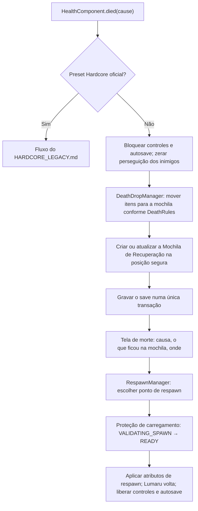

# Morte, Respawn e Recuperação de Equipamentos — Especificação

> **Origem:** GDD 008 / diretriz WLD-DEATH-001 (2026-11-19).
> **Status:** design documentado. **Nenhuma implementação iniciada.** Nenhum arquivo citado em "Arquitetura prevista" existe ainda.
> **Direção do Game Director:** quanto maior a dificuldade, maior o risco de sair despreparado. O jogador deve aprender a construir abrigos, guardar equipamentos, preparar comida e estabelecer pontos seguros de retorno — ligando sobrevivência, exploração e construção.
>
> Este documento cobre os modos **não Hardcore**. A morte no Hardcore está em [`HARDCORE_LEGACY.md`](HARDCORE_LEGACY.md) e **não** usa o fluxo de respawn daqui.
> Resolve a pendência **P-SV-01** e **substitui** a regra de reaparecimento proposta em [`SURVIVAL_DIFFICULTY.md`](SURVIVAL_DIFFICULTY.md) 6.2 (vida 100, energia 100, fome ≥ 50, sem perda de itens).
>
> Legenda: **[APROVADO]** decisão do GDD 008 · **[PROPOSTO]** regra preenchida aqui, válida até confirmação · **[PENDENTE]** em aberto (seção 14) · **[1.0]** fora do MVP.
>
> **Ordem exigida [APROVADO]:** estas regras só são implementadas **depois** que o inventário e o save estiverem funcionando. Se a mochila atrasar o projeto, testar primeiro o respawn simples e adicionar a perda de itens na etapa seguinte.

---

## 1. Regras por dificuldade

### 1.1 Visão geral [APROVADO]

| Modo | Nome | Resumo |
|---|---|---|
| **Fácil** | Recuperação tranquila | Reaparece num ponto seguro com equipamentos e itens. A morte custa tempo, não inventário. |
| **Intermediário** | Recuperação da mochila | Itens carregados ficam no local da morte; reaparece num abrigo ou no ponto inicial e precisa voltar. |
| **Difícil** | Expedição de recuperação | Itens **e** equipamento vestido ficam no local; penalidade temporária ao reaparecer (1.0). |
| **Hardcore** | Jornada encerrada | Sem respawn; a partida vira memorial (GDD 007). |

### 1.2 Tabela de regras [APROVADO]

| Regra | Fácil | Intermediário | Difícil | Hardcore |
|---|---|---|---|---|
| Respawn | Sim | Sim | Sim | Não |
| Itens perdidos ao morrer | Nenhum | Mochila | Mochila | Jornada |
| Equipamento vestido | Mantido | Mantido | Vai para a mochila | Não se aplica |
| Recuperação de itens | Não necessária | Sim | Sim | Não |
| Marcador de morte | — | Sim | Sim | Memorial |
| Penalidade temporária | Não | Não | Sim (Exaustão, 1.0) | — |
| Morte permanente | Não | Não | Não | Sim |

Justificativa aprovada: no Intermediário, manter o equipamento vestido reduz a chance de o jogador ficar incapaz de recuperar a mochila; no Difícil, perdê-lo também aumenta o risco de forma significativa.

### 1.3 Atributos ao reaparecer [APROVADO — valores provisórios]

| Atributo | Fácil | Intermediário | Difícil |
|---|---|---|---|
| Vida | 100% | 75% | 60% |
| Fome | 75% | 50% | 35% |
| Energia mágica | 100% | 75% | 60% |
| Exaustão | Não | Não | Sim (1.0) |

**Aplicação [PROPOSTO]:** os valores são **fixados** ao reaparecer (não "pelo menos"). Morrer com a fome em 90 no Intermediário faz reaparecer com 50; morrer de inanição faz reaparecer com 50. Assim a morte nunca é uma recuperação gratuita, e também não leva a morrer de fome de novo logo em seguida. Ver P-DR-05.

### 1.4 O que conta como "item carregado" e "equipamento vestido" [PROPOSTO]

| Categoria | No MVP | Exemplo |
|---|---|---|
| Item carregado | Tudo no inventário do jogador | Frutas silvestres, madeira, pedra |
| Equipamento vestido | Arma equipada (e, no futuro, armaduras e ferramentas equipadas) | Clava improvisada |
| **Nunca** perdido | Desbloqueios, essências, habilidades equipadas, marcas ativadas, conquistas, companheiro | Centelha Ancestral, Lumaru |

Consequência no MVP: no **Difícil**, o jogador reaparece **sem a clava**, mas continua com a magia (Centelha e Pulso Vital), que não é item. Isso mantém a regra aprovada "a penalidade não impede lutar".

### 1.5 Hardcore experimental no MVP [PROPOSTO]
No MVP, o preset Hardcore não tem morte permanente (GDD 006/007). Ao morrer, segue as regras do **Difícil** (sem Exaustão), e o preset continua marcado como experimental. Ver P-DR-06.

---

## 2. Fluxo da morte e do respawn

### 2.1 Um único fluxo [APROVADO]
**Não** haverá três sistemas de morte: um fluxo só, com parâmetros (`DeathRules`) consultados no perfil de dificuldade do mundo.

### 2.2 Sequência [PROPOSTO]



| Passo | Responsável | Detalhe |
|---|---|---|
| 1 | `DeathManager` | Recebe `died(cause)`. Se for o Hardcore oficial, passa o controle ao fluxo Hardcore e para. |
| 2 | `DeathManager` | Desativa controles, **trava o autosave**, faz os inimigos perderem o alvo. |
| 3 | `DeathDropManager` | Calcula a lista de itens a mover conforme `DeathRules`. No Fácil, a lista é vazia. |
| 4 | `DeathDropManager` | Move os itens para a mochila **numa operação única em memória** (seção 7). |
| 5 | `DeathManager` → `SaveManager` | Grava inventário, mochila, ponto de respawn e estado do jogador **na mesma gravação transacional**. |
| 6 | UI | Tela de morte curta: causa, se há mochila e a direção dela. Botão "Reaparecer". |
| 7 | `RespawnManager` | Escolhe o ponto (seção 3). |
| 8 | Proteção de carregamento | Mesmos estados `VALIDATING_SPAWN` → `READY` do `HARDCORE_LEGACY.md` 5.2: sem dano até a posição estar validada. |
| 9 | `DeathManager` | Aplica vida, fome e energia da tabela 1.3; Exaustão no Difícil (1.0); devolve controles; destrava o autosave; o Lumaru volta (seção 6). |

### 2.3 Área segura no respawn [APROVADO + PROPOSTO]
- O ponto de respawn oferece uma pequena área segura **limitada ao carregamento e à inicialização** do personagem; **não** é uma zona invulnerável permanente **[APROVADO]**.
- Implementação: a proteção de carregamento (passo 8) **mais** a perda de alvo dos inimigos no passo 2 **[PROPOSTO]**. Nenhuma invulnerabilidade depois de `READY`.

---

## 3. Pontos de respawn

### 3.1 Tipos [APROVADO]
- **Ponto inicial seguro** do mundo (sempre existe).
- **Leito de Sobrevivência**, como ponto de retorno escolhido pelo jogador.

### 3.2 Leito de Sobrevivência [APROVADO]
- Estrutura construída com recursos básicos.
- Define um ponto de respawn no mundo.
- **Não** cura automaticamente nem protege contra ataques.
- Vários leitos poderão ser construídos no futuro; **apenas um** é o ponto de respawn ativo.
- Se o leito ativo for destruído, o jogador volta ao ponto inicial seguro.
- **Não** funciona no Hardcore como ressurreição.
- O ponto de respawn é salvo com o mundo.
- Sem sistema complexo de camas, sono ou descanso agora.

**MVP [APROVADO]:** um único leito / ponto de respawn na base. Vários leitos e alternância entre eles: 1.0.

### 3.3 Regras complementares [PROPOSTO]
1. **Definir o ponto:** interagir com o leito (ação `interact`) → "Definir como ponto de retorno". Construir um leito **não** o ativa sozinho.
2. **Escolha no respawn:** se houver leito ativo e válido, ele; senão, o ponto inicial.
3. **Leito válido:** existe no mundo, não foi destruído e o local em volta permite colocar o jogador (validação de posição do `HARDCORE_LEGACY.md` 5.2, procurando um ponto livre ao lado do leito).
4. **Leito obstruído** (sem ponto livre): usa o ponto inicial e avisa o jogador; o leito continua ativo.
5. **Destruição:** o leito ativo destruído deixa de ser ponto de respawn **imediatamente** (o save passa a apontar para o ponto inicial). No MVP, o único jeito de destruir é o próprio jogador desmontar o leito, porque não há ataques a bases.
6. **Identificação:** o save guarda o **id estável do leito** (gerado ao construir), nunca uma referência de nó.

### 3.4 Construir o leito no MVP

> **Atualização (GDD 011):** o leito é um **objeto de posicionamento livre** do sistema de construção ([`BUILDING.md`](BUILDING.md)), com custo próprio, prévia, rotação de 15° e remoção. A cena muda para `scenes/building/survival_bed.tscn`. Remover o leito ativo o invalida na hora.
>
> **Atualização (GDD 009):** a construção é **progressiva** e o leito é desbloqueado no **nível 3 (Construtor)**. A forma de construir ainda depende da especificação de construção (P-PG-03 em [`PROGRESSION.md`](PROGRESSION.md)). A morte não tira XP nem nível em nenhum modo normal.
O GDD 008 diz que o leito é "construído com recursos básicos", mas o sistema de construção ainda não foi definido (é a próxima decisão de design). Até lá, a sugestão é: no MVP, colocar o leito com uma receita mínima (ex.: madeira) por um posicionamento simples, ou deixar um leito pré-colocado numa área de base para validar o respawn. Ver P-DR-01.

---

## 4. Mochila de Recuperação

### 4.1 Regras aprovadas [APROVADO]
- Armazena os itens perdidos na morte.
- Permanece no mundo **até ser recuperada** — **sem** temporizador de desaparecimento.
- **Sem** deterioração dos itens.
- Inimigos **não** roubam nem destroem a mochila.
- Recuperação exige aproximar-se e interagir.
- **Recuperação parcial** quando o inventário está cheio.
- Persiste no save.
- **Nunca** duplica nem exclui itens silenciosamente.
- Aparece na **última posição segura próxima** ao local da morte.
- Tem um marcador (mapa ou bússola).
- Mochila vazia é removida automaticamente.

Motivo aprovado para não sumir: perder dezenas de horas de recursos por um temporizador arbitrário gera frustração. A dificuldade está em **voltar** ao local, não em correr contra o relógio.

### 4.2 Posição [PROPOSTO]
1. Usa a **última posição segura** (gravada a cada 2 s com o jogador no chão, `HARDCORE_LEGACY.md` 5.3).
2. Se essa posição estiver a mais de 30 m do local da morte, procura um ponto de chão válido mais perto da morte; se não achar, usa a última posição segura assim mesmo.
3. A mochila **não** tem física: fica parada, sem cair nem ser empurrada.
4. Fora dos limites do mundo nunca: se nenhuma posição for válida, a mochila vai para o ponto de respawn (nunca é perdida).

### 4.3 Marcador [PROPOSTO]
Não há mapa nem bússola no MVP. Proposta: um feixe de luz vertical visível de longe sobre a mochila e um indicador de direção e distância na borda do HUD. Mapa com mochilas: 1.0. Ver P-DR-03.

### 4.4 Recuperar [PROPOSTO]
- Interagir com a mochila abre um painel simples com a lista de itens e o botão **"Pegar tudo"**.
- "Pegar tudo" transfere o máximo que couber, incluindo pilhas parciais; o que não couber **fica** na mochila.
- Equipamento recuperado (Difícil) volta a ser equipado automaticamente se o espaço estiver vazio; senão, vai para o inventário.
- Pegar itens individualmente: 1.0, se o painel simples se mostrar insuficiente.
- Quando a mochila fica vazia, é removida no mesmo momento e o marcador some.

---

## 5. Mortes repetidas

### 5.1 MVP: uma mochila ativa com preservação [APROVADO]
No MVP existe **uma** mochila ativa por vez. Se o jogador morrer de novo antes de recuperá-la, os itens antigos **não** podem ser destruídos e devem continuar acessíveis.

**Regra proposta para cumprir isso [PROPOSTO]:** na nova morte, a mochila antiga é **unida** à nova: todos os itens dela passam para a mochila criada no novo local, e a antiga é removida. Resultado: uma única mochila, no local da morte mais recente, com tudo. Nenhum item some. Ver P-DR-02 (alternativa: manter a mochila no local antigo e somar os itens novos a ela).

### 5.2 Versão 1.0: várias mochilas [APROVADO]

> **GDD 012:** baús destruídos (1.0) transferem o conteúdo para um recipiente recuperável. Proposta: reaproveitar a Mochila de Recuperação com origem "baú", sem contar no limite de mochilas de morte (P-TR-05 em [`TERRITORY_RAIDS.md`](TERRITORY_RAIDS.md)).
- Cada morte pode criar uma nova mochila, até o limite de **3** por mundo.
- O jogador pode recuperar qualquer uma.
- Interface com todas as mochilas pendentes e suas localizações.
- Ao atingir o limite, o jogo **avisa** o jogador antes que uma nova morte possa afetar itens não recuperados. **Sem** exclusão silenciosa.

**Regra para a 4ª morte com 3 mochilas pendentes [PROPOSTO]:** os itens da nova morte são unidos à mochila **mais recente** (mesma lógica do MVP), sem criar uma quarta. O aviso aparece ao reaparecer com 3 mochilas pendentes e ao sair do raio da base. Ver P-DR-04.

---

## 6. Companheiros [APROVADO para o MVP]

- O Lumaru **não** morre quando o jogador morre.
- No respawn, retorna ao jogador ou ao ponto seguro.
- **Não** carrega itens da mochila.
- O estado domesticado permanece salvo.
- O sistema de recuperação **não pode duplicar** o Lumaru.
- [1.0] Criaturas com inventário próprio ou transporte precisarão de regras adicionais.
- No Hardcore, a morte encerra a jornada; as criaturas ficam no memorial e não passam para outro mundo.

Detalhes **[PROPOSTO]**:
- Lumaru em **Seguindo** → é reposicionado perto do jogador no respawn, pela mesma recuperação de posição do Wild Bond (fora da câmera, chão válido).
- Lumaru em **Parado** → continua onde estava.
- Lumaru **incapacitado** → continua incapacitado conforme as regras dele (Wild Bond P-11).
- Sem duplicação: o companheiro é identificado pelo id único do Wild Bond; o respawn **move** a instância existente, nunca cria outra.

---

## 7. Integridade dos itens (sem duplicação, sem perda)

Esta é a parte mais sensível do sistema.

### 7.1 Regra de conservação [PROPOSTO]
Para qualquer operação de morte, união de mochilas ou recuperação:

> **Quantidade total de cada item** (inventário do jogador + equipamento + todas as mochilas) **antes = depois.**

Essa regra vira teste automático (seção 13) e verificação em build de desenvolvimento.

### 7.2 Como garantir [PROPOSTO]
1. **Operação única:** remover do inventário e adicionar à mochila acontecem juntos, em memória, numa só função; se qualquer parte falhar, nada muda.
2. **Gravação única:** o save que registra a morte contém o inventário já esvaziado **e** a mochila já cheia, na mesma gravação transacional. Não existe save intermediário com os itens em nenhum dos dois, nem nos dois.
3. **Autosave travado** do passo 2 ao passo 9 do fluxo (2.2).
4. **Fechamento inesperado:** antes do passo 5 → o jogo carrega o último save, com o jogador vivo e os itens no inventário (nada perdido). Depois do passo 5 → carrega o jogador morto, que reaparece normalmente, com os itens na mochila.
5. **Recuperação:** a mesma regra — a transferência mochila → inventário é uma operação única, seguida de gravação.
6. **Itens únicos (1.0):** armas e itens com id de instância (encantamentos) são movidos pelo id, nunca recriados.

### 7.3 Inventário cheio [APROVADO]
O sistema **não** destrói itens quando o inventário está cheio: o que não couber fica na mochila.

---

## 8. Exaustão — Difícil [1.0]

| Regra | Valor |
|---|---|
| Quem recebe | Só o Difícil |
| Efeito | −15% na regeneração de energia mágica |
| Duração | 5 minutos |
| Acúmulo | Não acumula; morrer de novo **reinicia** a duração |
| Não faz | Não impede lutar nem se mover; nenhuma redução permanente de atributos |

Valores iniciais sujeitos a testes **[APROVADO]**. Proposto: a duração restante é salva com o jogador e conta só tempo de jogo ativo **[PROPOSTO]**. No MVP, **sem Exaustão funcional** **[APROVADO]**.

Motivo aprovado: reduzir atributos de forma permanente criaria um ciclo negativo (morrer → ficar mais fraco → morrer de novo → perder mais).

---

## 9. Relação com bases e preparação [APROVADO]

| Escolha do jogador | Benefício |
|---|---|
| Guardar recursos num armazenamento | Menos risco de perder tudo numa morte |
| Construir um leito perto de uma região perigosa | Menos tempo para recuperar a mochila |
| Preparar a expedição (comida, ferramentas, equipamento) | Menos chance de morrer e melhor recuperação |

Exemplo do GDD 008: antes de ir a uma ruína distante, guardar recursos raros num baú, preparar comida e definir o leito. Ao morrer: no Intermediário, volta para buscar a mochila; no Difícil, volta com menos equipamento e sob Exaustão; no Hardcore, a jornada termina.

Armazenamento e construção: o **baú passou para a 1.0** (GDD 011), então no MVP não há onde guardar itens antes de uma expedição; o leito faz parte do MVP. Construção especificada em `BUILDING.md`.

---

## 10. Escopo por versão [APROVADO]

| Funcionalidade | MVP | 1.0 |
|---|---|---|
| Respawn no ponto inicial | ✓ | ✓ |
| Respawn em leito | ✓ | ✓ |
| Fácil mantém inventário | ✓ | ✓ |
| Intermediário perde itens carregados | ✓ | ✓ |
| Difícil perde inventário e equipamentos | ✓ | ✓ |
| Uma mochila recuperável | ✓ | ✓ |
| Várias mochilas pendentes | — | ✓ |
| Penalidade de Exaustão | — | ✓ |
| Mapa de mochilas perdidas | — | ✓ |
| Morte permanente Hardcore | — | ✓ |
| Memorial Hardcore | — | ✓ |

**Fora do MVP, de forma explícita:** várias mochilas, Exaustão, mapa de mochilas, vários leitos e alternância entre eles, sono e descanso, regras para companheiros com inventário.

---

## 11. Arquitetura prevista

> Arquivos **planejados**, não criados.

### 11.1 Estrutura (GDD 008)

```
Wildbound/
├── scripts/
│   ├── death/
│   │   ├── death_manager.gd
│   │   ├── respawn_manager.gd
│   │   ├── death_drop_manager.gd
│   │   └── recovery_bag.gd
│   └── world/
│       └── respawn_point.gd
├── resources/death/
│   └── death_rules.gd              (+ um .tres por dificuldade)
├── scenes/
│   ├── world/
│   │   ├── survival_bed.tscn          # movido para scenes/building/ pelo GDD 011
│   │   └── recovery_bag.tscn
│   └── ui/death/
│       └── death_screen.tscn
└── tests/
    ├── test_respawn.gd
    ├── test_death_drops.gd
    └── test_recovery_bag.gd
```

`scripts/world/` já foi previsto na WLD-001 (`test_world.gd`, "somente se necessário") e não existe; `respawn_point.gd` seria o primeiro script dessa pasta. O GDD 008 volta a colocar o script de `Resource` em `resources/` (pendência P-10).

### 11.2 Responsabilidades

| Componente | Tipo Godot | Responsabilidade | Não faz |
|---|---|---|---|
| `DeathManager` | `Node` | Consequências da morte; orquestra o fluxo 2.2; desvia para o Hardcore | Mover itens diretamente |
| `RespawnManager` | `Node` | Escolhe e valida o ponto de retorno | Aplicar atributos |
| `DeathDropManager` | `RefCounted` | Decide quais itens são perdidos e executa a transferência única | Decidir o ponto de respawn |
| `RecoveryBag` | `Node3D` (cena `recovery_bag.tscn`) | Guarda itens; interação; recuperação parcial; remove-se quando vazia | Ser destruída por inimigos |
| `RespawnPoint` | `Node3D` | Representa um ponto (inicial ou leito), com id estável e validade | Escolher qual está ativo |
| `DeathRules` | `Resource` | Regras por dificuldade (tabela 11.3) | Lógica |

### 11.3 Campos de `DeathRules` [PROPOSTO]

| Campo | Fácil | Intermediário | Difícil |
|---|---|---|---|
| `respawn_enabled` | true | true | true |
| `drop_carried_items` | false | true | true |
| `drop_equipped_items` | false | false | true |
| `respawn_health_ratio` | 1,0 | 0,75 | 0,6 |
| `respawn_hunger_ratio` | 0,75 | 0,5 | 0,35 |
| `respawn_energy_ratio` | 1,0 | 0,75 | 0,6 |
| `exhaustion_enabled` (1.0) | false | false | true |
| `exhaustion_energy_regen_penalty` (1.0) | — | — | 0,15 |
| `exhaustion_duration_s` (1.0) | — | — | 300 |
| `max_pending_bags` | 1 no MVP, 3 na 1.0 | idem | idem |

O `DifficultySettings` (GDD 006) passa a referenciar um `DeathRules`, cumprindo a regra aprovada de que a perda de itens consulta o perfil de dificuldade. O Hardcore oficial não usa `DeathRules` (fluxo próprio).

### 11.4 Regras de dependência
- `DeathManager` ouve o `HealthComponent`; o `HealthComponent` não conhece o `DeathManager`.
- `DeathManager` consulta o `HardcoreRunManager` só para saber se deve desviar o fluxo.
- `DeathDropManager` usa o inventário por uma interface pequena (listar, remover, adicionar em lote); não conhece a UI.
- Persistência sempre pelo `SaveManager`, em gravação transacional.
- A UI só escuta sinais e envia o pedido "Reaparecer" e "Pegar tudo".
- Sem novos autoloads.

### 11.5 Eventos (sinais Godot) [PROPOSTO]

| Emissor | Sinal |
|---|---|
| `DeathManager` | `death_processed(cause, bag_id)` / `respawned(point_id)` |
| `RespawnManager` | `respawn_point_changed(point_id)` / `respawn_point_invalidated(point_id)` |
| `RecoveryBag` | `items_recovered(bag_id, recovered_count, remaining_count)` / `bag_emptied(bag_id)` |
| `DeathDropManager` | `bags_merged(from_bag_id, into_bag_id)` |

---

## 12. Persistência

### 12.1 O que salvar [APROVADO + PROPOSTO]

| Dado | Detalhe |
|---|---|
| Ponto de respawn ativo | Id do leito ou `initial` **[APROVADO: salvo com o mundo]** |
| Leitos existentes | Id, posição, destruído ou não |
| Mochilas pendentes | Id estável, posição, lista de itens (id do item + quantidade; id de instância na 1.0), horário da morte |
| Exaustão (1.0) | Tempo restante |
| Estado do jogador após a morte | Se o jogo fechar entre a morte gravada e o respawn: salvar "morto, aguardando respawn" para que, ao abrir, a tela de morte apareça de novo e nenhum item volte ao inventário |

### 12.2 Regras de carregamento [PROPOSTO]
1. Mochila com lista vazia no save é descartada ao carregar.
2. Mochila em posição inválida é movida para o ponto válido mais próximo (nunca descartada com itens).
3. Ponto de respawn que aponta para leito inexistente volta para `initial`.
4. Itens desconhecidos (conteúdo removido) ficam guardados na mochila e são registrados no log, nunca apagados em silêncio.

---

## 13. Testes e critérios de aceite

Integrados à suíte headless existente.

### 13.1 Exigidos pelo GDD 008 [APROVADO]

| # | Teste | Resultado esperado |
|---|---|---|
| DR01 | Fácil: morrer com itens e clava | Todos os itens e a clava mantidos; nenhuma mochila |
| DR02 | Intermediário: morrer | Itens carregados na mochila; clava continua equipada |
| DR03 | Difícil: morrer | Inventário e clava na mochila |
| DR04 | Sem duplicação na morte | Conservação 7.1 respeitada em DR01–DR03 |
| DR05 | Salvar e carregar com mochila | Mochila no mesmo lugar, com os mesmos itens |
| DR06 | Recuperação parcial | Com inventário quase cheio, entra o que cabe; o resto fica na mochila |
| DR07 | Inventário cheio | Nenhum item destruído |
| DR08 | Respawn em posição segura | Jogador colocado em ponto validado (sem sobreposição, com chão) |
| DR09 | Leito destruído | Não é usado; respawn no ponto inicial |
| DR10 | Lumaru no respawn | Exatamente uma instância do Lumaru após o respawn |
| DR11 | Morte no Hardcore oficial | Não passa pelo fluxo de respawn |

### 13.2 Complementares [PROPOSTO]

| # | Teste | Resultado esperado |
|---|---|---|
| DR12 | Atributos ao reaparecer | Vida, fome e energia conforme a tabela 1.3 em cada preset |
| DR13 | Morrer de novo antes de recuperar (MVP) | Uma mochila, no local novo, com os itens das duas mortes; conservação respeitada |
| DR14 | Mochila esvaziada | Removida, marcador some |
| DR15 | Interromper antes da gravação da morte | Ao abrir: jogador vivo, itens no inventário, sem mochila |
| DR16 | Interromper depois da gravação da morte | Ao abrir: tela de morte; itens na mochila; nada no inventário |
| DR17 | Autosave durante o fluxo de morte | Não acontece |
| DR18 | Leito obstruído | Respawn no ponto inicial, leito continua ativo, aviso exibido |
| DR19 | Definir leito como ponto de retorno | Só por interação; construir não ativa |
| DR20 | Desbloqueios e companheiro após a morte | Inalterados em todos os presets |
| DR21 | Inimigos após a morte | Perdem o alvo; nenhum dano antes de `READY` |
| DR22 | Clava recuperada no Difícil | Reequipada se o espaço estiver vazio |
| DR23 | Hardcore experimental (MVP) | Segue o Difícil, sem Exaustão |
| DR24 | Regressão | Testes de todas as tarefas anteriores passando |

### 13.3 Testes da 1.0

| # | Teste | Resultado esperado |
|---|---|---|
| DR25 | Três mortes sem recuperar | Três mochilas, todas recuperáveis em qualquer ordem |
| DR26 | Quarta morte com 3 pendentes | Aviso dado; itens unidos à mais recente; nada perdido |
| DR27 | Exaustão | −15% de regeneração por 5 min; morrer de novo reinicia, sem acumular |
| DR28 | Vários leitos | Só um ativo por vez |

### 13.4 Critérios de conclusão (MVP)
1. DR01–DR24 passando no modo headless (com o save base funcionando).
2. Teste manual: morrer em cada preset e recuperar a mochila no Intermediário e no Difícil.
3. Nada fora do MVP implementado (seção 10).

---

## 14. Pendências

| ID | Pendência | Sugestão |
|---|---|---|
| P-DR-01 | ~~Como o leito é construído no MVP~~ | **Resolvida (GDD 011):** objeto de posicionamento livre (`BUILDING.md` 5); nível de desbloqueio em P-BL-09 |
| P-DR-02 | MVP com mortes repetidas: unir a mochila antiga à nova no local mais recente, ou somar os itens novos à mochila antiga | Unir no local mais recente |
| P-DR-03 | Marcador sem mapa nem bússola | Feixe de luz + indicador de direção na borda do HUD |
| P-DR-04 | 1.0: o que fazer na 4ª morte com 3 mochilas | Unir à mais recente, com aviso |
| P-DR-05 | Atributos de respawn fixos ou "pelo menos" | Fixos |
| P-DR-06 | Regras de morte do Hardcore experimental no MVP | Iguais ao Difícil, sem Exaustão |
| P-DR-07 | Capacidade do inventário (necessária para "inventário cheio") | Definir na tarefa de inventário |
| P-DR-08 | Penalidade de Exaustão vale também para a regeneração de vida, se ela existir (P-SV-02)? | Não; só energia, como aprovado |
| P-BD-01 | ~~Sistema de construção~~ | **Direção definida (GDD 009):** progressiva por níveis e materiais; detalhes em P-PG-03 |
| P-10 | (herdada) Scripts de `Resource` em `resources/` ou `scripts/` | Decidir antes da primeira implementação com recursos de dados |

---

## 15. Dependências

| Dependência | Situação | Necessária para |
|---|---|---|
| Inventário com capacidade e operações em lote | Não existe (WLD-006 prevê só o mínimo) | Mochila, recuperação parcial |
| Equipamento (arma equipada) | Documentado (GDD 004), não implementado | Regra do Difícil |
| **Save base** (gravação transacional, autosave, carregamento) | Especificado em parte (`HARDCORE_LEGACY.md` 4); não implementado | Mochila persistente, estado "aguardando respawn" — **necessário já no MVP** |
| Proteção de carregamento e posição segura | Especificadas (`HARDCORE_LEGACY.md` 5) | Respawn seguro, posição da mochila |
| Perfil de dificuldade | Documentado (GDD 006) | `DeathRules` por preset |
| `HealthComponent.died(cause)` | Documentado (GDD 004/006) | Início do fluxo |
| Construção | Especificada (`BUILDING.md`); baú só na 1.0 | Leito |
| Companheiro (Wild Bond) | Documentado | Retorno do Lumaru sem duplicação |
| Hardcore | Documentado (GDD 007) | Desvio do fluxo |
| UI e controles touch | Não existe (WLD-003) | Tela de morte, painel da mochila, marcador |

---

## 16. Riscos

| ID | Risco | Mitigação |
|---|---|---|
| R-DR-01 | **Duplicação** de itens por fechar o app entre "remover do inventário" e "criar a mochila" | Operação única em memória + uma gravação transacional; autosave travado; testes DR15–DR17 |
| R-DR-02 | **Perda** de itens no mesmo cenário | Mesma mitigação; regra de conservação 7.1 testada |
| R-DR-03 | Perda silenciosa ao unir mochilas | União conserva todos os itens; teste DR13; sem exclusão sem aviso |
| R-DR-04 | Mochila em lugar inalcançável (dentro de rocha, abaixo do mundo) | Última posição segura; validação ao carregar; fallback no ponto de respawn |
| R-DR-05 | Duplicação do Lumaru no respawn | Mover a instância existente pelo id; teste DR10 |
| R-DR-06 | Difícil sem clava pode frustrar | A magia continua disponível; testar e ajustar |
| R-DR-07 | O MVP depende de inventário e save antes de testar a morte por dificuldade | Aprovado: respawn simples primeiro, perda de itens depois |
| R-DR-08 | Leito sem sistema de construção | P-DR-01; leito pré-colocado para validar |
| R-DR-09 | Respawn em leito perto do perigo vira "spawn kill" | Inimigos perdem o alvo na morte; proteção até `READY`; observar em teste |
