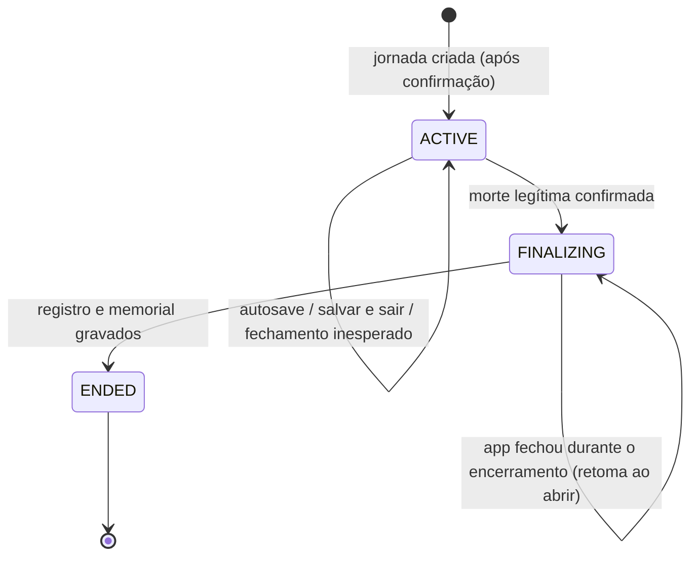

# Hardcore — Legado dos Sobreviventes — Especificação

> **Origem:** GDD 007 / diretriz WLD-HARDCORE-001 (2026-11-19).
> **Status:** design documentado. **Nenhuma implementação iniciada.** Nenhum arquivo citado em "Arquitetura prevista" existe ainda.
> **Identidade oficial do Hardcore [APROVADO]:** *Uma vida. Uma jornada. Um legado.* Quando o personagem morre, a aventura termina definitivamente; o mundo deixa de ser jogável e passa a existir como **Memorial de Sobrevivência**, somente leitura.
>
> Este documento resolve a pendência **P-SV-08** (morte no Hardcore → memorial / jornada encerrada) e cobre a parte do save que o Hardcore exige, adiantando a pendência **P-SV-12**. Substitui as regras técnicas propostas em [`SURVIVAL_DIFFICULTY.md`](SURVIVAL_DIFFICULTY.md) 7.4 (o estado único `run_ended` virou a máquina ACTIVE → FINALIZING → ENDED).
>
> Legenda: **[APROVADO]** decisão do GDD 007 · **[PROPOSTO]** regra preenchida aqui, válida até confirmação · **[PENDENTE]** em aberto (seção 14) · **[2.0]** / **[Futuro]** fora da 1.0.
>
> **Escopo:** nada deste documento entra no MVP. No MVP o preset Hardcore é **experimental**, sem morte permanente funcional (GDD 006 e GDD 007). Morte permanente só depois de save e carregamento estarem suficientemente testados **[APROVADO]**.

---

## 1. Regras definitivas [APROVADO]

| Regra | Decisão |
|---|---|
| Vidas disponíveis | 1 |
| Ressurreição | Não |
| Checkpoints para voltar após morrer | Não |
| Salvar e sair | Permitido (enquanto vivo) |
| Continuar após a morte | Não |
| Mundo após a morte | Memorial (somente leitura) |
| Construções e descobertas | Preservadas no registro |
| Recompensas | Prestígio e cosméticos — nunca poder de combate |
| Alterar dificuldade durante a jornada | Não |
| Reset da árvore de conhecimentos (GDD 010) | Permitido com a jornada ativa, fora de combate |
| Recuperar partida encerrada | Não pela interface normal |
| Exclusão imediata dos arquivos | Não |
| Proteção contra falhas técnicas | Obrigatória antes do lançamento |
| Transferência entre jornadas | Nenhuma: recursos, itens, criaturas e poderes não passam para a próxima jornada |
| Hardcore oficial | Sem alterações personalizadas de dificuldade |

---

## 2. Morte legítima e falha técnica

### 2.1 Definições [APROVADO]
- **Morte legítima:** o jogador recebeu dano **dentro das regras do jogo** e chegou a zero de vida. Causas válidas: ataques de criaturas hostis, inanição, quedas e perigos ambientais, e efeitos de dano que venham a existir.
- **Falha técnica:** o jogo travou, perdeu dados, carregou o personagem numa posição inválida ou executou uma ação incorreta.
- **Uma falha técnica nunca é tratada como morte.** Não haverá botão de "desfazer morte"; a proteção está em impedir que falhas virem mortes.

### 2.2 Critério técnico de morte legítima [PROPOSTO]
Uma morte só é **confirmada** quando todas as condições forem verdadeiras:

1. A vida chegou a 0 pelo `HealthComponent`, por um **pacote de dano** (caminho comum do GDD 004).
2. O pacote tem uma **causa declarada e válida**: `enemy:<id>`, `starvation`, `fall`, `environment:<id>`, `ability:<id>`. Pacotes sem causa são rejeitados (e geram erro em build de desenvolvimento), então não podem matar.
3. O mundo está no estado `READY` (seção 5), ou seja, fora da proteção de carregamento.
4. A jornada está em `ACTIVE`.

Se o personagem sair dos limites do mundo (abaixo do plano de segurança), isso é tratado como **falha técnica**, não como queda (seção 5.3).

---

## 3. Máquina de estados da jornada

### 3.1 Estados [APROVADO]

| Estado | Significado | Pode carregar para jogar? |
|---|---|---|
| `ACTIVE` | Personagem vivo, partida jogável | Sim |
| `FINALIZING` | Morte confirmada; encerramento em processamento | **Não** — o jogo conclui o encerramento |
| `ENDED` | Jornada encerrada; só o memorial | **Não** |

`FINALIZING` existe porque o app pode ser fechado durante a gravação da morte. Ao reabrir, o jogo conclui uma morte já confirmada, **sem reativar o personagem** **[APROVADO]**.

### 3.2 Transições



Regras **[APROVADO + PROPOSTO]**:
- A transição para `FINALIZING` acontece **uma única vez** por jornada; mortes adicionais no mesmo quadro são ignoradas.
- **Não existe** transição de `FINALIZING` ou `ENDED` de volta para `ACTIVE`.
- Fechamento inesperado em `ACTIVE` continua `ACTIVE` (carrega o último estado válido).

### 3.3 Sequência da morte [APROVADO + PROPOSTO]

| Passo | O que acontece | Quem faz |
|---|---|---|
| 1. Morte confirmada | Vida 0 com causa válida; controles desativados; partida interrompida (pausa da simulação) | Survival → `HardcoreDeathHandler` |
| 2. Captura | Causa, local (bioma/região + posição), horário, estatísticas da jornada e uma imagem representativa | `HardcoreDeathHandler` |
| 3. Registro prioritário | Autosaves pendentes são cancelados; grava o save em `FINALIZING` com o registro de morte; grava o mesmo estado no **registro de jornadas do perfil** (seção 7.3) | `HardcoreRunManager` → `SaveManager` |
| 4. Memorial | Monta os dados do memorial a partir do registro gravado (não precisa do mundo carregado) | `MemorialBuilder` |
| 5. Encerramento | Grava o save em `ENDED` e copia o memorial para o perfil geral | `SaveManager` |
| 6. Tela de legado | Resumo: tempo sobrevivido, descobertas e conquistas, paisagem do mundo, trilha curta | UI |
| 7. Memorial permanente | A jornada aparece numa seção própria do menu principal | UI |
| 8. Novo começo | O jogador pode criar outra jornada Hardcore, do zero | UI |

A tela de legado só aparece **depois** do passo 3 gravado **[PROPOSTO]**. Sem drama exagerado: trilha curta, paisagem e estatísticas bastam **[APROVADO]**.

### 3.4 Retomada ao reabrir [PROPOSTO]
- Save em `FINALIZING` → o mundo **não** é carregado; o jogo executa os passos 4 e 5 a partir do registro de morte salvo e vai para a tela de legado.
- Save em `ENDED` → abre o memorial.
- O registro de jornadas do perfil diz `FINALIZING` ou `ENDED`, mas o save do mundo diz `ACTIVE` (ex.: recuperação a partir de cópia antiga) → **prevalece o perfil**: a jornada é tratada como encerrada. Isso impede que uma cópia de segurança desfaça uma morte legítima **[APROVADO: recuperação sem desfazer mortes]**.

---

## 4. Salvamento

### 4.1 Regras de autosave [APROVADO]
- Periódico durante a jornada — ponto de partida: **60 s**, ajustável nos testes.
- Em marcos importantes: domesticação, desbloqueio de poder (e, por coerência, conclusão de desafio ancestral) **[PROPOSTO]**.
- Ao sair pelo menu.
- **Não** é possível carregar manualmente uma versão anterior da mesma jornada.
- Morte registrada de forma **prioritária**.
- Uma **cópia de segurança técnica** existe para recuperar corrupção, **não** para desfazer mortes legítimas.

Complementos **[PROPOSTO]**:
- Também salvar quando o app vai para segundo plano no iOS e ao receber o pedido de fechamento da janela no PC.
- **Um único slot por jornada Hardcore.** A cópia de segurança não aparece na interface.
- Depois de `FINALIZING`, nenhum autosave de gameplay pode ser gravado (trava de escrita).

### 4.2 Gravação transacional [APROVADO]
Primeiro preparar o novo arquivo, **validar** os dados e só então substituir o estado anterior.

Procedimento **[PROPOSTO]**:
1. Serializar o estado para `<slot>.tmp`.
2. Reler o `.tmp` e passar pelo `SaveValidator`.
3. Se válido: o arquivo atual vira `<slot>.bak` e o `.tmp` vira o arquivo atual (renomeações).
4. Se inválido: descartar o `.tmp`, manter o arquivo atual e registrar o erro. Não tentar de novo no mesmo quadro.

Assim, uma interrupção em qualquer passo deixa pelo menos um arquivo íntegro.

### 4.3 Validação [PROPOSTO]
O `SaveValidator` verifica:
- Versão de formato conhecida (com migração quando houver versões antigas).
- Campos obrigatórios presentes (`run_id`, `run_state`, preset, posição, vida...).
- **Soma de verificação** do conteúdo, para detectar arquivo truncado ou corrompido. Não é proteção contra edição manual (aceito pelo GDD 007).
- Valores dentro de limites (vida 0–máximo, fome 0–100, posição finita).

### 4.4 Recuperação [APROVADO + PROPOSTO]

| Situação | Comportamento |
|---|---|
| Arquivo atual válido | Carrega |
| Atual inválido, `.bak` válido | Carrega o `.bak` — **depois** de conferir o registro de jornadas do perfil (3.4) |
| Atual e `.bak` inválidos | Jornada marcada como **"precisa de recuperação"**, nunca como morta. Não abre para jogar nem vira memorial; mostra mensagem e mantém os arquivos para diagnóstico (P-HC-04) |
| `.tmp` sobrando de uma gravação interrompida | Ignorado e apagado |

**Save corrompido nunca é tratado automaticamente como morte [APROVADO].**

### 4.5 Brecha aceita
Fechar o app à força **antes** da morte ser confirmada volta ao último autosave (até ~60 s antes). O GDD 007 aprova que "fechamento inesperado não equivale a morte" e aceita que um jogo offline não impede manipulação. A brecha fica registrada (R-HC-01).

---

## 5. Proteção contra falhas de carregamento

### 5.1 Proteções obrigatórias [APROVADO]

| Situação | Comportamento esperado |
|---|---|
| App fecha inesperadamente | Carrega o último estado válido |
| Falta de bateria | Recupera save íntegro |
| Save corrompido | Tenta recuperação técnica |
| Jogador nasce dentro de um objeto | Corrige a posição antes de habilitar dano |
| Mundo ainda carregando | Personagem não recebe dano |
| Personagem cai por falha de carregamento | O sistema evita a morte por essa falha |
| Morte legítima confirmada | Jornada encerrada |
| App fecha durante o encerramento | Conclui o encerramento ao reabrir |

### 5.2 Proteção de carregamento [APROVADO + PROPOSTO]
Enquanto o mundo não está pronto, o jogador fica protegido contra dano. A proteção termina quando posição, colisões e sistemas essenciais estão prontos, e **não** pode ser ativada pelo jogador **[APROVADO]**.

Estados do mundo **[PROPOSTO]**: `LOADING` → `VALIDATING_SPAWN` → `READY`.

| Regra | Valor proposto |
|---|---|
| Durante `LOADING` e `VALIDATING_SPAWN` | Todo pacote de dano contra o jogador é descartado; IA hostil, fome e inanição pausadas; controles bloqueados |
| Fim de `LOADING` | Cena carregada e pelo menos 2 passos de física executados |
| `VALIDATING_SPAWN` | Verifica se a cápsula do jogador sobrepõe colisões e se há chão abaixo (raycast) |
| Sobreposição ou sem chão | Procura um ponto livre próximo (até 16 tentativas em espiral, até 5 m); se falhar, usa a última posição segura; se falhar, o ponto de origem do mundo |
| Tempo máximo | 10 s; se estourar, usa a última posição segura e registra o erro |
| `READY` | Dano, IA, fome e controles liberados |

A mesma proteção vale ao reaparecer nos modos normais.

### 5.3 Queda por falha [PROPOSTO]
- **Última posição segura:** gravada a cada 2 s quando o jogador está no chão, fora de perigos, e incluída no save.
- **Plano de segurança:** se o jogador ficar abaixo de um limite (ex.: 50 m abaixo do ponto mais baixo do terreno), é uma **falha técnica**: ele volta à última posição segura, sem dano, e o evento é registrado.
- Dano de queda legítimo (quando existir) vem do impacto com o chão, não de atravessar o mundo.

### 5.4 Limite reconhecido [APROVADO]
Nenhum sistema identifica todos os bugs automaticamente. Por isso o Hardcore com morte permanente **não** é lançado enquanto save e carregamento não estiverem suficientemente testados.

---

## 6. Memorial de Sobrevivência

### 6.1 Conteúdo na 1.0 [APROVADO]
- Nome do personagem ou da jornada.
- Nível de sobrevivente alcançado **[PROPOSTO, GDD 009]** — não passa para a próxima jornada.
- Dificuldade Hardcore.
- Tempo de sobrevivência (tempo de jogo).
- Dias sobrevividos no mundo.
- Causa e local da morte.
- Criaturas domesticadas.
- Essências Ancestrais descobertas.
- Principais marcos de construção.
- Conquistas desbloqueadas.
- Imagem representativa.

Exemplo fictício do GDD 007: "O Último Acampamento" — 18 dias, 12h 43m, 3 criaturas, 4 essências, morte por criatura hostil na Floresta Primordial, última conquista "Domador Ancestral". Rodapé: *Jornada encerrada · Somente leitura*.

### 6.2 Decisões de escopo [APROVADO]
- **Não** armazenar uma cópia 3D completa do mundo para o memorial: aumentaria o save e exigiria manter o mundo funcionando depois da morte.
- No lançamento: ficha com estatísticas, imagem representativa e histórico de conquistas.
- Memorial 3D visitável: possível na **2.0**.
- As construções continuam registradas no estado final da jornada (o save do mundo não é apagado), mas o memorial mostra só os marcos.

### 6.3 Detalhes [PROPOSTO]
- **Imagem representativa:** captura da tela no passo 2 da sequência da morte, reduzida (ex.: 512 px de largura), salva com o memorial. Alternativa: a última captura feita num autosave (P-HC-03).
- **Nome da jornada:** digitado na criação; se vazio, "Jornada Hardcore #N".
- **Local da morte:** nome do bioma/região + coordenadas.
- **Tempo de sobrevivência:** soma do tempo de jogo ativo (sem pausa, menus de sistema nem tempo fora do app).
- **Somente leitura:** a tela do memorial não oferece nenhuma ação que altere o estado da jornada.
- **Os dados do memorial são copiados para o perfil geral** ao entrar em `ENDED`, para que a lista de memoriais não dependa de abrir saves de mundo.

---

## 7. Perfil geral e save da jornada

### 7.1 Separação [APROVADO]
Conquistas e cosméticos ficam no **perfil geral do jogador**, separado do save da jornada. A partida termina, mas o legado permanece.

### 7.2 O que fica em cada lugar [PROPOSTO]

| Dado | Save da jornada (um por mundo) | Perfil geral (um por instalação) |
|---|---|---|
| Estado do mundo, posição, vida, fome, inventário, construções, criaturas | ✓ | — |
| Preset de dificuldade, `run_id`, `run_state` | ✓ | — |
| Registro de morte | ✓ | ✓ (cópia) |
| Dados do memorial | ✓ | ✓ (cópia) |
| Registro de jornadas Hardcore (`run_id` → estado) | — | ✓ |
| Conquistas desbloqueadas (ids) | — | ✓ |
| Cosméticos desbloqueados (ids) | — | ✓ |
| Preferências (som, controles) | — | ✓ |

### 7.3 Registro de jornadas no perfil [PROPOSTO]
Lista pequena `run_id → ACTIVE | FINALIZING | ENDED`, atualizada pela mesma gravação transacional. É a segunda fonte de verdade que impede que um save recuperado de uma cópia antiga volte a ser jogável depois de uma morte (3.4).

### 7.4 Conquistas sem duplicação [APROVADO + PROPOSTO]
- O sistema **não** concede recompensas duplicadas **[APROVADO]**.
- Cada conquista tem um **id estável**; o perfil guarda um conjunto de ids; desbloquear de novo não faz nada **[PROPOSTO]**.
- A conquista é gravada no perfil **no momento** em que é obtida, não só na morte. Assim, uma conquista obtida antes de um fechamento inesperado não se perde **[PROPOSTO]**.

---

## 8. Recompensas

### 8.1 Tipos [APROVADO]

| Tipo | Conteúdo |
|---|---|
| Conquistas de sobrevivência | Marcos por dias sobrevividos, descobertas e desafios |
| Cosméticos exclusivos | Aparências, cores e elementos visuais que demonstram experiência |
| Legado permanente | Memorial e registro das jornadas mais marcantes |

**Nunca** recompensas que aumentem poder de combate, para não fazer os outros modos parecerem inferiores **[APROVADO]**.

### 8.2 Marcos propostos [APROVADO — nomes e quantidades podem mudar]

| Marco | Recompensa | Id proposto |
|---|---|---|
| Sobreviver 1 dia | Conquista **Primeira Noite** | `hc_first_night` |
| Sobreviver 7 dias | Insígnia **Sobrevivente** | `hc_survivor` |
| Domesticar a primeira criatura | Conquista **Vínculo Selvagem** | `hc_wild_bond` |
| Desbloquear a primeira essência | Conquista **Despertar Ancestral** | `hc_ancestral_awakening` |
| Sobreviver 30 dias | Cosmético de prestígio | `hc_prestige_30_days` |
| Concluir o objetivo principal da 1.0 | Título **Lenda Ancestral** | `hc_ancestral_legend` |

Os ids seguem a regra de identificadores estáveis do GDD 005 **[PROPOSTO]**. O exemplo do memorial cita "Domador Ancestral — domesticou seu primeiro companheiro", enquanto a tabela chama esse marco de "Vínculo Selvagem"; o nome final fica para P-HC-06.

### 8.3 Regras [APROVADO + PROPOSTO]
- Recompensas do Hardcore só em mundos com o preset Hardcore **oficial, sem alterações** (regra de integridade do GDD 006) **[APROVADO]**.
- Conquistas e cosméticos sobrevivem à morte **[APROVADO]**.
- Itens, recursos, criaturas e poderes **não** passam para novas jornadas **[APROVADO]**.
- Cosméticos: **limitados na 1.0**, expandidos na 2.0 **[APROVADO no GDD 007]**. Isso adianta o que o GDD 006 deixava para a 2.0; prevalece o GDD 007.

---

## 9. Interface de criação do mundo Hardcore [APROVADO]

Aviso explícito antes de iniciar:

> **Criar mundo Hardcore**
> Neste modo, seu personagem possui apenas uma vida. Ao morrer, a jornada será encerrada permanentemente e o mundo ficará disponível somente como memorial.
> Você poderá salvar e sair normalmente enquanto estiver vivo. Não será possível retornar a um checkpoint após uma morte legítima.
> ☐ Entendo que a morte encerra definitivamente esta jornada.
> **[Confirmar regras do Hardcore]**

Regras **[PROPOSTO]**: o botão de confirmar só fica ativo depois de marcar a caixa; nenhuma opção de personalização aparece para o preset oficial; área de toque mínima de 44 × 44 pt.

---

## 10. Escopo por versão [APROVADO]

| Funcionalidade | MVP | 1.0 | 2.0 |
|---|---|---|---|
| Quatro dificuldades | ✓ | ✓ | ✓ |
| Fome e dano por inanição | ✓ | ✓ | ✓ |
| Perfil Hardcore experimental | ✓ | — | — |
| Morte permanente funcional | — | ✓ | ✓ |
| Save com encerramento seguro | — | ✓ | ✓ |
| Memorial com estatísticas | — | ✓ | ✓ |
| Conquistas Hardcore | — | ✓ | ✓ |
| Cosméticos exclusivos | — | Limitados | Expandidos |
| Memorial 3D visitável | — | — | Possível |
| Rankings online | — | — | Futuro |

O MVP continua focado em sobrevivência, exploração e validação do gameplay. "Rankings online" contraria o caráter offline do jogo e exigiria servidor; fica registrado como futuro (P-HC-08).

---

## 11. Arquitetura prevista

> Arquivos **planejados**, não criados.

### 11.1 Três responsabilidades separadas [APROVADO]
- **Survival:** decide quando o personagem morre.
- **Hardcore Run:** controla o estado da jornada.
- **Save System:** registra o encerramento e preserva os dados.

### 11.2 Estrutura (GDD 007)

```
Wildbound/
├── scripts/
│   ├── hardcore/
│   │   ├── hardcore_run_manager.gd
│   │   ├── hardcore_death_handler.gd
│   │   └── memorial_builder.gd
│   └── save/
│       ├── save_manager.gd
│       ├── save_validator.gd
│       └── profile_store.gd           # PROPOSTO — perfil geral (não listado no GDD 007)
├── resources/hardcore/
│   ├── hardcore_run_data.gd
│   └── memorial_data.gd
├── scenes/ui/hardcore/
│   ├── hardcore_confirmation.tscn
│   ├── hardcore_death_screen.tscn
│   └── memorial_screen.tscn
└── tests/
    ├── test_hardcore_death.gd
    ├── test_hardcore_save.gd
    └── test_memorial.gd
```

`profile_store.gd` é um acréscimo justificado: o GDD 007 exige o perfil geral separado, mas não lista quem o grava.

O GDD 007 volta a colocar scripts de `Resource` em `resources/`, ao contrário do GDD 006 (`scripts/difficulty/difficulty_settings.gd`). A pendência **P-10** precisa ser decidida antes da primeira implementação com recursos de dados.

### 11.3 Responsabilidades

| Componente | Tipo Godot | Responsabilidade | Não faz |
|---|---|---|---|
| `HealthComponent` (Survival) | `Node` | Informa morte com causa (`died(cause)`) | Saber de Hardcore |
| `HardcoreDeathHandler` | `Node` | Recebe a morte, valida o critério 2.2, desativa controles, captura o registro | Gravar arquivos |
| `HardcoreRunManager` | `Node` | Estado da jornada; encerra **uma única vez**; bloqueia autosave após `FINALIZING` | Montar telas |
| `MemorialBuilder` | `RefCounted` | Monta `MemorialData` a partir de `HardcoreRunData` + registro de morte | Acessar a cena do mundo |
| `SaveManager` | ver 11.5 | Gravação transacional, autosave, carregamento, recuperação, retomada de `FINALIZING` | Decidir morte |
| `SaveValidator` | `RefCounted` | Valida arquivos (4.3) | Corrigir dados |
| `ProfileStore` | `RefCounted` | Perfil geral: conquistas, cosméticos, registro de jornadas, cópias de memorial | Dados do mundo |
| `HardcoreRunData` | `Resource` | `run_id`, nome, preset e versão, estado, tempo de jogo, estatísticas, registro de morte | Lógica |
| `MemorialData` | `Resource` | Campos da seção 6.1 | Lógica |
| Telas Hardcore | `Control` | Confirmação, tela de morte/legado, memorial | **Alterar o estado de morte** |

### 11.4 Regras de arquitetura [APROVADO]
- O sistema de vida informa uma morte confirmada.
- O gerenciador Hardcore encerra a jornada **uma única vez**.
- O save grava o estado final com segurança.
- O memorial é construído a partir dos dados da jornada.
- O perfil geral guarda conquistas e cosméticos separadamente.
- A interface **não** altera diretamente o estado de morte.
- Um save encerrado **não** pode ser carregado como partida ativa.

### 11.5 Exceção à regra "sem autoload" [PROPOSTO]
O `SaveManager` e o `ProfileStore` precisam existir antes de qualquer mundo ser carregado (menu principal, retomada de `FINALIZING`) e entre trocas de cena. A WLD-001 proíbe singletons **desnecessários**; este é um caso em que um autoload é justificável. Proposta: **um único autoload `SaveManager`**, que é dono do `ProfileStore`. Os demais sistemas continuam recebendo dependências por injeção. Requer aprovação (P-HC-01).

---

## 12. Dependências

| Dependência | Situação | Necessária para |
|---|---|---|
| `HealthComponent` com causa de morte | Documentado (GDD 004/006) | Critério de morte legítima |
| Sistema de save geral (todos os modos) | Este documento cobre o que o Hardcore exige; o formato do mundo inteiro ainda não está especificado (P-SV-12) | Tudo |
| Menu principal (seção de memoriais, criar jornada) | Não existe | Fluxo da morte e novo começo |
| Ciclo de dia e noite | Não existe (P-SV-09) | "Dias sobrevividos" e marcos de 1, 7 e 30 dias |
| Sistema de construção | Não existe | Marcos de construção do memorial |
| Domesticação e essências | Documentados | Estatísticas e conquistas |
| Personalização de aparência | Não existe | Cosméticos |
| Objetivo principal da 1.0 | Não definido | Título Lenda Ancestral |
| Ciclo de vida do app no iOS (segundo plano, fechamento) | Não tratado | Autosave em interrupções |
| Sistema de pausa | Não existe | Interromper a partida na morte |

---

## 13. Riscos técnicos

| ID | Risco | Mitigação |
|---|---|---|
| R-HC-01 | Fechar o app à força antes de a morte ser confirmada volta até ~60 s no tempo | Brecha aceita (jogo offline); autosave frequente; registro prioritário da morte |
| R-HC-02 | Cópia de segurança antiga reativar uma jornada encerrada | Registro de jornadas no perfil prevalece sobre o save (3.4) |
| R-HC-03 | Os dois arquivos corrompidos fazem o jogador perder a jornada por motivo técnico | Estado "precisa de recuperação" em vez de morte; arquivos mantidos; testes de interrupção antes do lançamento |
| R-HC-04 | Bug de colisão ou carregamento causa morte injusta e permanente | Proteção de carregamento, plano de segurança, posição segura; não lançar sem testes de várias sessões |
| R-HC-05 | Autosave gravado depois do registro de morte sobrescreve `FINALIZING` com `ACTIVE` | Trava de escrita após `FINALIZING`; cancelar autosaves pendentes; teste específico |
| R-HC-06 | Armazenamento cheio no iPhone impede gravar a morte | Gravação transacional mantém o arquivo anterior; registrar a morte no perfil (arquivo pequeno); mensagem ao jogador |
| R-HC-07 | Autoload do `SaveManager` vira dependência global usada por tudo | Uma única exceção, com interface pequena; demais sistemas por injeção |
| R-HC-08 | Marcos baseados em dias sem ciclo de dia e noite | Decidir P-SV-09 antes da 1.0 |
| R-HC-09 | Captura de tela no momento da morte custar memória no iPhone | Imagem pequena; alternativa de usar a captura do último autosave |

---

## 14. Pendências

| ID | Pendência | Sugestão |
|---|---|---|
| P-HC-01 | Aprovar `SaveManager` como único autoload (11.5) | Aprovar |
| P-HC-02 | Formato do arquivo de save (JSON, `ConfigFile` ou binário com `store_var`) | JSON com versão de formato, legível para depuração |
| P-HC-03 | Imagem do memorial: captura na morte ou do último autosave | Captura na morte, reduzida |
| P-HC-04 | O que oferecer quando os dois arquivos estiverem corrompidos | Mensagem + manter arquivos; sem morte e sem jogar |
| P-HC-05 | Limite de memoriais guardados no perfil | Sem limite na 1.0 (cada um é pequeno) |
| P-HC-06 | Nomes finais das conquistas ("Vínculo Selvagem" × "Domador Ancestral") | Decidir no balanceamento |
| P-HC-07 | Conquistas existem também fora do Hardcore? | Fora do escopo deste GDD; decidir depois |
| P-HC-08 | Rankings online num jogo offline | Manter como futuro sem compromisso |
| P-SV-01 | ~~Morte nos modos normais~~ | **Resolvida (GDD 008):** ver [`DEATH_RESPAWN.md`](DEATH_RESPAWN.md) |
| P-SV-09 | (herdada) Ciclo de dia e noite para "dias sobrevividos" | Decidir antes da 1.0 |
| P-10 | (herdada) Scripts de `Resource` em `resources/` ou `scripts/` — GDDs 006 e 007 divergem | Decidir antes da primeira implementação com recursos de dados |

---

## 15. Plano de testes e critérios de aceite

Exigidos antes de lançar o Hardcore com morte permanente **[APROVADO]**. Integrados à suíte headless; simulações de interrupção feitas interrompendo o procedimento de gravação entre passos.

### 15.1 Critérios do GDD 007 [APROVADO]

| # | Critério | Teste |
|---|---|---|
| HC01 | Morte legítima encerra a jornada | Dano com causa válida até vida 0 em `READY` → `FINALIZING` → `ENDED` |
| HC02 | Não é possível continuar após morrer | Carregar uma jornada `ENDED` abre o memorial, nunca o mundo |
| HC03 | Salvar e sair vivo funciona | Salvar, reiniciar, carregar: estado igual e `ACTIVE` |
| HC04 | Fechamento inesperado não causa morte | Interromper em `ACTIVE` em qualquer passo da gravação → carrega `ACTIVE` íntegro |
| HC05 | Sem recompensas duplicadas | Desbloquear a mesma conquista duas vezes e após recarregar → um registro |
| HC06 | Morte confirmada persiste após reiniciar | Interromper em cada passo da sequência 3.3 → ao reabrir, nunca `ACTIVE` |
| HC07 | Memorial com estatísticas corretas | Jornada com valores conhecidos → memorial mostra os mesmos valores |
| HC08 | Conquistas permanecem no perfil | Morrer → conquistas continuam no perfil; nova jornada não as remove |
| HC09 | Save corrompido não vira morte | Corromper o arquivo atual (e depois os dois) → `.bak` ou "precisa de recuperação", nunca `ENDED` |
| HC10 | Dificuldade não muda durante a jornada | Tentar alterar o preset de uma jornada Hardcore → recusado |
| HC11 | Funciona após múltiplas sessões | 20 ciclos de jogar → autosave → fechar → abrir sem divergência |

### 15.2 Testes técnicos complementares [PROPOSTO]

| # | Teste | Resultado esperado |
|---|---|---|
| HC12 | Dano durante `LOADING`/`VALIDATING_SPAWN` | Descartado |
| HC13 | Nascer sobrepondo um obstáculo | Posição corrigida antes de `READY` |
| HC14 | Cair abaixo do plano de segurança | Volta à última posição segura, sem dano e sem morte |
| HC15 | Pacote de dano sem causa | Rejeitado; não pode matar |
| HC16 | Duas mortes no mesmo quadro | Uma única transição para `FINALIZING` |
| HC17 | Autosave agendado logo depois da morte | Não grava; `FINALIZING` não é sobrescrito |
| HC18 | Save em `ACTIVE`, perfil em `ENDED` | Tratado como encerrado |
| HC19 | `.tmp` órfão | Ignorado e removido |
| HC20 | Itens, criaturas e poderes numa nova jornada | Nada herdado |
| HC21 | Mundo personalizado a partir do Hardcore | Sem conquistas Hardcore |
| HC22 | Confirmação de criação | Botão só ativo com a caixa marcada |
| HC23 | Hardcore experimental do MVP | Nunca entra em `FINALIZING` |
| HC24 | Regressão | Testes de todas as tarefas anteriores passando |

### 15.3 Teste manual obrigatório [PROPOSTO]
Antes do lançamento, em iPhone real: fechar o app durante o jogo, durante um autosave e durante a sequência de morte; deixar a bateria acabar; encher o armazenamento. Registrar o resultado de cada caso.
