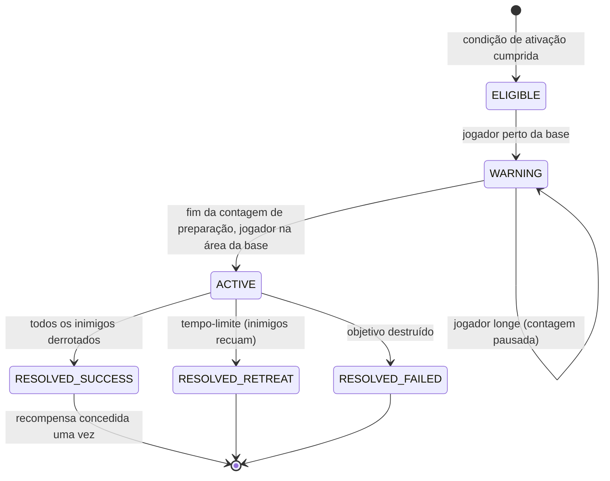

# Ameaças Territoriais e Invasões de Bases — Especificação

> **Origem:** GDD 012 / diretriz WLD-BASE-THREATS-001 (2026-11-19).
> **Status:** design documentado. **Nenhuma implementação iniciada.** Nenhum arquivo citado em "Arquitetura prevista" existe ainda.
> **Decisão aprovada:** sistema **híbrido** — agressividade **territorial** de criaturas + **eventos de invasão** especiais. O lugar da base importa tanto quanto o material. O sistema deve recompensar preparação e boas decisões, **sem** destruir horas de progresso com ataques imprevisíveis.
>
> Resolve a pendência **P-BL-02** de [`BUILDING.md`](BUILDING.md). Avança a pendência **P-PW-02** de [`ANCESTRAL_POWERS.md`](ANCESTRAL_POWERS.md): o MVP terá criaturas hostis ao jogador e territórios simples, mas a espécie hostil ainda não foi definida.
>
> Legenda: **[APROVADO]** decisão do GDD 012 · **[PROPOSTO]** regra preenchida aqui, válida até confirmação · **[PENDENTE]** em aberto (seção 15) · **[1.0]** / **[2.0]** fora do MVP.
>
> **Escopo do MVP [APROVADO]:** criaturas hostis **ao jogador** e territórios simples. **Sem** ataques a construções e **sem** invasões. Quase tudo neste documento é da 1.0.

---

## 1. Dois sistemas relacionados, mas independentes [APROVADO]

| Sistema | O que é | Previsível? |
|---|---|---|
| **Ameaça territorial** | Criaturas reagem à presença do jogador e de construções nas regiões que habitam. Local, não constante | Sim — depende de onde o jogador está e constrói |
| **Evento de invasão** | Acontecimento organizado, **com aviso**, início, objetivo e fim; criaturas se aproximam da base e o jogador defende | Sim — tem causa compreensível e aviso |

Um predador pode atacar uma base por estar no território dele, sem invasão ativa. Uma invasão é um evento com começo, objetivo e encerramento.

---

## 2. Territórios

### 2.1 Zonas de perigo [APROVADO]

| Zona | Conteúdo | Uso |
|---|---|---|
| **Segura** | Predominam criaturas pacíficas | Bases iniciais |
| **Atenção** | Criaturas defensivas e predadores ocasionais | — |
| **Perigosa** | Predadores fortes, recursos melhores, mais risco territorial | — |
| **Ancestral** | Criaturas excepcionais e desafios avançados | — |

### 2.2 Proteção para iniciantes [APROVADO]
A região inicial da Floresta Primordial tem pelo menos **uma área segura adequada** para o primeiro abrigo. O jogador não descobre por tentativa e erro que construiu dentro do território de um predador muito superior.

Para o MVP **[PROPOSTO]**: o mundo de teste da WLD-001 vira uma **zona segura** ao redor do ponto inicial, com uma pequena **zona de atenção** onde ficam as criaturas hostis do MVP.

### 2.3 Avaliação do local ao construir [APROVADO]
No modo de construção, um indicador mostra a zona e o risco, **sem revelar** todas as criaturas da região.

Exemplo do GDD 012: *"Bosque dos Predadores — Moderado — Criaturas defensivas podem reagir à presença da base."*

Formato **[PROPOSTO]**: nome da região + nível da zona (texto e ícone, nunca só cor) + uma frase. Se o indicador entra no MVP está em P-TR-02.

---

## 3. Agressividade das criaturas

### 3.1 Fatores [APROVADO]
- Tipo de criatura: **pacífica, defensiva ou agressiva**.
- Distância do jogador ou da construção.
- Estar dentro de um território protegido.
- Provocação (ex.: ser atacada).
- Dificuldade do mundo.

### 3.2 Comportamento por tipo [APROVADO]

| Tipo | Comportamento |
|---|---|
| **Pacífica** | Nunca começa a destruir paredes só porque encontrou uma base |
| **Defensiva** | Reage se provocada ou se o jogador se aproximar demais do ninho |
| **Agressiva** | Pode perseguir o jogador e atacar obstáculos que bloqueiem a passagem, dentro de limites de comportamento |

**Relação com o Wild Bond [PROPOSTO]:** o Wild Bond usa os temperamentos pacífico, cauteloso e agressivo. O Lumaru (cauteloso) **foge**, não ataca; para o sistema territorial ele é tratado como **pacífico** (nunca agride). O temperamento descreve como a criatura reage à aproximação; o tipo territorial descreve se ela agride. Ver P-TR-08.

### 3.3 Regra fundamental: agressividade local [APROVADO]
**Nenhuma** criatura detecta bases a quilômetros para destruí-las. O sistema é local, o que reduz o custo de processamento e torna o comportamento compreensível.

### 3.4 Valores [PROPOSTO]

| Parâmetro | Valor inicial |
|---|---|
| Raio de percepção (agressiva) | 18 m |
| Raio do ninho (defensiva reage) | 8 m |
| Raio de guarda (*leash*): distância máxima da área de origem antes de voltar | 35 m |
| Esquecer o alvo | 8 s sem ver o jogador |
| Criaturas hostis ativas perto do jogador (iPhone) | No máximo 6 |
| Dificuldade e percepção | **Não** altera raios no MVP; a dificuldade age em dano e vida (GDD 006) |

### 3.5 Prioridade de alvos [APROVADO]

| Prioridade | Alvo | Regra |
|---|---|---|
| 1 | Jogador | Se estiver acessível e for uma ameaça |
| 2 | Defesas ativas | Se estiverem atacando a criatura |
| 3 | Portas e obstáculos | Se bloquearem o caminho até um alvo |
| 4 | Objetivo do evento | Quando a invasão exigir um alvo específico |
| 5 | Outras estruturas | Só espécies e eventos que permitam |

Criaturas comuns **não** destroem uma fundação só por estarem perto. Em eventos, o alvo pode ser um objeto definido, como um **Marco de Defesa**, para não destruir a base indiscriminadamente.

**No MVP:** só a prioridade 1 existe (criaturas não atacam construções). Construções são obstáculos físicos comuns; a criatura contorna ou desiste.

**Companheiro como alvo [PROPOSTO]:** no MVP, criaturas hostis miram só o jogador (mantém a proposta P-11 do Wild Bond). Na 1.0, o Guardião pode virar alvo ao atacar (equivalente à prioridade 2).

---

## 4. Eventos de invasão [1.0]

### 4.1 Fluxo [APROVADO]
1. **Condição de ativação** — estágio de progressão + base válida.
2. **Aviso antecipado** — sinais de atividade hostil por perto.
3. **Preparação** — reparar, guardar recursos, posicionar defesas.
4. **Ataque** — um pequeno grupo tenta alcançar um objetivo da base.
5. **Encerramento** — inimigos derrotados, recuam ou atingem o objetivo.
6. **Resultado** — recompensa pela defesa bem-sucedida; reparo dos danos.

### 4.2 Ativação [APROVADO]
Por **marcos de progressão e condições territoriais**, **nunca** por um relógio que dispara ataques continuamente. Exemplos futuros: base avançada em região perigosa; concluir um desafio ancestral que agita as criaturas locais; ativar um objeto que atrai inimigos; provocar uma espécie territorial poderosa. O jogador entende **por que** está sendo atacado.

**Nenhuma invasão obrigatória** durante o tutorial ou enquanto o jogador aprende a construir a primeira base.

### 4.3 Estados [PROPOSTO]



| Regra | Valor proposto |
|---|---|
| Área da base | 40 m ao redor do Marco de Defesa |
| Contagem de preparação (aviso) | 5 min de jogo no Intermediário |
| Jogador fora da área | A contagem **pausa**; a invasão **nunca** começa sem o jogador presente |
| Tempo-limite do ataque | 4 min; depois os inimigos recuam |
| Tamanho do grupo | 3 a 5 criaturas no Intermediário |
| Uma invasão por vez | Sim |
| Intervalo mínimo entre invasões | 2 horas de jogo |

Essas regras traduzem as regras de justiça aprovadas: aviso antes do ataque e nenhuma destruição sem o jogador saber (seção 7).

### 4.4 Objetivo da invasão [APROVADO + PROPOSTO]
O alvo do evento é um objeto definido, o **Marco de Defesa** **[APROVADO como exemplo]**. Proposta: o Marco é uma construção de posicionamento livre que define a "base" para invasões; sem Marco, não há invasão obrigatória **[PROPOSTO]**. Consequências de uma invasão perdida são a próxima decisão de design (P-TR-01).

### 4.5 Resultado e recompensas [APROVADO + PROPOSTO]
- Defesa bem-sucedida dá recompensa (materiais e XP de marco) **[APROVADO]**.
- Recompensa concedida **uma única vez** por evento, registrada por id do evento no save **[PROPOSTO]**.
- A primeira defesa bem-sucedida dá XP de marco (`PROGRESSION.md`); defesas seguintes dão XP de abate normal **[PROPOSTO]**.

---

## 5. Dano estrutural e resistência [1.0]

### 5.1 Regras [APROVADO]
- Cada peça tem **integridade** própria.
- Dano só de ataques **compatíveis**.
- Materiais avançados resistem melhor a criaturas comuns.
- Estruturas danificadas podem ser reparadas.
- Integridade zero pode destruir a peça, respeitando as regras de proteção.
- Nem toda criatura danifica todos os materiais. Ex.: um pequeno predador danifica uma parede de palha, mas não derruba uma fortaleza de pedra com mordidas comuns.

### 5.2 Resistência dos materiais [PROPOSTO]
O GDD 012 cita uma escala de "resistência relativa proposta", mas os valores não vieram no texto. Proposta:

| Material | Tier | Resistência relativa | Integridade de uma parede |
|---|---|---|---|
| Primitivo (palha, madeira simples) | 1 | 1× | 200 |
| Madeira reforçada | 2 | 2,5× | 500 |
| Pedra | 3 | 6× | 1.200 |
| Concreto Ancestral | 4 | 12× | 2.400 |

Fundações têm 1,5× a integridade da parede do mesmo material; telhados, 0,75×.

### 5.3 Compatibilidade [PROPOSTO]
- Cada ataque de criatura tem um **tier estrutural** (0 a 4). Tier 0 = não danifica estruturas.
- **Regra:** um ataque só danifica peças de tier **menor ou igual** ao seu tier estrutural.
- Dano à estrutura = dano do ataque × multiplicador estrutural da dificuldade (5.4).
- Exemplo: pequeno predador (tier 1) danifica primitivo; não toca madeira reforçada nem pedra.

### 5.4 Dificuldade [APROVADO + PROPOSTO]

| Parâmetro | Fácil | Intermediário | Difícil | Hardcore |
|---|---|---|---|---|
| Dano dos inimigos (ao jogador) | 0,7× | 1× | 1,4× | 1,7× |
| Vida dos inimigos | 0,8× | 1× | 1,2× | 1,3× |
| Quantidade em invasões | Reduzida (0,75×) | Normal | Maior (1,25×) | Maior (1,25×) |
| Tempo de aviso | Longo (1,5×) | Normal | Normal | Normal |
| Dano às estruturas | Reduzido (0,6×) | Normal | Elevado (1,3×) | Elevado (1,3×) |
| Invasões durante o tutorial | Não | Não | Não | Não |

As duas primeiras linhas são do GDD 006 **[APROVADO]**; as demais são qualitativas no GDD 012 e os números entre parênteses são **[PROPOSTOS]**.

**Regra de aplicação única [PROPOSTO]:** contra estruturas vale **só** o multiplicador de "dano às estruturas"; o de "dano dos inimigos" vale só contra jogador e companheiros. Isso evita a dupla aplicação já identificada em R-SV-09.

**Hardcore [APROVADO]:** sem ataques inevitáveis e sem eventos que matem o personagem enquanto ele está ausente. Difícil, mas justo. A dificuldade muda a **intensidade**, não a **frequência** de forma descontrolada.

---

## 6. Defesas e reparo

### 6.1 Defesas [APROVADO]

| Defesa | Função | Versão |
|---|---|---|
| **Paliçada** | Obstáculo simples que dificulta a aproximação; início da progressão defensiva | 1.0 |
| **Armadilha de estacas** | Dano moderado a quem atravessa; exige manutenção | 1.0 |
| **Torre defensiva** | Observação e posicionamento estratégico | 2.0 |
| **Proteção Ancestral** | Defesa especial ligada às Essências e à exploração | 2.0 |

Armas, poderes e companheiros do jogador também defendem. **Guardião** (1.0) ajuda a defender o jogador e o território próximo. O **Lumaru** continua explorador; não vira "torre de defesa ambulante" **[APROVADO]**.

### 6.2 Regras das defesas [PROPOSTO]
- Paliçada e armadilha são **objetos de posicionamento livre** do sistema de construção (`BUILDING.md` 5), com integridade.
- Armadilha: cada acionamento gasta durabilidade; com zero, para de funcionar até ser reparada (a "manutenção").
- Armadilhas não ferem o jogador nem o companheiro (sem fogo amigo, regra do GDD 004).
- Conhecimentos de defesa ficam no ramo Construção e entram no orçamento de 98 pontos (teste KN01).

### 6.3 Reparo [APROVADO + PROPOSTO]
- Peças danificadas são reparadas com os materiais correspondentes **[APROVADO]**.
- Custo: proporcional à integridade perdida — reparar uma peça de 0 a 100% custa **50%** do custo de construção, arredondado para cima por recurso **[PROPOSTO]**.
- Reparo nunca passa da integridade máxima, então nunca "rende" recursos **[PROPOSTO]**.
- Não é possível reparar uma peça que levou dano nos últimos 5 s (evita reparo infinito em pleno ataque) **[PROPOSTO]**.
- Reparar uma peça de tecnologia esquecida exige reaprendê-la (`BUILDING.md` 8.4).

---

## 7. Proteção contra perdas injustas [APROVADO]

| Regra | Conteúdo | Detalhe proposto |
|---|---|---|
| **1. Sem ataques com o jogo fechado** | Nenhuma invasão ou dano com a partida fechada; o tempo não avança para simular ataques | Também em segundo plano no iOS |
| **2. Invasões pausam com o jogo** | Pausar pausa a invasão; salvar e sair preserva e retoma o estado, sem reiniciar recompensas nem duplicar inimigos | Ver 7.1 |
| **3. Aviso antes do ataque** | Sinais antecipados; o jogador nunca abre o jogo e descobre a base destruída sem aviso | A invasão só começa com o jogador na área da base (4.3) |
| **4. Proteção do abrigo inicial** | A primeira base na região segura da Floresta Primordial não é alvo de invasões obrigatórias | Proposta: nenhuma base em **zona segura** recebe invasão obrigatória (P-TR-03) |
| **5. Sem destruição em cadeia injusta** | Destruir uma parede não apaga objetos próximos; estabilidade futura deve ser previsível e sinalizada | Peças que perderem o suporte **ficam** no lugar, marcadas como "sem suporte", sem cair, até haver estabilidade (1.0+) |
| **6. Itens armazenados protegidos (1.0)** | Destruir um baú não apaga os itens; o conteúdo vai para um recipiente recuperável e persistente | Reaproveitar a **Mochila de Recuperação** (`DEATH_RESPAWN.md` 4), com origem "baú"; não conta no limite de mochilas de morte (P-TR-05) |

### 7.1 Save durante uma invasão [PROPOSTO]

| Dado salvo | Ao carregar |
|---|---|
| Id do evento, estado e tempo restante | Retoma do mesmo ponto |
| Lista de inimigos do evento: id, espécie, vida, posição | Recria **exatamente** esses inimigos; nenhum novo é gerado |
| Recompensa já concedida (sim/não) | Não concede de novo |
| Integridade de cada peça | Restaurada |

Durante o carregamento, a invasão fica pausada até o mundo estar `READY` (proteção de carregamento, `HARDCORE_LEGACY.md` 5.2): nenhum inimigo ataca e nenhuma estrutura recebe dano. Isso cobre a exigência "o Hardcore não provoca mortes automáticas durante o carregamento".

---

## 8. Integração com progressão

- **Invasões** dependem de marcos de progressão (4.2). Proposta: invasões possíveis só a partir do **nível 8** e com um Marco de Defesa construído, fora da zona segura **[PROPOSTO]**.
- **Defesas** desbloqueadas pela árvore (ramo Construção).
- **Materiais** mais resistentes dão valor real à evolução (5.2).
- **XP:** primeira defesa bem-sucedida como marco; abates de invasão como XP de inimigo, com o limite anti-repetição de `PROGRESSION.md` 2.2.
- A dificuldade **não** muda requisitos da árvore (GDD 010); muda intensidade.

---

## 9. Simulador de risco (referência de design) [APROVADO]
Exemplo do GDD 012: zona ancestral + Intermediário + madeira → risco **extremo**, "evite bases permanentes sem defesas avançadas". **Materiais não impedem eventos; só melhoram a resistência.** O modelo é ilustrativo; a fórmula final depende das espécies e do balanceamento.

---

## 10. Escopo por versão [APROVADO]

| Funcionalidade | MVP 0.1 | 1.0 | 2.0 |
|---|---|---|---|
| Criaturas hostis ao jogador | ✓ | ✓ | ✓ |
| Territórios simples | ✓ | ✓ | ✓ |
| Ataques a construções | — | ✓ | ✓ |
| Integridade estrutural | — | ✓ | ✓ |
| Reparo de peças | — | ✓ | ✓ |
| Paliçadas e armadilhas | — | ✓ | ✓ |
| Um tipo de invasão | — | ✓ | ✓ |
| Eventos especiais variados | — | — | ✓ |
| Torres e proteções ancestrais | — | — | ✓ |
| IA avançada de cerco | — | — | Possível |

**Ordem na 1.0 [APROVADO]:** primeiro os ataques territoriais; depois que estiverem estáveis, **um** evento de invasão.

---

## 11. Arquitetura prevista

> Arquivos **planejados**, não criados.

### 11.1 Estrutura (GDD 012)

```
Wildbound/
├── scripts/
│   ├── territory/
│   │   ├── territory_manager.gd
│   │   └── territory_zone.gd
│   ├── raids/
│   │   ├── raid_manager.gd
│   │   ├── raid_event.gd
│   │   └── raid_objective.gd
│   └── building/
│       ├── structure_health.gd
│       ├── structure_damage_rules.gd
│       └── structure_repair.gd
├── resources/
│   ├── territory/territory_definition.gd
│   └── raids/raid_definition.gd
├── scenes/ui/
│   ├── territory_warning.tscn
│   └── raid_warning.tscn
└── tests/
    ├── test_territory_aggression.gd
    ├── test_structure_damage.gd
    ├── test_raid_lifecycle.gd
    └── test_raid_save.gd
```

`scripts/building/` já foi prevista no GDD 011; os três scripts de estrutura somam-se a ela.

### 11.2 Responsabilidades

| Componente | Tipo Godot | Responsabilidade | Não faz |
|---|---|---|---|
| `TerritoryZone` | `Area3D` | Delimita uma zona, com sua `TerritoryDefinition` | Comandar criaturas |
| `TerritoryManager` | `Node` (no mundo) | Diz em que zona está um ponto; regras de agressividade da zona; dado do indicador de construção | Atacar |
| `RaidManager` | `Node` (no mundo) | Elegibilidade, aviso, início, fim, uma invasão por vez, persistência do evento | Calcular dano |
| `RaidEvent` | `Node` | Estado de um evento, inimigos, tempo, resultado | Decidir quando começa |
| `RaidObjective` | `Node3D` | Marco de Defesa: alvo do evento e centro da área da base | — |
| `StructureHealth` | `Node` (filho de `BuildingPiece`) | Integridade da peça; sinal de destruição | Saber de compatibilidade |
| `StructureDamageRules` | `RefCounted` | Compatibilidade tier × material, multiplicador estrutural da dificuldade | Guardar estado |
| `StructureRepair` | `RefCounted` | Custo e aplicação do reparo; consome recursos | Reparar além do máximo |
| `TerritoryDefinition` | `Resource` | Nome, nível da zona, frase de risco, espécies possíveis, se aceita invasão | Lógica |
| `RaidDefinition` | `Resource` | Condição de ativação, composição, tempos, recompensa, objetivo | Lógica |
| Avisos de território e invasão | `Control` | Mostrar risco e contagem | Alterar estado |

### 11.3 Regras de dependência [APROVADO + PROPOSTO]
- Eventos usam **as mesmas** regras de dano e combate do GDD 004 **[APROVADO]**: o ataque monta o **pacote de dano**; um `DamageReceiver` na peça repassa a `StructureDamageRules` e depois a `StructureHealth`. Criaturas e jogador continuam no `HealthComponent`.
- `StructureHealth` é separado do `HealthComponent` porque a peça tem regras de material; os dois recebem o mesmo pacote **[PROPOSTO]**.
- A destruição de uma peça usa o mesmo caminho da remoção do `BuildingManager` (sem devolver recursos), para manter conexões, dependências (regra 5) e o leito (respawn) consistentes **[PROPOSTO]**.
- A IA territorial reaproveita a máquina de estados das criaturas (`WILD_BOND.md` 10) e as regras de desempenho (10.6 de lá).
- Sem autoload: gerenciadores como nós do mundo.

### 11.4 Desempenho mobile [APROVADO + PROPOSTO]
- Zonas por `Area3D` e sinais de entrada/saída; nada de varrer o mapa.
- IA perto do jogador a 10 Hz, longe a 2 Hz; sem cálculo de caminho fora da área ativa.
- No máximo 6 hostis ativos perto do jogador; invasões até 5 criaturas no Intermediário (6 no Difícil/Hardcore).
- Integridade só é atualizada quando há dano; nada a cada quadro.

---

## 12. Testes e critérios de aceite

### 12.1 MVP

| # | Teste | Resultado esperado |
|---|---|---|
| TR01 | Criatura hostil vê o jogador dentro do raio de percepção | Persegue e ataca |
| TR02 | Jogador sai além do raio de guarda | A criatura volta à área de origem |
| TR03 | Criatura hostil diante de uma parede | Não causa dano à parede (MVP); contorna ou desiste |
| TR04 | Zona do ponto inicial | Segura |
| TR05 | Criatura pacífica (Lumaru) | Nunca ataca jogador nem estruturas |
| TR06 | Limite de hostis ativos | Nunca mais de 6 perto do jogador |
| TR07 | Dano e vida dos hostis por preset | Multiplicadores do GDD 006, aplicados uma vez |
| TR08 | Carregar o mundo com hostis por perto | Nenhum dano antes de `READY` |
| TR09 | Regressão | Testes de todas as tarefas anteriores passando |

### 12.2 Versão 1.0 — exigidos pelo GDD 012 [APROVADO]

| # | Teste | Resultado esperado |
|---|---|---|
| TR10 | Criaturas pacíficas e construções | Não atacam sem motivo |
| TR11 | Criaturas territoriais | Respeitam raios e limites |
| TR12 | Zona inicial | Sem invasões obrigatórias |
| TR13 | Aviso | Sempre antes do ataque |
| TR14 | Jogo fechado | Nenhuma invasão nem dano |
| TR15 | Salvar durante um evento | Nenhum inimigo nem recompensa duplicados |
| TR16 | Dano estrutural | Só de ataques compatíveis |
| TR17 | Reparo | Não duplica recursos |
| TR18 | Baú destruído | Itens vão para recipiente recuperável |
| TR19 | Dificuldades | Mudam o combate sem criar ataques inevitáveis |
| TR20 | Hardcore e carregamento | Nenhuma morte durante o carregamento |
| TR21 | Desempenho | Aceitável em iPhone (medição na exportação) |

### 12.3 Versão 1.0 — complementares [PROPOSTO]

| # | Teste | Resultado esperado |
|---|---|---|
| TR22 | Jogador fora da área da base durante o aviso | Contagem pausa; invasão não começa |
| TR23 | Tempo-limite do ataque | Inimigos recuam; estado `RESOLVED_RETREAT` |
| TR24 | Pausar durante a invasão | Tudo para |
| TR25 | Tier estrutural 1 contra pedra | Sem dano |
| TR26 | Dano estrutural com multiplicador | Só o multiplicador estrutural é aplicado |
| TR27 | Parede sob telhado destruída | Telhado continua, marcado "sem suporte" |
| TR28 | Reparo durante dano recente | Recusado nos 5 s após o último dano |
| TR29 | Leito destruído | Respawn volta ao ponto inicial (`DEATH_RESPAWN.md`) |
| TR30 | Armadilha | Gasta durabilidade; não fere jogador nem companheiro |
| TR31 | Recompensa | Concedida uma vez por evento |

### 12.4 Critérios de conclusão
- **MVP:** TR01–TR09 passando; hostis do MVP definidos (P-PW-02).
- **1.0:** TR10–TR31 passando; ataques territoriais estáveis antes de habilitar a invasão; teste de desempenho em iPhone.

---

## 13. Riscos

| ID | Risco | Mitigação |
|---|---|---|
| R-TR-01 | Invasões viram tarefa repetitiva de reparo | Ativação por marcos, intervalo mínimo, sem relógio; uma invasão por vez |
| R-TR-02 | Perda de horas de construção por uma defesa falha | Consequência controlada (próxima decisão, P-TR-01); baús viram recipientes recuperáveis; sem cascata |
| R-TR-03 | Inimigos duplicados ao carregar | Lista salva de inimigos do evento; teste TR15 |
| R-TR-04 | Multiplicador aplicado duas vezes em estruturas | Regra de aplicação única (5.4); teste TR26 |
| R-TR-05 | Peças "sem suporte" flutuando parecem bug | Marcação visual clara; estabilidade na 1.0+ com regras previsíveis |
| R-TR-06 | IA de muitas criaturas pesada no iPhone | Limites de quantidade e frequência; zonas por eventos |
| R-TR-07 | MVP sem espécie hostil definida | Decidir P-PW-02 antes da trilha de combate |
| R-TR-08 | Indicador de risco revela demais e tira o mistério | Mostrar só nível e uma frase, nunca a lista de criaturas |

---

## 14. Dependências

| Dependência | Situação | Necessária para |
|---|---|---|
| Inimigo hostil do MVP | **Espécie não definida** (P-PW-02) | Territórios do MVP, combate |
| Combate e pacote de dano | Documentados (GDD 004) | Hostis, dano estrutural |
| Máquina de estados das criaturas | Documentada (Wild Bond) | IA territorial |
| Construção (`BuildingPiece`, `BuildingManager`) | Documentada (GDD 011) | Integridade, destruição, reparo, defesas |
| Mochila de Recuperação | Documentada (GDD 008) | Baús destruídos |
| Proteção de carregamento | Documentada (GDD 007) | Sem dano ao carregar |
| Save base | Planejado (WLD-019) | Estado de eventos e integridade |
| Dificuldade | Documentada (GDD 006) | Multiplicadores |
| Progressão e árvore | Documentadas (GDDs 009–010) | Ativação, defesas |
| Baú | 1.0 (GDD 011) | Regra 6 |
| Guardião | 1.0 (GDD 003) | Companheiro defensivo |
| Sistema de pausa | Não existe | Pausar invasões |

---

## 15. Pendências

| ID | Pendência | Sugestão |
|---|---|---|
| P-TR-01 | **Invasões podem destruir a base inteira?** (destruição total, controlada ou por dificuldade) — próxima decisão de design | Recomendação do GDD 012: controlada |
| P-TR-02 | O indicador de risco no modo de construção entra no MVP? | Sim, simples (nome + nível da zona), já que o MVP tem territórios |
| P-TR-03 | Proteção contra invasão obrigatória: só a primeira base ou toda base em zona segura? | Toda base em zona segura |
| P-TR-04 | Valores de resistência e integridade (5.2) — o texto do GDD 012 não trouxe os números | Validar a proposta |
| P-TR-05 | Recipiente de baú destruído: reaproveitar a Mochila de Recuperação? Conta no limite de mochilas? | Reaproveitar; não contar no limite |
| P-TR-06 | Marco de Defesa como objeto construível que define a "base" para invasões | Sim |
| P-TR-07 | Nível mínimo para invasões | Nível 8 |
| P-TR-08 | Relação entre temperamentos do Wild Bond (pacífico, cauteloso, agressivo) e tipos territoriais (pacífico, defensivo, agressivo) | Dois atributos separados: temperamento (reação à aproximação) e tipo territorial (se agride) |
| P-PW-02 | (herdada, parcial) Qual criatura hostil existe no MVP | Um inimigo hostil mínimo, separado das criaturas domesticáveis |
