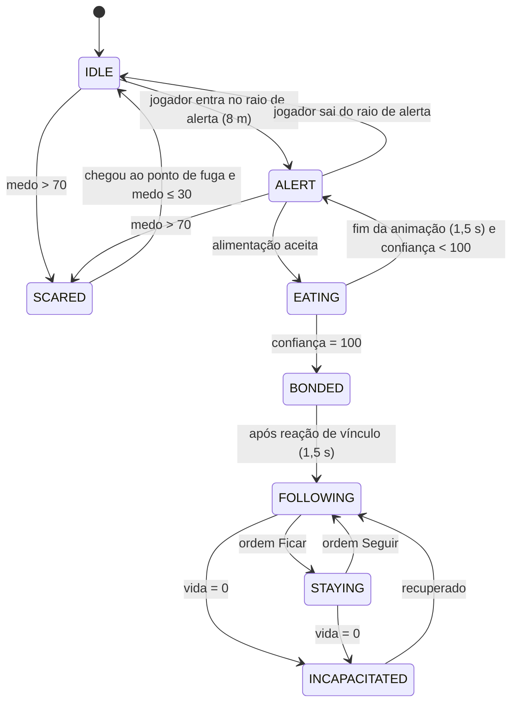

# Wild Bond — Especificação do sistema de domesticação

> **Origem:** GDD 002 / diretriz WLD-TAMING-001 (2026-11-19).
> **Status:** design documentado. **Nenhuma implementação iniciada.** Nenhum arquivo citado em "Arquitetura prevista" existe ainda.
> **Atualização 2026-11-19 (GDD 003):** especialização, habilidade, menu e progressão do companheiro passaram para [`WILD_COMPANIONS.md`](WILD_COMPANIONS.md). Pendências P-01 e P-02 resolvidas; `companion_controller.gd` e o menu de comandos mudaram de pasta (seção 10.1).
> **Atualização 2026-11-19 (GDD 004):** o MVP passa a ter combate do **jogador** ([`ANCESTRAL_POWERS.md`](ANCESTRAL_POWERS.md)). O companheiro continua sem lutar, mas a vida dele usa o `HealthComponent` compartilhado e a incapacitação pode acontecer de verdade se houver inimigos (seção 8).
>
> Legenda usada neste documento:
> - **[APROVADO]** — decisão do Game Director registrada no GDD 002.
> - **[PROPOSTO]** — regra que o GDD 002 não define e que foi preenchida aqui para que a implementação não precise inventá-la. Vale como padrão até o Game Director confirmar ou alterar.
> - **[PENDENTE]** — decisão em aberto; listada na seção 12.
>
> Todos os números são parâmetros de prototipagem e ficam em recursos de dados (`TamingProfile`, `CreatureDefinition`), nunca fixos no código.

---

## 1. Visão geral

| Item | Valor |
|---|---|
| Nome | Wild Bond |
| Abordagem | Híbrida — confiança (Caminho A) e contenção (Caminho B) **[APROVADO]** |
| MVP | Apenas Caminho A (confiança por alimentação) **[APROVADO]** |
| Versão 1.0 | Caminho A + Caminho B (contenção) **[APROVADO]** |
| Plataforma | iOS / touch; desenvolvimento em teclado e mouse |
| Engine | Godot 4.x / GDScript |

**Princípio central [APROVADO]:** domesticar deve abrir novas possibilidades de sobrevivência e exploração, não só adicionar um animal que segue o jogador.

### Objetivos
1. Fazer o jogador observar e entender o comportamento das criaturas.
2. Criar decisões sobre quais recursos gastar e quais riscos assumir.
3. Recompensar a preparação, não a repetição.
4. Dar utilidade concreta aos companheiros.
5. Conectar domesticação, biomas e poderes sem obrigar todos os estilos de jogo a usá-la.

---

## 2. Os dois caminhos

### Caminho A — Confiança (MVP e 1.0)
Para criaturas pacíficas ou cautelosas: observar → aproximar-se sem assustar → oferecer o alimento certo → ganhar confiança aos poucos.

### Caminho B — Contenção (somente 1.0)
Para criaturas agressivas ou territoriais: preparar ferramentas → imobilizar sem matar → estabilizar → criar vínculo.

**Regra [APROVADO]:** contenção **não** é bater até desmaiar. É uma escolha estratégica, com ferramenta adequada e risco de fuga. A primeira implementação terá **uma única ferramenta de contenção**; sem sedativos, torpor, vários tipos de armadilha ou estatísticas complexas. Detalhes do Caminho B ficam para uma especificação própria antes da 1.0 (seção 12).

---

## 3. Core loop

1. **Encontrar** — descobrir a criatura no bioma.
2. **Observar** — identificar comportamento e alimento.
3. **Preparar** — separar recursos e ferramentas.
4. **Aproximar ou conter** — escolher o método.
5. **Criar vínculo** — aumentar a confiança até concluir.
6. **Utilizar** — receber uma vantagem de gameplay.

Loop secundário: cuidar do companheiro → explorar com ele → superar desafios → descobrir criaturas de outros biomas.

---

## 4. Primeira criatura: Lumaru

| Atributo | Valor |
|---|---|
| Bioma | Floresta Primordial (no MVP: uma clareira da região florestal) |
| Temperamento | Cauteloso (para o sistema territorial do GDD 012: tipo **pacífico**, nunca agride — ver `TERRITORY_RAIDS.md` 3.2) |
| Alimento favorito | Frutas silvestres (id provisório `wild_berries`) |
| Método | Confiança |
| Especialização | Explorador (GDD 003) |
| Habilidade | Instinto Selvagem: sinaliza recursos próximos, **faz parte do MVP** (regras em [`WILD_COMPANIONS.md`](WILD_COMPANIONS.md)) |
| Ordens no MVP | Seguir, Ficar |
| Morte | Não morre de forma permanente: fica **incapacitado** com vida 0 |

**Comportamento no MVP [APROVADO]:** o Lumaru aparece em uma clareira. Se o jogador correr até ele, ele se assusta e se afasta. Se o jogador se aproximar devagar e oferecer frutas, ele começa a confiar. Com confiança 100, reconhece o jogador e aceita as ordens Seguir e Ficar. Não exige alimentação constante depois de domesticado.

---

## 5. Regras de confiança e medo (Caminho A)

### 5.1 Indicadores
- **Confiança:** 0 a 100 **[APROVADO]**. Começa em 0.
- **Medo:** 0 a 100, indicador separado **[APROVADO]**. Começa em 0.

### 5.2 Tabela de regras

| Regra | Valor | Status |
|---|---|---|
| Alimento preferido aceito | +25 confiança | APROVADO |
| Alimento aceitável aceito | +10 confiança | APROVADO (sem alimento aceitável no MVP — ver 12) |
| Aproximação agressiva | +35 medo | APROVADO |
| Assustar a criatura | −10 confiança | APROVADO |
| Medo acima de 70 | Tentativa de fuga | APROVADO |
| Confiança em 100 | Vínculo concluído | APROVADO |
| Intervalo entre alimentações | 8 s | APROVADO (prototipagem) |
| Frutas preferidas necessárias | 4 (4 × 25 = 100) | APROVADO (prototipagem) |
| Distância de interação | 2,5 m | APROVADO (prototipagem) |
| Tentativas de domesticação | Ilimitadas | APROVADO |
| Tempo-alvo da primeira domesticação | 1 a 3 min, incluindo coleta e fugas | APROVADO |

### 5.3 Regras complementares [PROPOSTO]

Estas regras preenchem lacunas do GDD 002 e devem ser confirmadas:

1. **Aproximação agressiva:** o jogador está dentro do **raio de alerta (8 m)** e se move acima da velocidade de caminhada (ou seja, correndo). Aplica +35 de medo no máximo **uma vez por segundo** enquanto a condição durar. Andar devagar dentro do raio não gera medo.
2. **Assustar:** a penalidade de −10 de confiança é aplicada **uma vez** cada vez que o medo ultrapassa 70 (a criatura entra em fuga). Correr direto até a criatura por ~3 s leva o medo de 0 a mais de 70 e dispara fuga + penalidade.
3. **Calma:** o medo diminui **5 pontos/s** quando nenhuma aproximação agressiva está acontecendo.
4. **Limiar para aceitar alimento:** a criatura só aceita alimento com **medo ≤ 30**. Com medo entre 31 e 70 ela rejeita (está desconfiada) sem fugir; acima de 70 ela foge.
5. **Confiança não decai** com o tempo no MVP e nunca fica abaixo de 0.
6. **Intervalo:** começa somente depois de uma alimentação **aceita**. Tentativas recusadas não iniciam nem reiniciam o intervalo.
7. **Fuga:** a criatura corre para um ponto a ~15 m do jogador, na direção oposta a ele, sem sair de 25 m do centro da sua área. Ao chegar, para de fugir e espera o medo baixar; com medo ≤ 30 volta ao comportamento ocioso e caminha de volta para a área.
8. **Área de origem:** raio de 10 m ao redor do ponto de spawn na clareira; a criatura ociosa vaga apenas dentro dela.
9. **Conclusão única:** ao chegar a 100, o vínculo é concluído **uma única vez**. O evento `bond_completed` não pode ser emitido de novo, e confiança/medo deixam de ser processados para essa criatura.

### 5.4 Prevenção de exploração do sistema [APROVADO]
- Não é possível alimentar durante o intervalo.
- Criatura assustada pode rejeitar alimento.
- Sem o item exigido, a confiança não sobe.
- Qualquer interação recusada **não consome** recurso.
- O companheiro não atravessa o mapa para buscar recursos nem carrega quantidades ilimitadas de itens (relevante quando houver habilidades de coleta).
- No MVP, poderes não modificam a domesticação. Na 1.0, um poder de natureza pode reduzir medo, mas sem tornar alimento e preparação desnecessários.

---

## 6. Estados, transições e eventos

### 6.1 Catálogo completo de estados (design)

| Estado | Comportamento | No MVP? |
|---|---|---|
| Ociosa | Anda ou permanece na área de origem | Sim |
| Alerta | Observa o jogador (equivale à "aproximação cautelosa") | Sim |
| Assustada | Foge e depois recupera a calma | Sim |
| Agressiva | Persegue e ataca | **Não** (1.0) |
| Alimentando-se | Consome o alimento recebido | Sim |
| Vinculada | Reconhece o jogador como dono | Sim (transição curta) |
| Seguindo | Acompanha o jogador | Sim |
| Parada | Aguarda no local indicado | Sim |
| Incapacitada | Vida 0; não age até se recuperar | Sim; pode ocorrer se inimigos do MVP atacarem o companheiro (ver P-11 e `ANCESTRAL_POWERS.md` P-PW-02) |

### 6.2 Máquina de estados do MVP



Regras da máquina:
- **SCARED não aceita alimento.** Só depois de voltar a IDLE/ALERT com medo ≤ 30. **[APROVADO]**
- Estados selvagens (IDLE, ALERT, SCARED, EATING) e domesticados (BONDED, FOLLOWING, STAYING, INCAPACITATED) nunca se misturam: depois de BONDED não há volta ao estado selvagem.
- Duração de EATING (1,5 s) e BONDED (1,5 s) **[PROPOSTO]**.
- Ao sair de INCAPACITATED, volta para FOLLOWING **[PROPOSTO]**; regras de recuperação em 12.

### 6.3 Eventos (sinais Godot)

| Emissor | Sinal | Quando |
|---|---|---|
| `CreatureStateMachine` | `state_changed(previous: StringName, current: StringName)` | Toda transição |
| `TamingComponent` | `trust_changed(value: float, max_value: float)` | Confiança mudou |
| `TamingComponent` | `fear_changed(value: float, max_value: float)` | Medo mudou |
| `TamingComponent` | `feed_accepted(item_id: StringName, trust_gain: float)` | Alimentação aceita |
| `TamingComponent` | `feed_rejected(reason: StringName)` | Alimentação recusada (motivos em 7.2) |
| `TamingComponent` | `scared()` | Medo ultrapassou 70 |
| `TamingComponent` | `bond_completed()` | Confiança chegou a 100 (uma única vez) |
| `CompanionController` | `command_changed(command: StringName)` | `follow` ou `stay` |
| `CompanionController` | `position_recovered()` | Recuperação de posição executada |
| `CompanionController` | `incapacitated()` / `recovered()` | Vida chegou a 0 / recuperou |

A interface **só escuta** sinais; nunca altera confiança ou estado diretamente.

---

## 7. Interação e alimentação

### 7.1 Fluxo técnico de uma alimentação [APROVADO]

1. Jogador aciona a interação (ação `interact`).
1a. **(GDD 009)** Validar os requisitos da categoria de domesticação da espécie (Lumaru: Categoria I, nível 1). Se faltar algo, recusar com `requirements_not_met` e a lista do que falta, sem consumir nada. Ver [`PROGRESSION.md`](PROGRESSION.md) 6.
2. Validar distância (≤ 2,5 m) e estado da criatura.
3. Verificar o alimento no inventário.
4. Consumir **um** alimento.
5. Atualizar confiança e medo.
6. Emitir evento de progresso.
7. Interface atualiza.
8. Verificar conclusão do vínculo.

Ordem obrigatória: **todas as validações acontecem antes do consumo.** Se qualquer uma falhar, nada é consumido.

### 7.2 Motivos de recusa (`feed_rejected`)

| Motivo | Condição |
|---|---|
| `requirements_not_met` | Jogador não atende à categoria de domesticação da espécie (GDD 009) |
| `too_far` | Distância > 2,5 m |
| `cooldown` | Intervalo de 8 s ainda ativo |
| `scared` | Estado SCARED ou medo > 30 |
| `no_item` | Jogador não tem alimento aceito por esta espécie |
| `wrong_food` | Item não é preferido nem aceitável |
| `already_bonded` | Criatura já domesticada |

Qual alimento é oferecido: o preferido, se o jogador tiver; senão um aceitável **[PROPOSTO]**. No MVP só existe um alimento, então não há escolha na interface.

### 7.3 Interação com companheiro
Depois do vínculo, a mesma ação `interact` (perto do companheiro) abre um menu compacto com **Seguir, Ficar e Informações** **[APROVADO]**. "Informações" mostra nome, espécie, vida e ordem atual **[PROPOSTO]**.

---

## 8. Companheiro

| Parâmetro | Valor | Status |
|---|---|---|
| Companheiros ativos | 1 | APROVADO |
| Distância para seguir | 3 m | APROVADO |
| Distância para recuperar posição | 20 m | APROVADO |
| Faixa de parada ao seguir | começa a andar acima de 3,5 m, para abaixo de 2,5 m | PROPOSTO (evita tremer no limite) |
| Velocidade | igual à caminhada do jogador; acima de 6 m de distância, 10% mais rápido que a corrida do jogador | PROPOSTO |
| Detecção de "preso" | tentando seguir, mas avançou menos de 0,5 m em 3 s | PROPOSTO |

**Recuperação de posição [APROVADO + PROPOSTO]:** se o companheiro estiver a mais de 20 m por 2 s seguidos, ou preso, ele é reposicionado em um ponto com chão válido (verificado por raycast) 3–5 m atrás do jogador, de preferência **fora do campo de visão da câmera**. Se em 5 s não houver ponto fora da visão, reposiciona assim mesmo. A recuperação nunca bloqueia o jogo e não se aplica no estado STAYING.

**Ficar:** o companheiro permanece no ponto indicado indefinidamente, sem recuperação automática.

**Morte do jogador (GDD 008):** o Lumaru não morre junto, não carrega itens da mochila e mantém o estado domesticado. No respawn, se estava Seguindo, é reposicionado perto do jogador; se estava Parado, continua onde está. A instância é movida, nunca recriada (sem duplicação). Ver [`DEATH_RESPAWN.md`](DEATH_RESPAWN.md) 6.

**Vida e incapacitação [APROVADO]:** com vida 0 fica incapacitado em vez de morrer. Recuperação e cuidados serão ampliados depois. Desde o GDD 004 o MVP tem combate do jogador; se os inimigos do MVP puderem atacar o companheiro, a incapacitação será exercitada em jogo. A vida usa o `HealthComponent` compartilhado (`ANCESTRAL_POWERS.md` 10.5).

---

## 9. Interface (iPhone, tela horizontal)

| Regra | Status |
|---|---|
| Funciona com o polegar e não ocupa a tela toda | APROVADO |
| Botão de interação aparece só perto de criatura/objeto interativo | APROVADO |
| Indicador de confiança só aparece enquanto a criatura é observada ou domesticada | APROVADO |
| Respeita a área segura do iPhone (`DisplayServer.get_display_safe_area()`) | APROVADO |
| Sem botões minúsculos nem gestos difíceis | APROVADO |
| "Observada" = jogador a até 10 m de uma criatura selvagem | PROPOSTO |
| No PC, o botão de interação é um aviso na tela com a tecla da ação | PROPOSTO |

**Conteúdo do HUD de domesticação** (wireframe do GDD 002): nome + situação ("LUMARU SELVAGEM"), confiança em %, dica contextual ("Aproxime-se devagar").

Dicas sugeridas por situação **[PROPOSTO]**: medo alto → "Aproxime-se devagar"; intervalo ativo → "Ele ainda está comendo"; sem item → "Precisa de frutas silvestres"; longe → sem dica.

O controle touch em si (joystick, botão de interação) depende da tarefa de controles touch do roadmap.

---

## 10. Arquitetura prevista

> Arquivos **previstos**, não criados. Antes de implementar, verificar a estrutura existente.

### 10.1 Estrutura

```
Wildbound/
├── scenes/
│   ├── creatures/
│   │   ├── lumaru.tscn
│   │   └── components/taming_component.tscn
│   └── ui/
│       ├── taming/taming_hud.tscn
│       └── companions/companion_menu.tscn      # GDD 003 (antes: ui/taming/companion_commands.tscn)
├── scripts/
│   ├── creatures/
│   │   ├── creature_controller.gd
│   │   └── creature_state_machine.gd
│   ├── companions/
│   │   └── companion_controller.gd             # GDD 003 (antes: scripts/creatures/)
│   └── taming/
│       ├── taming_component.gd
│       └── taming_service.gd
├── resources/
│   ├── creatures/creature_definition.gd   (+ lumaru.tres)
│   └── taming/taming_profile.gd           (+ lumaru_taming.tres)
└── tests/test_taming.gd
```

Observação: o GDD 002 coloca os scripts de recurso em `resources/`, enquanto a WLD-001 mantém todos os scripts em `scripts/`. Ver pendência P-10.

### 10.2 Responsabilidades

| Componente | Tipo Godot | Responsabilidade | Não faz |
|---|---|---|---|
| `CreatureDefinition` | `Resource` | Dados da espécie: id, nome, velocidades, raios (alerta, área, fuga), vida máxima, referência ao `TamingProfile` | Lógica |
| `TamingProfile` | `Resource` | Dados da domesticação: confiança máx., alimentos preferidos/aceitáveis, ganhos, valores de medo, limiares, intervalo, distância de interação, decaimento do medo | Lógica |
| `CreatureController` | `CharacterBody3D` | Movimento (vagar, fugir, voltar), percepção do jogador, aplica o que o estado pede | Contar confiança, ler inventário |
| `CreatureStateMachine` | `Node` | Estado atual e transições válidas; emite `state_changed` | Mover a criatura |
| `TamingComponent` | `Node` | Confiança, medo, intervalo, regras de ganho/perda, conclusão do vínculo; emite eventos | Ler inventário, mover, desenhar UI |
| `TamingService` | `RefCounted` | Valida uma interação de alimentação e executa a sequência validar → consumir → aplicar | Guardar estado entre chamadas |
| `CompanionController` | `Node` | Seguir, ficar, recuperar posição, incapacitação | Domesticação |
| `TamingHUD` | `Control` | Mostra nome, situação, confiança, dica | Alterar estado do jogo |
| `CompanionMenu` | `Control` | Menu Seguir / Ficar / Informações, com especialização e habilidade (ver `WILD_COMPANIONS.md` 5) | Mover o companheiro diretamente (só envia comandos) |

### 10.3 Regras de dependência
- Direção única: **UI → (escuta) → componentes**; `TamingService` → `TamingComponent` + inventário; `CreatureController` → `CreatureStateMachine`. Nenhum componente conhece a UI.
- `TamingComponent` não conhece inventário; `TamingService` faz a ponte. Isso evita dependência circular entre domesticação e inventário.
- `CompanionController` é ativado por `bond_completed`; não há dependência dele para `TamingComponent`.
- **Sem autoload/singleton** para o serviço (regra da WLD-001): `TamingService` é instanciado onde é usado. Ver pendência P-07.
- Todos os valores numéricos vêm de `.tres`; nenhum número de balanceamento fixo em script.
- Leitura de entrada somente pela ação `interact` do InputMap, para o botão touch acionar a mesma ação.

### 10.4 Contrato mínimo exigido do inventário
O Wild Bond precisa apenas de:

```gdscript
func has_item(item_id: StringName, amount: int = 1) -> bool
func remove_item(item_id: StringName, amount: int = 1) -> bool  # atômico: remove tudo ou nada
```

### 10.5 Persistência (quando o save existir)
Cada criatura domesticada salva: identificador único, espécie (`species_id`), estado de domesticação, vida atual, ordem ativa (`follow`/`stay`), posição segura para restauração e dados de vínculo necessários à progressão. **Nunca** salvar referências a nós da cena **[APROVADO]**.

Formato do identificador **[PROPOSTO]**: string gerada uma vez no vínculo (ex.: `lumaru_<timestamp>_<aleatório>`), guardada no `CompanionController`.

Criaturas **selvagens** não salvam progresso de confiança no MVP **[PROPOSTO]** — ver P-09.

### 10.6 Desempenho mobile [APROVADO + PROPOSTO]
- Limitar a frequência de atualização da IA distante (proposta: percepção a 10 Hz perto, 2 Hz acima de 30 m).
- Distâncias máximas de detecção (raio de alerta 8 m).
- Nada de cálculo de caminho para criaturas fora da área ativa.
- Apenas 1 companheiro ativo.
- Navegação do MVP: movimento direto com desvio simples, sem `NavigationRegion3D`, aproveitando o terreno quase plano da região de teste **[PROPOSTO]** — ver P-08.

---

## 11. Casos de teste

### 11.1 Critérios de aceite do GDD 002 [APROVADO]

| # | Teste | Resultado esperado | Tipo |
|---|---|---|---|
| T01 | Alimentar com item correto | Confiança aumenta 25; 1 item consumido | Automático |
| T02 | Alimentar sem item | `no_item`; nada consumido; confiança igual | Automático |
| T03 | Interagir fora do alcance (> 2,5 m) | `too_far`; nada consumido | Automático |
| T04 | Alimentar durante o intervalo | `cooldown`; nada consumido | Automático |
| T05 | Assustar a criatura | Medo aumenta 35 | Automático |
| T06 | Medo elevado (> 70) | Estado SCARED; criatura se afasta do jogador | Automático (simulação) |
| T07 | Atingir 100 de confiança | `bond_completed` emitido exatamente uma vez | Automático |
| T08 | Ordem Seguir | Companheiro fica a ~3 m do jogador enquanto ele anda | Automático (simulação) + manual |
| T09 | Ordem Ficar | Companheiro permanece no ponto | Automático (simulação) |
| T10 | Companheiro preso | Reposicionado sem travar o jogo | Automático (simulação) + manual |
| T11 | Salvar e carregar | Estado preservado | **Bloqueado** até existir save |

### 11.2 Testes complementares [PROPOSTO]

| # | Teste | Resultado esperado |
|---|---|---|
| T12 | 4 frutas preferidas respeitando o intervalo | Vínculo concluído na 4ª |
| T13 | Alimentar com medo entre 31 e 70 | `scared`; nada consumido |
| T14 | Andar devagar até a criatura | Medo não aumenta |
| T15 | Correr dentro do raio de alerta por ~3 s | Medo > 70, fuga, confiança −10 uma vez |
| T16 | Confiança nunca abaixo de 0 nem acima de 100 | Limites respeitados |
| T17 | Recusa não reinicia o intervalo | Intervalo segue a contagem original |
| T18 | Interagir após o vínculo | Abre menu; nenhum alimento consumido |
| T19 | Companheiro a mais de 20 m | Reposicionado 3–5 m atrás do jogador, em chão válido |
| T20 | Valores alterados no `.tres` | Comportamento muda sem mudar código |

### 11.3 Avaliação de diversão (manual) [APROVADO]
Medir em sessão real: tempo da primeira domesticação (meta 1–3 min) e se alimentar 4 vezes parece repetitivo. Se parecer, reduzir etapas ou adicionar comportamento interessante entre elas.

---

## 12. Decisões pendentes

| ID | Pendência | Impacto | Sugestão |
|---|---|---|---|
| P-01 | ~~Papel das criaturas domesticadas~~ | — | **Resolvida (GDD 003):** especializações por espécie |
| P-02 | ~~Vantagem concreta do Lumaru no MVP~~ | — | **Resolvida (GDD 003):** Explorador com Instinto Selvagem |
| P-03 | Inventário mínimo e coleta de frutas não existem | Bloqueia T01–T04 e o fluxo inteiro | Tarefa de inventário/coleta mínima antes do Wild Bond |
| P-04 | Confirmar as regras **[PROPOSTO]** da seção 5.3 (o que é aproximação agressiva, decaimento de medo, limiar 30) | Sensação da aproximação | Validar em protótipo |
| P-05 | Haverá alimento aceitável no MVP? | Hoje só existe "frutas silvestres" | Não no MVP |
| P-06 | Mostrar o medo ao jogador (barra) ou só por comportamento e dica? | Clareza x imersão | Só comportamento + dica |
| P-07 | `TamingService` como `RefCounted` local ou autoload | Regra da WLD-001 contra singletons | `RefCounted` local |
| P-08 | Navegação: movimento direto ou `NavigationAgent3D` | Desempenho e terreno futuro com relevo | Direto no MVP; reavaliar com a região florestal |
| P-09 | Confiança de criatura selvagem persiste no save? | Escopo do save | Não persiste no MVP |
| P-10 | Scripts de `Resource` em `resources/` (GDD 002) ou em `scripts/` (padrão WLD-001) | Consistência de pastas | Scripts em `scripts/resources/`, `.tres` em `resources/` |
| P-11 | Recuperação da incapacitação (tempo, vida restaurada, onde) e se inimigos do MVP atacam o companheiro | Passa a importar com o combate do GDD 004 | Proposta: inimigos do MVP miram só o jogador; se incapacitado, o Lumaru se recupera após 30 s com 50% da vida |
| P-12 | Especificação detalhada do Caminho B (ferramenta, estabilização, fuga) | Bloqueia a 1.0 | Documento próprio antes da 1.0 |
| P-13 | Nome definitivo e modelo visual do Lumaru e das frutas | Arte | Primitivas no protótipo |

---

## 13. Dependências

| Dependência | Situação | Necessária para |
|---|---|---|
| WLD-001 (jogador, câmera, InputMap) | Implementada; validação no Windows pendente | Tudo |
| Ação `interact` no InputMap | Não existe | Toda interação (será **adicionada**, sem alterar ações existentes) |
| Sistema de interação por proximidade | Não existe | Botão/aviso de interação |
| Inventário mínimo (`has_item`/`remove_item`) | Não existe | Alimentação |
| Coleta de frutas (fonte no mundo) | Não existe | Obter alimento |
| Controles touch | Não existe | Versão iOS jogável |
| Sistema de save | Não existe | T11, persistência |
| Combate / dano (`HealthComponent`, pacote de dano) | Documentado em `ANCESTRAL_POWERS.md`; não implementado | Vida do companheiro, incapacitação real; [1.0] Caminho B |

---

## 14. Riscos técnicos

| Risco | Mitigação |
|---|---|
| Repetição: 4 alimentações com 8 s parecem tarefa | Teste de diversão; parâmetros em `.tres`; comportamento entre alimentações |
| IA de seguir trava em obstáculos | Detecção de "preso" + recuperação; testes T10/T19 |
| Recuperação visível quebra imersão | Preferir ponto fora da câmera |
| Inventário inexistente gera acoplamento improvisado | Contrato mínimo (10.4) e tarefa própria antes |
| Custo da IA no iPhone ao crescer o número de criaturas | Frequência reduzida à distância; sem caminho fora da área ativa; 1 companheiro |
| Terreno com relevo invalida o movimento direto | Reavaliar navegação (P-08) na região florestal |
| Escopo cresce (montarias, evolução, genética) | Tabela de escopo por versão (seção 15) |

---

## 15. Escopo por versão [APROVADO]

| Funcionalidade | MVP | 1.0 | 2.0 | Futuro |
|---|---|---|---|---|
| Domesticação por alimento | ✓ | ✓ | ✓ | ✓ |
| Uma criatura domesticável | ✓ | ✓ | ✓ | ✓ |
| Seguir e ficar | ✓ | ✓ | ✓ | ✓ |
| Indicador de confiança | ✓ | ✓ | ✓ | ✓ |
| Contenção de criaturas agressivas | — | ✓ | ✓ | ✓ |
| Diferentes alimentos favoritos | — | ✓ | ✓ | ✓ |
| Habilidades de companheiros | ✓ ¹ | ✓ | ✓ | ✓ |
| Montarias | — | — | ✓ | ✓ |
| Evolução de criaturas | — | — | ✓ | ✓ |
| Reprodução e genética | — | — | — | Possível |
| Domesticação cooperativa | — | — | — | Possível |

¹ O GDD 002 marcava habilidades de companheiros como 1.0. O GDD 003 (mais recente) colocou **uma** habilidade no MVP: Instinto Selvagem, do Lumaru. Prevalece o GDD 003; confirmação registrada como pendência P-C11 em `WILD_COMPANIONS.md`.

Versão 1.0: limite inicial de **três espécies domesticáveis** — uma pacífica, uma cautelosa (Lumaru) e uma agressiva.

---

## 16. Critérios de conclusão do Wild Bond MVP

O MVP do Wild Bond estará concluído quando:

1. O Lumaru existir na clareira e alternar entre IDLE, ALERT, SCARED e EATING conforme as regras da seção 5.
2. Correr até ele o assusta; aproximar-se andando não.
3. Alimentar com frutas silvestres consome 1 item e aumenta a confiança; todas as recusas da seção 7.2 funcionam sem consumir item.
4. A 4ª alimentação aceita conclui o vínculo uma única vez.
5. Depois do vínculo, o menu Seguir / Ficar / Informações funciona e o companheiro segue, fica e se recupera quando preso ou distante.
6. O HUD obedece às regras de visibilidade da seção 9.
7. Todos os valores vêm de `.tres`.
8. Testes T01–T10 e T12–T20 passam no modo headless; T11 marcado como bloqueado.
9. O teste manual de diversão foi feito e o tempo da primeira domesticação foi registrado.
10. Nenhum sistema fora do escopo do MVP foi implementado.
