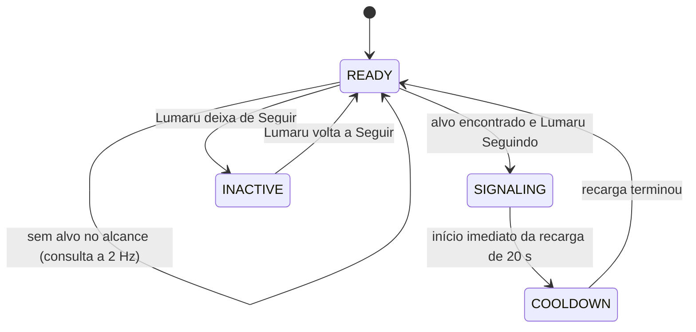

# Wild Companions — Especificação dos companheiros especializados

> **Origem:** GDD 003 / diretriz WLD-COMPANIONS-001 (2026-11-19).
> **Status:** design documentado. **Nenhuma implementação iniciada.** Nenhum arquivo citado em "Arquitetura prevista" existe ainda.
> **Atualização 2026-11-19 (GDD 004):** P-C10 resolvida — poderes híbridos com Essências Ancestrais ([`ANCESTRAL_POWERS.md`](ANCESTRAL_POWERS.md)). As etiquetas de sinergia vêm das `AbilityDefinition` equipadas.
> **Relação com o Wild Bond:** o Wild Bond ([`WILD_BOND.md`](WILD_BOND.md)) cobre **como** a criatura é domesticada. Este documento cobre **o que ela oferece depois**: especialização, habilidade, comandos, progressão e sinergias.
>
> Legenda: **[APROVADO]** decisão do Game Director (GDD 003) · **[PROPOSTO]** regra preenchida aqui para não ser inventada na implementação, válida até confirmação · **[PENDENTE]** em aberto (seção 12).
>
> Todos os números ficam em recursos de dados; nenhum valor de balanceamento fixo em código.

---

## 1. Visão geral

| Item | Valor |
|---|---|
| Nome | Wild Companions |
| Domesticação | Híbrida (Wild Bond) |
| Especialização | Uma principal **por espécie** **[APROVADO]** |
| Companheiros ativos no MVP | 1 **[APROVADO]** |
| Primeira criatura | Lumaru — Explorador **[APROVADO]** |
| Integração futura | Builds e poderes (1.0) |

**Princípio central [APROVADO]:** o jogador consegue sobreviver sozinho, mas um companheiro bem escolhido torna certas atividades mais eficientes ou seguras. Domesticar é uma escolha, nunca uma obrigação.

**Regra de equilíbrio [APROVADO]:** um companheiro melhora a eficiência de uma atividade, mas **não substitui o jogador**. Nenhuma criatura faz tudo; o jogador escolhe o companheiro conforme a aventura e a build.

Este documento resolve as pendências **P-01** (papel das criaturas → especializações) e **P-02** (vantagem do Lumaru no MVP → Instinto Selvagem) do Wild Bond.

---

## 2. Categorias de especialização

Classificação de design, **não** promessa de cinco criaturas no lançamento **[APROVADO]**.

| Categoria | Função | Perfil de jogador | Primeira versão possível |
|---|---|---|---|
| **Explorador** | Detecta pontos de interesse, recursos ou perigos próximos | Quem gosta de descobrir biomas e ruínas | **MVP** (Lumaru) |
| **Guardião** | Protege, distrai inimigos ou ajuda no combate; na 1.0, ajuda a defender o território próximo da base (GDD 012) | Builds ofensivas ou de pouca resistência | 1.0 (único tipo com combate) |
| **Transportador** | Carrega recursos extras, facilita viagens longas | Coleta, crafting e construção | Depois da 1.0 (montarias não entram na 1.0) |
| **Suporte** | Benefícios defensivos, recuperação ou resistência | Quem prioriza sobrevivência | A definir |
| **Arcano** | Interage com os poderes e modifica efeitos mágicos | Builds focadas em habilidades | Depende do sistema de poderes |

A coluna "Primeira versão possível" é **[PROPOSTO]**, derivada da tabela de limites (seção 7). A 1.0 tem até 3 espécies: quais categorias elas terão está em aberto (P-C07).

---

## 3. Lumaru — Explorador (MVP)

Única espécie do MVP **[APROVADO]**. Domesticado pelo Caminho A do Wild Bond.

- Função: ajudar o jogador a **perceber** recursos próximos, sem coletá-los.
- Ordens: Seguir e Ficar.
- Habilidade: **Instinto Selvagem**, disponível assim que for domesticado (sem níveis de vínculo no MVP) **[APROVADO]**.
- Não coleta, não transporta, não cria recursos e não luta **[APROVADO]**.
- Não tem equipamento nem inventário próprio no MVP **[APROVADO]**.

---

## 4. Habilidade Instinto Selvagem

### 4.1 Regras aprovadas

| Regra | Valor |
|---|---|
| Quando funciona | Lumaru domesticado **e** no estado Seguindo |
| Alvos | Madeira, pedra ou frutas |
| Alcance | 12 m |
| Escolha do alvo | O recurso mais próximo ainda não sinalizado |
| Sinalização | Pequeno indicador visual por 3 s |
| Recarga | 20 s após uma sinalização |
| Efeitos proibidos | Não coleta, não transporta, não cria recursos, não altera o inventário |
| Inativa | Quando o Lumaru está Parado (Ficar) |

### 4.2 Regras complementares [PROPOSTO]

1. **Ativação automática:** a habilidade dispara sozinha quando está pronta, o Lumaru está Seguindo e existe um alvo válido. O jogador não aperta botão (evita mais um controle na tela do iPhone). Ver P-C01.
2. **Sem alvo, sem recarga:** se não há recurso válido no alcance, nada é sinalizado e a recarga **não** começa; a habilidade continua pronta.
3. **Recarga corre sempre:** a contagem de 20 s continua mesmo se o Lumaru passar para Parado ou for incapacitado. Ela só não dispara fora do estado Seguindo.
4. **Estados que bloqueiam o disparo:** Parado, Incapacitado, a reação de vínculo (BONDED) e qualquer estado selvagem.
5. **Alcance medido em 3D** a partir da posição do Lumaru (esfera de 12 m). Não exige linha de visão no MVP. Ver P-C03.
6. **Memória de sinalizados:** um recurso sinalizado não é escolhido de novo por **60 s**. Recursos coletados ou removidos saem da memória.
7. **Desempate:** se dois recursos estão à mesma distância (diferença menor que 0,1 m), escolhe qualquer um de forma determinística (ex.: menor id de instância), para os testes serem reproduzíveis.
8. **Indicador:** um marcador simples acima do recurso (ícone `Sprite3D` sem iluminação ou malha pequena), visível por 3 s, com no máximo **1 indicador ativo** por vez. Opcionalmente o Lumaru vira a cabeça/corpo para o alvo. Sem partículas pesadas ou luzes extras.
9. **Indicador sobre recurso que some:** se o recurso for coletado durante os 3 s, o indicador desaparece imediatamente.
10. **Categorias filtráveis por dados:** a lista de categorias-alvo (`wood`, `stone`, `fruit`) fica na definição da habilidade, para a 1.0 poder mudar alvos sem mudar código.

### 4.3 Ciclo da habilidade



`SIGNALING` dura o tempo de mostrar o indicador (3 s) em paralelo com a recarga; a recarga começa no instante da sinalização **[PROPOSTO]**.

### 4.4 Eventos (sinais Godot)

| Emissor | Sinal | Quando |
|---|---|---|
| `CompanionAbilityComponent` | `ability_state_changed(state: StringName)` | `ready`, `cooldown`, `inactive` |
| `CompanionAbilityComponent` | `resource_signaled(resource: Node3D, category: StringName)` | Um recurso foi sinalizado |
| `CompanionAbilityComponent` | `cooldown_progress(remaining: float, total: float)` | No máximo 1 vez por segundo, só com o menu aberto **[PROPOSTO]** |

---

## 5. Interface de comandos

### 5.1 MVP [APROVADO]
Interagir com o Lumaru domesticado abre um menu compacto com **Seguir, Ficar e Informações**. Funciona com mouse e pode ser adaptado para toque. Sem equipamento ou inventário próprio.

### 5.2 Conteúdo (do protótipo do GDD 003)

| Campo | Exemplo |
|---|---|
| Nome | Lumaru |
| Especialização · situação | Explorador · Domesticado |
| Ordem atual | Seguindo jogador / Parado aqui |
| Botões | Seguir, Ficar (o da ordem atual aparece selecionado) |
| Habilidade | Instinto Selvagem |
| Descrição | Detecta recursos próximos quando está seguindo o jogador. |
| Estado da habilidade | Habilidade disponível / Recarga: 12 s / Inativa enquanto parado **[PROPOSTO]** |
| Vida | Mostrada em "Informações" (Wild Bond 7.3) |

### 5.3 Regras de interface [PROPOSTO]
- Botões com área de toque mínima de 44 × 44 pt (padrão Apple) e dentro da área segura do iPhone.
- Abrir o menu libera o mouse no PC; fechar devolve a captura. Isso **não** altera a câmera da WLD-001, só usa `ThirdPersonCamera.set_mouse_captured()`, que já existe.
- O jogo **não pausa** com o menu aberto (survival em tempo real). Ver P-C05.
- Fecha com a ação de cancelar, ao escolher uma ordem, ou ao se afastar mais que a distância de interação.

### 5.4 Versão 1.0
O menu pode incluir nível de vínculo, especialização, habilidade e estado da criatura **[APROVADO]**.

---

## 6. Progressão futura — Níveis de Vínculo (1.0)

**MVP: sem níveis.** A habilidade fica disponível imediatamente após a domesticação **[APROVADO]**. Os níveis entram só quando houver conteúdo suficiente para recompensá-los.

> **Nota (GDD 009):** os Níveis de Vínculo pertencem a **cada criatura**, não ao jogador; não são uma segunda barra de XP do personagem, que tem só o nível geral ([`PROGRESSION.md`](PROGRESSION.md)). O nome "Vínculo Ancestral" (nível 5 aqui) também foi usado pelo GDD 009 para um conhecimento de domesticação; ver P-PG-06.

| Nível | Nome | Efeito |
|---|---|---|
| 1 | Companheiro | Seguir, ficar e habilidade básica |
| 2 | Familiaridade | Pequena melhoria na eficiência da habilidade |
| 3 | Sintonia | Melhoria específica da espécie |
| 4 | Lealdade | Mais confiável em situações perigosas |
| 5 | Vínculo Ancestral | Interação especial com uma build de poderes |

**Ganho de experiência [APROVADO]:** fazendo atividades ligadas à especialização. Explorador ganha ao acompanhar descobertas de locais; Guardião ao participar de combates.
**Anti-exploração [APROVADO]:** ações repetidas no mesmo local rendem menos ou têm limite.

Exemplos de melhoria do Explorador (só ilustrativos, **[PENDENTE]**): alcance 12 → 14 m no nível 2; detectar perigos no nível 3.

Exigências técnicas para a 1.0: sistema de pontos de interesse/descoberta, save e regras de redução por repetição (ex.: experiência por local só na primeira vez, ou com tempo de espera por área). Ver P-C08.

---

## 7. Balanceamento e limites [APROVADO]

| Regra | MVP | 1.0 |
|---|---|---|
| Companheiros ativos | 1 | 1 inicialmente |
| Espécies domesticáveis | 1 | Até 3 |
| Habilidades por criatura | 1 | 1 principal + melhoria |
| Níveis de vínculo | Nenhum | 5 |
| Ordens | Seguir / Ficar | Adicionais se necessárias |
| Combate de companheiros | Não | Só Guardiões |
| Montarias | Não | Não |
| Sinergia com builds | Não | Sim, limitada |

O Lumaru **não** revela todos os recursos do mapa: alcance curto e recarga são obrigatórios.

**Definição de "ativo" [PROPOSTO]:** o companheiro ativo é o que está **Seguindo**. No máximo um companheiro pode estar Seguindo; dar a ordem Seguir a outro coloca o anterior em Ficar. Ver P-C02.

---

## 8. Integração futura com poderes e builds (1.0)

A build de poderes é do jogador; o companheiro oferece uma especialização **complementar**. Nenhuma combinação é obrigatória **[APROVADO]**.

### 8.1 Exemplos de sinergia [APROVADO]

| Build | Companheiro | Resultado |
|---|---|---|
| Ofensiva | Guardião | Jogador causa dano, companheiro segura inimigos |
| Exploração | Explorador | Mobilidade do jogador + localização de recursos/descobertas |
| Sobrevivência | Transportador | Mais capacidade logística para coletar e construir |
| "Explorador Ancestral": cura + percepção | Lumaru Explorador | Mais facilidade para achar recursos e sobreviver em expedições, sem aumentar dano |

### 8.2 Sinergia por especialização [APROVADO]

| Especialização | Sinergia proposta |
|---|---|
| Explorador | Revela recursos ou pistas ligados a poderes de percepção |
| Guardião | Protege o jogador durante habilidades de preparação longa |
| Transportador | Facilita expedições de coleta e construção |
| Suporte | Complementa habilidades defensivas |
| Arcano | Modifica um efeito secundário de habilidades mágicas |

Regras: interações pequenas e compreensíveis; **sem multiplicadores gigantes de dano** e sem combinações obrigatórias **[APROVADO]**.

### 8.3 Contrato técnico previsto [PROPOSTO]
- As definições de habilidade de companheiro declaram **etiquetas** de sinergia (ex.: `perception`).
- O sistema de poderes, quando existir, apenas **publica** as etiquetas dos poderes equipados.
- O componente do companheiro lê essas etiquetas por uma interface simples; **o sistema de poderes nunca referencia companheiros**. Dependência em uma única direção, sem circularidade.
- Fonte das etiquetas definida pelo GDD 004: cada `AbilityDefinition` declara etiquetas (afinidade, ex. `nature`; função, ex. `healing`, `perception`) e o `AbilityController` publica as das habilidades equipadas (`ANCESTRAL_POWERS.md` 8.1). A lista exata de etiquetas será fixada na 1.0.

---

## 9. Arquitetura prevista

> Arquivos **planejados**, não criados. Verificar a estrutura existente antes de implementar.

### 9.1 Estrutura (GDD 003)

```
Wildbound/
├── scripts/companions/
│   ├── companion_controller.gd          # substitui scripts/creatures/companion_controller.gd do GDD 002
│   ├── companion_ability_component.gd
│   └── companion_progression.gd         # só na 1.0
├── resources/companions/
│   ├── companion_specialization.gd      (+ explorer.tres)
│   └── companion_ability_definition.gd  (+ wild_instinct.tres)
├── scenes/ui/companions/
│   └── companion_menu.tscn              # substitui scenes/ui/taming/companion_commands.tscn do GDD 002
└── tests/test_companion_abilities.gd
```

As duas substituições acima seguem o documento mais recente (GDD 003) e já foram refletidas no [`WILD_BOND.md`](WILD_BOND.md). Os scripts de `Resource` em `resources/` continuam sujeitos à pendência P-10.

### 9.2 Responsabilidades

| Componente | Tipo Godot | Responsabilidade | Não faz |
|---|---|---|---|
| `CompanionController` | `Node` | Seguir, ficar, recuperar posição, incapacitação (ver Wild Bond seção 8) | Executar habilidade |
| `CompanionAbilityComponent` | `Node` | Ciclo da habilidade: pronta, consulta, sinalização, recarga, inativa | Mover a criatura, tocar no inventário |
| `CompanionSpecialization` | `Resource` | Categoria (`explorer`...), nome, descrição | Lógica |
| `CompanionAbilityDefinition` | `Resource` | Id, nome, descrição, alcance (12), duração do indicador (3), recarga (20), categorias-alvo, estado exigido (`following`), frequência de consulta (2 Hz), memória de sinalizados (60 s), etiquetas de sinergia | Lógica |
| `CompanionProgression` | `Node` | Níveis de vínculo e experiência (**1.0**) | Existir no MVP |
| `CompanionMenu` | `Control` | Mostrar informações e enviar comandos | Alterar estado diretamente |

`CreatureDefinition` (Wild Bond) passa a referenciar uma `CompanionSpecialization` e uma `CompanionAbilityDefinition` **[PROPOSTO]**.

### 9.3 Dependências entre componentes
- `CompanionAbilityComponent` observa o estado do `CompanionController` (sinal `command_changed` / estado) para saber se está Seguindo. O controlador **não** conhece a habilidade.
- `CompanionMenu` escuta sinais e envia comandos; nenhum componente conhece a UI.
- Habilidades de companheiro ficam separadas das habilidades do jogador **[APROVADO]**; integração só pelo contrato da seção 8.3.
- Sem autoload. A regra "um companheiro ativo" fica em um nó dono da lista de companheiros (proposta: um nó `CompanionRoster` na cena principal). Ver P-C02 e o risco R-06.

### 9.4 Contrato exigido dos recursos do mundo
Para serem detectados, madeira, pedra e frutas precisam:
- Estar numa **camada de física dedicada** a recursos (proposta: camada 3, `resources`), com um `CollisionShape3D` ou `Area3D`.
- Expor a categoria: `func get_resource_category() -> StringName` (`wood`, `stone`, `fruit`).
- Avisar quando forem coletados/removidos (ex.: sinal `depleted`), para sair da memória e apagar o indicador.

Nenhum desses objetos existe hoje (ver seção 11).

---

## 10. Limites de desempenho mobile

| Regra | Status |
|---|---|
| Não varrer todos os objetos do mundo a cada quadro | APROVADO |
| Não fazer atualizações desnecessárias a cada quadro | APROVADO |
| Consulta por forma esférica (`PhysicsDirectSpaceState3D.intersect_shape`) **somente na camada de recursos** e **somente** com a habilidade pronta e o Lumaru Seguindo | PROPOSTO |
| Frequência da consulta: no máximo 2 por segundo; **zero** durante a recarga e no estado inativo | PROPOSTO |
| Limite de resultados por consulta (ex.: 16) | PROPOSTO |
| Ordenação por distância apenas sobre o resultado da consulta, nunca sobre o mundo | PROPOSTO |
| No máximo 1 indicador ativo; indicador sem luz, sem sombra, sem partículas pesadas | PROPOSTO |
| 1 companheiro ativo, logo 1 habilidade rodando | APROVADO |

Alternativa registrada: um `Area3D` de 12 m filho do Lumaru mantendo a lista de recursos por sinais de entrada/saída. Custo baixo, mas monitora continuamente; a consulta sob demanda foi preferida por gastar zero durante a recarga (P-C04).

---

## 11. Dependências

| Dependência | Situação | Necessária para |
|---|---|---|
| Wild Bond MVP (domesticação por confiança) | Documentado, não implementado | Ter um Lumaru domesticado |
| `CompanionController` (Seguir/Ficar/recuperação) | Documentado, não implementado | Estado "Seguindo"; recuperação em obstáculos |
| Ação `interact` e interação por proximidade | Não existe | Abrir o menu |
| Recursos do mundo: **madeira, pedra e frutas** com categoria e camada de física | Não existe (o roadmap previa só o arbusto de frutas) | Alvos da habilidade |
| Coleta de madeira e pedra | Não existe; escopo no MVP indefinido (P-C06) | O jogador "continuar responsável por coletar" |
| Inventário | Não existe | **Não** é usado pela habilidade; só serve para o teste "não altera o inventário" |
| Controles touch | Não existe | Menu e interação no iPhone |
| Save | Não existe | Persistir companheiro (MVP) e vínculo (1.0) |
| Sistema de poderes | Documentado em `ANCESTRAL_POWERS.md`; não implementado | Sinergias (1.0) e categoria Arcano |
| Pontos de interesse / descoberta | Não existe | Experiência do Explorador (1.0) |

### Persistência (quando o save existir) [PROPOSTO]
- **MVP:** além do que o Wild Bond já salva (id, espécie, estado, vida, ordem, posição segura), salvar a especialização é desnecessário (vem da espécie). Recarga da habilidade e memória de sinalizados **não** são salvas; ao carregar, a habilidade começa pronta.
- **1.0:** salvar nível e experiência de vínculo, e os limites anti-repetição por local.
- Nunca salvar referências a nós da cena (regra do Wild Bond).

---

## 12. Decisões pendentes

| ID | Pendência | Sugestão |
|---|---|---|
| P-C01 | Instinto Selvagem é automático ou acionado pelo jogador? | Automático (seção 4.2) |
| P-C02 | O que acontece ao domesticar um 2º companheiro com um já ativo (só relevante na 1.0, ou se houver mais de um Lumaru no MVP) | "Ativo = Seguindo"; Seguir em um coloca o outro em Ficar. No MVP, um único Lumaru no mundo |
| P-C03 | Exigir linha de visão para detectar? | Não no MVP |
| P-C04 | Consulta sob demanda ou `Area3D` permanente | Sob demanda |
| P-C05 | O menu do companheiro pausa o jogo? | Não pausa |
| P-C06 | Madeira e pedra são coletáveis no MVP ou só detectáveis? | Coletáveis, numa forma mínima, ampliando a WLD-006 |
| P-C07 | Quais especializações terão as 3 espécies da 1.0 | Explorador (Lumaru) + Guardião (agressiva, combina com contenção) + uma a definir |
| P-C08 | Valores e fontes de experiência de vínculo; regra exata anti-repetição | Definir junto com pontos de interesse |
| P-C09 | Aparência do indicador (ícone por categoria ou único) | Ícone por categoria, simples |
| P-C10 | ~~Modelo do sistema de poderes~~ | **Resolvida (GDD 004):** híbrido — magia independente + armas encantadas, com Essências Ancestrais |
| P-C11 | Conflito entre documentos: o GDD 002 deixava habilidades de companheiros para a 1.0; o GDD 003 coloca o Instinto Selvagem no MVP | Prevalece o GDD 003 (mais recente); confirmar |
| P-10 | (herdada do Wild Bond) Scripts de `Resource` em `resources/` ou `scripts/` | Scripts em `scripts/resources/`, `.tres` em `resources/` |

---

## 13. Riscos

| ID | Risco | Mitigação |
|---|---|---|
| R-01 | A habilidade passa despercebida (indicador pequeno, 3 s) e o jogador não percebe valor no companheiro | Teste manual; reação visível do Lumaru; valores em `.tres` |
| R-02 | Habilidade forte demais trivializa a exploração | Alcance curto, recarga, 1 alvo por vez (regra aprovada) |
| R-03 | Mundo sem recursos suficientes deixa a habilidade sem alvo | A região de teste precisa de madeira, pedra e frutas distribuídas |
| R-04 | Escopo do MVP cresce: o Explorador puxa coleta de madeira e pedra | Decidir P-C06 antes de planejar a WLD-006 |
| R-05 | Consultas de física por companheiro escalam mal na 1.0 | Consulta só quando pronta, 1 ativo, camada dedicada |
| R-06 | Regra "1 ativo" e a lista de companheiros exigirão **adicionar** nós à cena principal e uma ação `interact` ao `project.godot`, arquivos criados na WLD-001 | Tratar como adição autorizada explicitamente na tarefa de implementação; nenhum comportamento da WLD-001 muda |
| R-07 | Sinergias criam dependência circular com o sistema de poderes | Contrato de etiquetas em direção única (seção 8.3) |
| R-08 | Níveis de vínculo sem conteúdo viram grind | Regra aprovada: só adicionar com conteúdo suficiente |

---

## 14. Casos de teste e critérios de aceite

Integrados à suíte existente (`tests/`), no mesmo estilo headless da WLD-001.

### 14.1 Critérios do GDD 003 [APROVADO]

| # | Teste | Resultado esperado | Tipo |
|---|---|---|---|
| C01 | Lumaru domesticado recebe Seguir | Acompanha o jogador a ~3 m | Automático (simulação) |
| C02 | Lumaru domesticado recebe Ficar | Permanece no ponto | Automático (simulação) |
| C03 | Só um companheiro ativo | Nunca há mais de um companheiro Seguindo | Automático |
| C04 | Recurso dentro de 12 m | É sinalizado | Automático |
| C05 | Recurso fora de 12 m | Não é sinalizado | Automático |
| C06 | Recarga | Nenhuma nova sinalização antes de 20 s | Automático |
| C07 | Lumaru Parado | Habilidade inativa, nada sinalizado | Automático |
| C08 | Inventário e mundo | Contagem do inventário e número de recursos inalterados após várias sinalizações | Automático |
| C09 | Menu | Funciona com mouse; botões com área mínima para toque | Manual + verificação de tamanho automática |
| C10 | Obstáculo simples | Lumaru não fica permanentemente preso (recuperação em ≤ 5 s) | Automático (simulação) + manual |
| C11 | Sem atualização por quadro | Durante a recarga: 0 consultas; pronto sem alvo: ≤ 2 consultas/s (contador interno de teste) | Automático |

### 14.2 Testes complementares [PROPOSTO]

| # | Teste | Resultado esperado |
|---|---|---|
| C12 | Dois recursos no alcance | O mais próximo é sinalizado primeiro |
| C13 | Mesmo recurso após recarga, dentro de 60 s | Não é sinalizado de novo se houver outro alvo; sem outro alvo, nada é sinalizado |
| C14 | Nenhum recurso no alcance | Recarga não começa; ao entrar um recurso, é sinalizado sem esperar 20 s |
| C15 | Recurso coletado durante o indicador | Indicador some imediatamente |
| C16 | Indicador | Desaparece após 3 s; nunca mais de 1 ativo |
| C17 | Seguir → Ficar → Seguir durante a recarga | A recarga continua contando; dispara só depois de terminar e com Seguir |
| C18 | Lumaru selvagem ou incapacitado | Habilidade não dispara |
| C19 | Categoria fora da lista (ex.: objeto sem categoria) | Ignorado |
| C20 | Valores alterados no `.tres` (alcance, recarga) | Comportamento muda sem mudar código |

### 14.3 Critérios de conclusão (implementação futura)
1. C01–C20 passando no modo headless, sem regressão nos 40 testes da WLD-001.
2. Teste manual: o jogador percebe o indicador e entende de onde veio.
3. Menu operável com mouse, com layout pronto para toque.
4. Nada fora do escopo do MVP implementado (sem níveis, sem combate de companheiro, sem montaria, sem sinergia).
